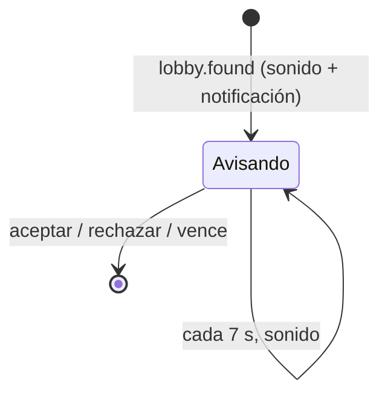

# Aviso de partida encontrada: documentación

## Qué hace

Cuando el matchmaking encuentra partida, la web avisa más fuerte y por más tiempo, para que lo note el que está en otra pestaña, en otra ventana o jugando a otra cosa.

- **Sonido:** suena al encontrar la partida y se repite cada 7 s mientras la ventana para aceptar está abierta y no aceptaste. El pitido predeterminado suena más fuerte que antes (volumen 0,2 en lugar de 0,08). Un sonido subido se corta cuando empieza el siguiente.
- **Notificación del navegador:** sale cuando la ventana no tiene el foco, no solo cuando la pestaña está oculta. La de partida encontrada no se borra sola. Al tocarla, vuelve a la web. Se cierra al aceptar, al rechazar o cuando se cierra la ventana.
- **Título de la pestaña:** alterna cada segundo entre "¡Partida encontrada! · CM League" y el normal.
- **Permiso bloqueado:** en Jugar, debajo de **Buscar partida**, una línea avisa que las notificaciones están bloqueadas y cómo activarlas.
- Con autoaceptar (VIP), la partida ya llega aceptada: suena una vez y no se repite.

## Límite

La web no puede pasar por encima de un juego en pantalla completa exclusiva ni de la opción "No molestar" de Windows mientras se juega. En ese caso solo queda el sonido. El aviso por Discord quedó afuera (necesita backend y bot).

## Qué cambia para cada rol

| Rol | Qué cambia | Página del manual |
|---|---|---|
| Jugador | El aviso de partida encontrada se repite, parpadea y la notificación no se borra sola; aviso si las notificaciones están bloqueadas | `jugador/buscar-partida.md` |

## Términos y privacidad

Sin cambios.

## Dónde está cada cosa

| Qué | Archivo |
|---|---|
| Sonido, notificación y hook que repite | `web/frontend/src/features/matchmaking/alert.ts` (`useMatchFoundRepeat`, `notify`, `notificationsBlocked`) |
| Prueba del hook | `web/frontend/src/features/matchmaking/alert.test.ts` |
| Ventana para aceptar | `web/frontend/src/features/matchmaking/AcceptDialog.tsx` |
| Título "Buscando partida" fuera de Jugar | `web/frontend/src/features/matchmaking/MatchAlerts.tsx` |
| Aviso de notificaciones bloqueadas | `web/frontend/src/features/matchmaking/PlayBar.tsx` |
