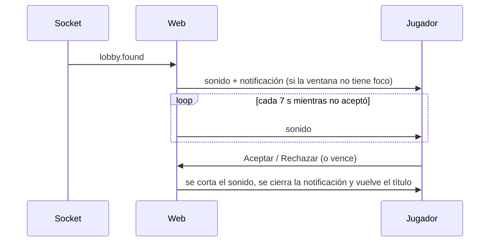

# Plan: que el aviso de partida encontrada se oiga y se vea

> Planeación original. Estado: **aprobada** por Daniel el 2026-11-23 (solo la parte web, "A").

Varios jugadores no escuchan el aviso cuando se encuentra partida: están en otra pestaña, en otra ventana o con un juego abierto.

## Decisiones tomadas

| Tema | Decisión |
|---|---|
| Sonido | Suena al encontrar la partida y se repite **cada 7 s** (Daniel) hasta que aceptas, rechazas o se cierra la ventana. El pitido predeterminado sube de volumen. Un sonido subido se corta antes de que empiece el siguiente. |
| Notificación del navegador | Sale cuando la ventana **no tiene el foco** (antes, solo con la pestaña oculta, lo que fallaba con el navegador en otro monitor). No se borra sola; al tocarla vuelve a la pestaña; se cierra al aceptar o al cerrarse la ventana. |
| Título de la pestaña | Alterna cada segundo entre "¡Partida encontrada!" y el normal mientras no aceptaste. |
| Permiso bloqueado | En Jugar, debajo de **Buscar partida**, una línea avisa que las notificaciones están bloqueadas y cómo activarlas. |
| Autoaceptar (VIP) | Suena una vez, como hasta ahora; no se repite porque la partida ya llega aceptada. |
| Fuera de alcance | Mensaje por Discord (necesita backend y bot) y lo que Windows tapa con "No molestar al jugar": se explica en el manual. |

## 1. El flujo

## 2. Cambios en la web

- `features/matchmaking/alert.ts`: `notify` con `document.hasFocus()`, `requireInteraction` y clic que enfoca; `useMatchFoundRepeat(active, url)` (sonido cada 7 s, título que alterna y cierre de la notificación).
- `AcceptDialog.tsx`: usa el hook mientras no aceptaste; recibe la URL del sonido.
- `MatchAlerts.tsx` y `PlayPage.tsx`: le pasan el sonido al diálogo; el título fijo de "¡Partida encontrada!" lo reemplaza el que alterna.
- `PlayBar.tsx`: aviso de notificaciones bloqueadas.

## 3. Manual

`docs/manual/jugador/buscar-partida.md`: el sonido que se repite, la notificación y qué hacer si juegas en pantalla completa.

## 4. Orden

1. `alert.ts` y el hook.
2. Diálogo y callers.
3. Aviso en Jugar.
4. Typecheck, lint y pruebas.
5. Manual, documentación y guía.
