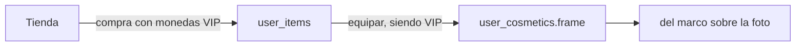

# 4 marcos VIP nuevos en la tienda: documentación

## Qué hace

Suma 4 marcos de perfil animados a la tienda, en la colección `cs`. Los 4 son exclusivos de VIP y cuestan 450 monedas VIP, como los demás marcos VIP. Llevan la etiqueta **Nuevo** durante 3 días, porque entran con `created_at` de ahora.

Se hicieron con la guía de arte (`docs/guia_y_flujo_de_arte_conceptual_estilo_steam.md`), tomando como referencia marcos de la tienda de puntos de Steam. Son diseños propios: no copian los de Steam.

## Los marcos

| Id | Nombre | Archivo | Peso | Cómo se hizo |
|---|---|---|---|---|
| `marco-nevada` | Nevada | `nevada.webp` | 319 KB | Marco de nieve con `flux-schnell`, una chibi propia con `animagine-xl-3.1` recortada y compuesta en local, video `kling-v2.5-turbo-pro` y copos que caen sobre la foto agregados en local (`copos_marco.mjs`) |
| `marco-celda` | Celda | `celda.svg` | 18 KB | SVG (`generar_celda.mjs`): plancha de hierro remachada, dos barrotes sobre la foto y dos puños esposados que suben, los doblan y caen |
| `marco-polaroid` | Polaroid | `polaroid.webp` | 63 KB | Textura de papel de `flux-schnell` (en grises y teñida en local) y `generar_polaroid.mjs`: Polaroid apiladas, clip, cinta y un velo de película vieja animado sobre la foto |
| `marco-pintura` | Pintura | `pintura.svg` | 14 KB | SVG (`generar_pintura.mjs`): ventana de programa de dibujo de los 90 en rosa pastel; la foto es el lienzo y la herramienta seleccionada cambia |

Los archivos están en `web/frontend/public/cosmetics/marcos/`. Orden 4050 a 4080, después de Synthwave. El precio es el inicial: el admin lo cambia en Administración › Tienda.

## Reglas de dibujo

- La web pone la foto dentro del marco con un margen de 12,5 % por lado y esquinas redondeadas al 8 %. Los 4 marcos pisan ese borde, también en las esquinas (Daniel, 2026-11-20).
- La chibi de Nevada, los barrotes de Celda y el clip y la cinta de Polaroid tapan a propósito una parte de la foto, como en las referencias.
- El velo de Polaroid tiñe la foto de sepia (marrón al 40 %), pero no la pasa a blanco y negro: el marco se dibuja con `` encima de la foto.
- Los WebP animados se arman con `libwebp_anim`: con `libwebp`, cada cuadro se mezclaba con el anterior y lo que se mueve sobre transparencia dejaba rastro.

## Qué cambia para cada rol

| Rol | Qué cambia | Página del manual |
|---|---|---|
| Jugador | 4 marcos VIP nuevos para comprar con monedas VIP y ponerse mientras sea VIP | `docs/manual/jugador/tienda-y-cosmeticos.md` (sin cambios: describe los marcos y el VIP en general) |
| Admin | 4 artículos más para editar en Administración › Tienda | `docs/manual/admin/tienda-y-puntos.md` (sin cambios) |

## Términos y privacidad

Sin cambios. Son imágenes de la tienda, con las mismas reglas de compra que los demás marcos VIP: no se guarda ni se publica ningún dato nuevo de los usuarios. Replicate se usó solo para hacer las imágenes, fuera de la web.

## Dónde está cada cosa

| Qué | Archivo / ubicación |
|---|---|
| Los marcos | `web/frontend/public/cosmetics/marcos/` (`nevada.webp`, `celda.svg`, `polaroid.webp`, `pintura.svg`) |
| Catálogo | `web/frontend/public/cosmetics/catalogo.json` (versión 17) |
| Migración | `supabase/replanteo/138_tienda_marcos_vip.sql` |
| Inversa | `docs/bitacora/2026-10-14-replanteo-modelo-datos/reversas/138_tienda_marcos_vip.sql` |
| Script que generó la 138, su inversa y el catálogo | `docs/bitacora/2026-11-23-marcos-vip/pruebas/generar_138.mjs` |
| Guía de arte | `docs/guia_y_flujo_de_arte_conceptual_estilo_steam.md` |
| Scripts nuevos | `docs/generar_celda.mjs`, `docs/generar_polaroid.mjs`, `docs/generar_pintura.mjs`, `docs/copos_marco.mjs`, `docs/recortar_personaje.mjs` |
| Scripts cambiados | `docs/animar_marco.sh` (`MODO=--linea` y `libwebp_anim`) y `docs/recortar_marco.mjs` (`--con-personaje` y la franja hasta el 13,5 %) |
