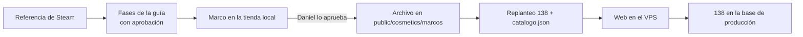

# Plan: 4 marcos VIP nuevos en la tienda

> Planeación original. Estado: **aprobado** por Daniel el 2026-11-23, marco por marco, durante la sesión en que se hicieron (cada uno se vio en la tienda local antes de seguir). El 2026-11-23 pidió desplegarlos todos como VIP, con precios como los demás.

## Decisiones tomadas

| Tema | Decisión |
|---|---|
| Cómo se hacen | Con la guía de arte (`docs/guia_y_flujo_de_arte_conceptual_estilo_steam.md`), una referencia de Steam por marco (`inspiraciones/1`, `3`, `4` y `6`, fuera del repo), con aprobación de Daniel en cada fase. |
| Qué se publica | Nevada (`1.gif`: `flux-schnell`, personaje de `animagine-xl-3.1` y video `kling-v2.5-turbo-pro`), Celda (`3.gif`: SVG), Polaroid (`4.png`: textura de `flux-schnell` y velo animado en código) y Pintura (`6.png`: SVG). |
| Diseños propios | Ninguno copia el de Steam: otra chibi, hierro remachado en vez de hormigón, iconos y paleta propios, Polaroid armadas en código. |
| VIP | Los 4 son exclusivos de VIP, a **450 monedas VIP**, como los 38 marcos VIP activos (todos a 450 en local y en producción). |
| Colección y orden | `cs`, orden 4050 a 4080, después de Synthwave (4040). |
| Base | Una migración nueva (`138`) que inserta los 4 y falla si alguno ya existe, con su inversa. Los mismos datos en `catalogo.json` (versión 17), generados con un script de una sola lista. |
| Formatos | WebP animado (Nevada y Polaroid, armados con `libwebp_anim`) y SVG animado (Celda y Pintura). De 14 KB a 319 KB. |

## 1. El flujo completo

## 2. Archivos

Los 4 archivos van en `web/frontend/public/cosmetics/marcos/` y se publican con la web. Los generadores nuevos (`docs/generar_celda.mjs`, `generar_polaroid.mjs`, `generar_pintura.mjs`, `copos_marco.mjs` y `recortar_personaje.mjs`) y los cambios a `animar_marco.sh` y `recortar_marco.mjs` van en `docs/` para repetir el proceso.

## 3. Base de datos

`supabase/replanteo/138_tienda_marcos_vip.sql` inserta los 4 en `shop_items` en una transacción, después de comprobar que no existan, y comprueba al final que estén los 4 como VIP a 450. La inversa los borra, salvo que un código canjeable dé alguno.

## 4. Requisitos antes de empezar

- Acceso SSH al VPS (`VPS_HOST` del `.env`) para la web y la base.

## 5. Orden de implementación

1. Commit en `main` solo con lo de este pedido (en `main` hay cambios sin commit de otros pedidos).
2. Worktree limpio en ese commit y `deploy/vps/desplegar.sh web`: los archivos tienen que estar antes que los artículos.
3. `138` en la base de producción.
4. Comprobar en `cmleague.lat` que se sirven los 4 archivos y que la API los devuelve.
