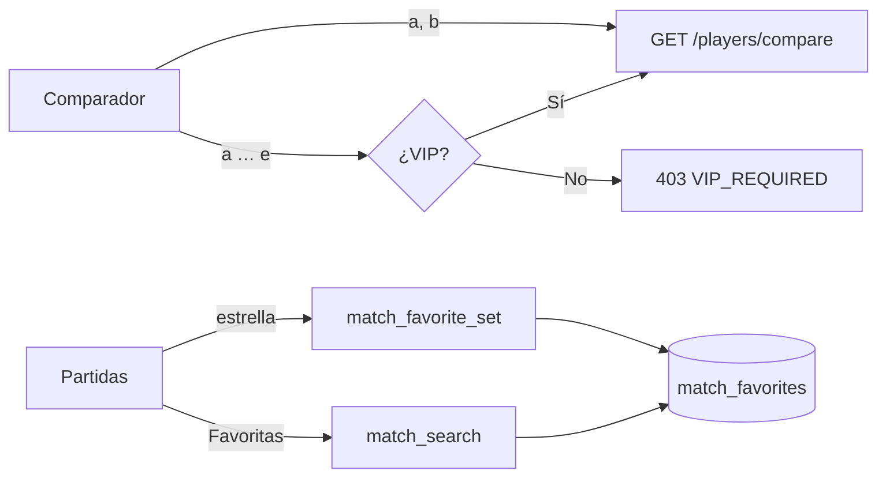

# Comparador de hasta 5 jugadores y partidas favoritas para VIP: documentación

## Qué hace

Son los dos primeros beneficios VIP de los prototipos de Kyan (`origin/kyan/vip`, `0f411d07`) hechos de verdad en `main`.

**Comparador:** `/players/compare` acepta hasta cinco jugadores con VIP. Con dos, todo sigue igual para todos.

**Favoritas:** en Partidas, una estrella por fila y el filtro **Favoritas**. Marcar es VIP.

## Comparador

| Cuántos | Cómo se ve |
|---|---|
| 2 | Las filas de dos lados, como siempre |
| 3 a 5 | Una columna por jugador, con el mejor de cada fila en su color |

- **URL:** `a` a `e`. El color va con la letra, así que sacar a uno no cambia el de los demás. Los links viejos (`a` y `b`) sirven.
- **Se sacan** solo los agregados (`c`, `d` y `e`). `a` y `b` se cambian con sus selectores.
- **Mixes juntos y como rivales:** siempre contra A.
- **Sin VIP:** un link con más de dos compara los dos primeros y lo avisa. La tarjeta punteada abre "Cómo ser VIP".
- **API:** `c`, `d` y `e` son opcionales y piden VIP (`requireVip`, 401 sin sesión y 403 `VIP_REQUIRED`). Vienen en `others`.

## Favoritas

- **Tabla `match_favorites`** (cuenta y partida), con RLS: cada cuenta ve las suyas. Se borran con la cuenta o con la partida. Sin escritura directa.
- **`match_favorite_set(partida, sí o no)`:** marcar exige VIP (`V8901` → 403 `VIP_REQUIRED`) y una partida que exista y se pueda ver (no la de un torneo en testing). Desmarcar, solo sesión.
- **VIP vencido:** lo marcado se ve y se puede sacar; no se suma nada nuevo.
- **API:** `PUT` y `DELETE /api/v1/me/favorites/{id}`; en `GET /api/v1/matches`, `favorites=true` y `favorite` en cada fila. El filtro pasa por `match_search` (replanteo `141`).
- **Web:** la estrella cambia al instante y vuelve atrás si falla.

## Qué cambia para cada rol

| Rol | Qué cambia | Página del manual |
|---|---|---|
| Jugador | Estrella y filtro **Favoritas** en Partidas (marcar es VIP) | `jugador/partidas-favoritas.md` (nueva) |
| Jugador VIP | Comparar hasta cinco | `jugador/comparar-jugadores.md` (nueva) y `jugador/elo-y-estadisticas.md` |
| Los demás | Nada | — |

## Términos y privacidad

- **Términos, VIP:** nombra comparar hasta 5 jugadores y las favoritas, y qué pasa con las favoritas al vencer.
- **Privacidad:** suma las favoritas a los datos que guardamos, quién las ve (solo tú) y el plazo (hasta que las borres o borres tu cuenta).

"Varias de sus ventajas todavía están en preparación" se queda: faltan configs y créditos.

## Dónde está cada cosa

| Qué | Archivo |
|---|---|
| Base | `supabase/replanteo/140_partidas_favoritas.sql` |
| API: favoritas | `web/backend/src/routes/vip-extras.ts` |
| API: comparador y listado | `web/backend/src/routes/ranking.ts`, `matches.ts` |
| Chequeo de VIP de la API | `requireVip` en `web/backend/src/services/vip.ts` |
| Comparador | `web/frontend/src/features/ranking/pages/Compare.tsx` |
| Estrella | `web/frontend/src/features/matches/components/FavoriteStar.tsx` |
| Candado de VIP común | `web/frontend/src/features/vip/VipLock.tsx`, `useVip.ts` |
