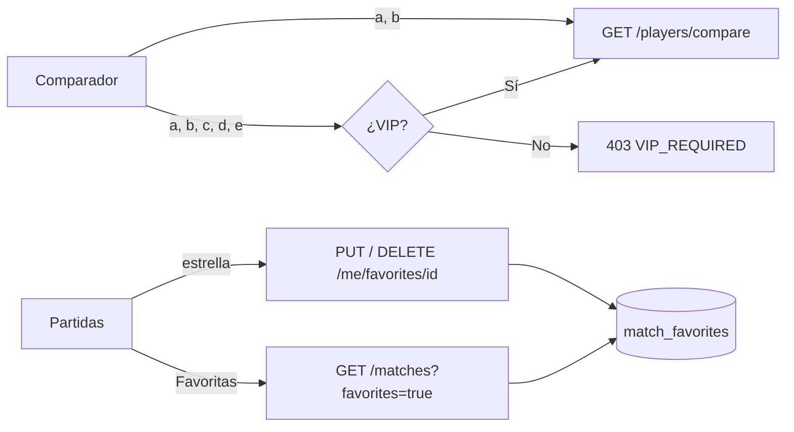

# Plan: comparador de hasta 5 jugadores y partidas favoritas para VIP

> Planeación original. Estado: **aprobado** por Daniel (2026-11-24): puntos 1 a 3 de la revisión de `kyan/vip`, en `main`.

Parte de los prototipos de Kyan `2026-10-29-comparador-5` y `2026-10-29-partidas-favoritas` (rama `origin/kyan/vip`, `0f411d07`). No se hace merge de esa rama: se lleva lo necesario, con datos reales.

## Decisiones tomadas

| Tema | Decisión |
|---|---|
| Dónde va el comparador | El mismo `/players/compare`. Con dos jugadores no cambia nada |
| Límite | 2 sin VIP, 5 con VIP. Lo controla la API: pedir un tercero sin VIP da `403 VIP_REQUIRED` |
| URL | Siguen `a` y `b` (los links viejos sirven) y se suman `c`, `d` y `e`. El color sigue a la letra: sacar a uno no cambia el color de los demás |
| Link con más jugadores que el límite | Sin VIP se comparan los dos primeros y lo dice un aviso |
| Favoritas: qué se marca | Cualquier partida del listado (mix, PCW o torneo) |
| Favoritas sin VIP | No se puede marcar. Si el VIP venció, las que marcó se siguen viendo y se pueden sacar (propuesta de Kyan) |
| Quién ve las favoritas | Solo su dueño |
| Cartel de VIP | El diálogo "Cómo ser VIP" que ya existe. La página "Hacete VIP" del prototipo no se trae |

## 1. El flujo completo

## 2. Base (replanteo 140)

- Tabla `match_favorites (user_id, match_id, created_at)`, clave las dos primeras, con borrado en cascada. RLS: cada cuenta ve las suyas. Sin escritura directa.
- `match_favorite_set(p_match, p_on)`: marcar exige VIP y que la partida exista y sea visible; desmarcar, solo sesión.

El filtro `favorites=true` necesita la búsqueda paginada en la base: va con `match_search` (replanteo 141, requerimiento `2026-11-24-exportar-stats-y-buscador-vip`).

## 3. API

- `GET /api/v1/players/compare`: `c`, `d` y `e` opcionales. La respuesta suma `others` (jugador y mixes juntos contra A). `a`, `b` y `together` no cambian.
- `PUT` y `DELETE /api/v1/me/favorites/{id}`.
- `GET /api/v1/matches`: `favorites=true` y, con sesión, `favorite` en cada fila.

## 4. Web

- Comparador: tarjeta punteada **Agregar jugador**, X en los agregados, tabla de una columna por jugador con 3 a 5, gráfico con una línea por jugador y los mixes juntos de cada uno con A.
- Partidas: estrella en cada fila y el filtro **Favoritas**.
- Diálogo "Cómo ser VIP" en los dos candados.

## 5. Requisitos antes de empezar

Ninguno.

## 6. Orden de implementación

1. Replanteo 140, su inversa y sus pruebas en la base local.
2. API y pruebas.
3. Web y pruebas.
4. Manual, términos y privacidad, y documentación.
