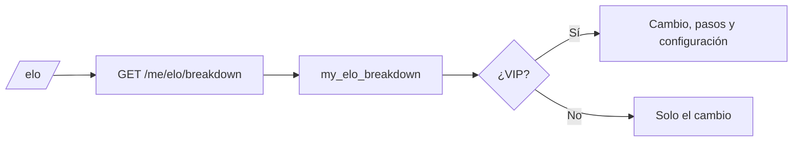

# Desglose de tu ELO para VIP: documentación

## Qué hace

En `/elo` (botón **Ver desglose** en Evolución de ELO del perfil propio), cada jugador ve cuánto ganó o perdió en cada mix. Con VIP ve además cada paso de la cuenta y un simulador.

El prototipo de Kyan copiaba la fórmula anterior en TypeScript. Acá los pasos los calcula la base, con las mismas funciones que usa el ELO.

## Los pasos

| Paso | De dónde sale |
|---|---|
| Probabilidad | `win_prob`, guardada |
| Base | `2 × base × (resultado − probabilidad)` |
| Multiplicador | `elo_mult`, guardado |
| Rondas | `elo_weight` (un abandono cuenta 1) |
| Cambio | base × multiplicador × rondas |
| Abandono o rendición | `mm_elo_delta` |
| Tope por equipo | `elo_scale`, guardado |
| Mínimo | `elo_min_for` × rondas |
| ELO mínimo | `elo_floor` |

- **Quien abandonó** ve un solo paso: su cuenta es otra y no mira el rating.
- **Fórmula anterior** (mixes de antes de la Temporada 2, sin `elo_mult`): solo el cambio.
- **`exact`:** si la cuenta con la configuración de hoy no da el cambio guardado, la web muestra el cambio real y no los pasos. Pasa si un admin cambia la configuración del ELO después.
- **De quién:** solo el propio. La función sale de `auth.uid()`.
- **Si cambia `elo_apply_match`**, hay que cambiar `my_elo_breakdown` y `features/elo/lib/formula.ts` (el simulador).

## El simulador

En el navegador, con la configuración vigente que manda la API. No incluye abandonos, el ELO mínimo, ni el tope cuando lo pasa un compañero.

## Qué cambia para cada rol

| Rol | Qué cambia | Página del manual |
|---|---|---|
| Jugador | La lista de sus mixes con el cambio de ELO | `jugador/desglose-de-elo.md` (nueva) y `jugador/elo-y-estadisticas.md` |
| Jugador VIP | Los pasos y el simulador | La misma |
| Los demás | Nada | — |

## Términos y privacidad

- **Términos, VIP:** nombra el desglose del ELO.
- **Privacidad:** el desglose lo ves solo tú. No guarda nada nuevo.

## Dónde está cada cosa

| Qué | Archivo |
|---|---|
| Base | `supabase/replanteo/142_desglose_de_elo.sql` |
| API | `web/backend/src/routes/vip-extras.ts` |
| Web | `web/frontend/src/features/elo/` y `routes/_app/elo.tsx` |
