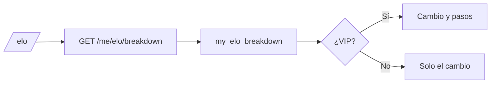

# Plan: desglose de tu ELO para VIP

> Planeación original. Estado: **aprobado** por Daniel (2026-11-24): puntos 1 a 3 de la revisión de `kyan/vip`, en `main`.

Parte del prototipo de Kyan `2026-10-29-desglose-elo` (rama `origin/kyan/vip`). Ese prototipo copia la fórmula anterior (TrueSkill y bonus de ±5): se rehace con la del replanteo `100`.

## Decisiones tomadas

| Tema | Decisión |
|---|---|
| Dónde se calcula | En la base, con las mismas funciones que usa `elo_apply_match` (`elo_weight`, `mm_elo_delta`, `elo_min_for`). La web no recalcula lo que ya se jugó |
| De quién | Solo el propio. Página nueva `/elo`, con un botón en la tarjeta Evolución de ELO del perfil propio |
| Sin VIP | La lista de los mixes con su cambio. Los pasos no salen de la base |
| Mixes con la fórmula anterior | Se listan con su cambio, sin pasos |
| Si la cuenta de hoy no da el cambio guardado (porque un admin cambió la configuración después) | Se muestra el cambio real y se avisa que la configuración cambió. Los pasos no se muestran como exactos |
| Simulador | Con VIP. Resultado, probabilidad, rating y rondas, con la configuración vigente que manda la API. No incluye abandonos ni el tope por equipo cuando el que se pasa es otro |
| La fuerza de los equipos | Se muestra la probabilidad, no el ELO promedio de cada equipo |

## 1. El flujo completo

## 2. Base (replanteo 142)

`my_elo_breakdown(p_limit, p_offset)`, `security definer` sobre la ficha de `auth.uid()`: un objeto con `vip`, `total`, la configuración vigente y los mixes. Cada paso:

1. Probabilidad guardada.
2. Base: `2 × base × (resultado − p)`.
3. Multiplicador por rating.
4. Peso por rondas.
5. Ajuste por abandono o rendición (`mm_elo_delta`).
6. Tope por equipo.
7. Mínimo por partida.
8. ELO mínimo.

## 3. API

`GET /api/v1/me/elo/breakdown?page&per`, con la sesión.

## 4. Web

`features/elo-breakdown`: la lista, el ticket y el simulador.

## 5. Requisitos antes de empezar

Ninguno.

## 6. Orden de implementación

1. Replanteo 142 y comprobar, con la copia local de producción, en cuántos mixes la cuenta da el cambio guardado.
2. API y pruebas.
3. Web y pruebas.
4. Manual y documentación.
