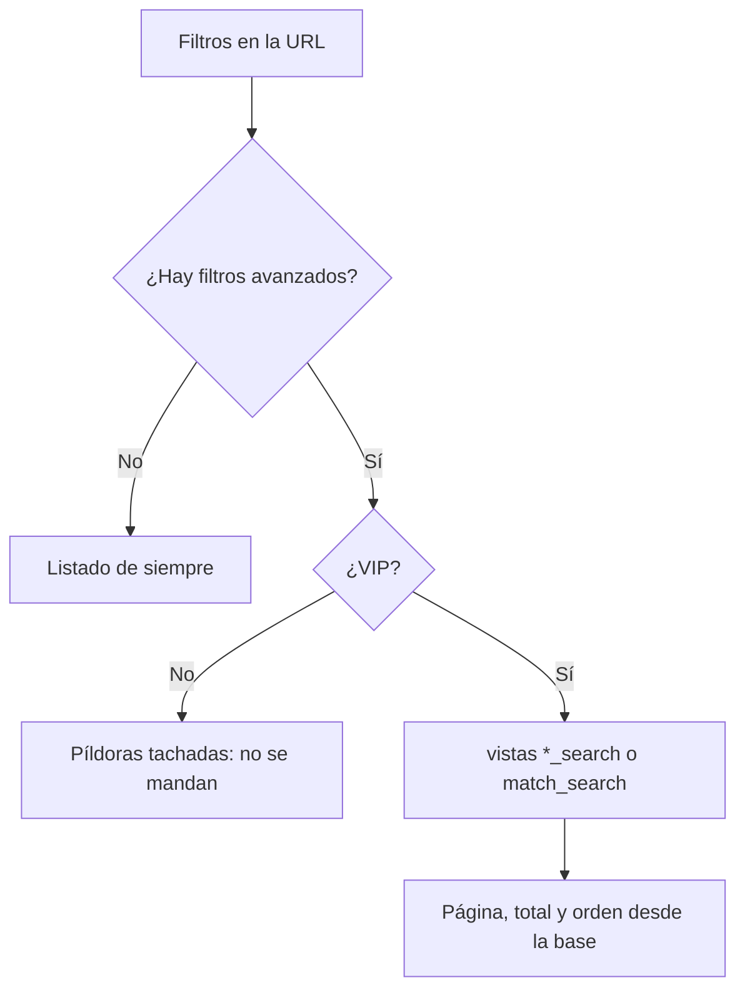

# Exportar tus stats y buscador avanzado para VIP: documentación

## Qué hace

**Tarjeta de stats** (Mi perfil › Tarjeta): el jugador arma una imagen con sus números de los mixes y la descarga como PNG o PDF.

**Filtros avanzados:** Ranking (temporadas e Histórico) y Partidas. Los dos guardan búsquedas en la cuenta. `/players`, que decía "Próximamente", lleva a `/ranking`.

## Tarjeta de stats

| Opción | Valores |
|---|---|
| Formato | Cuadrado 1080 × 1080, Historia 1080 × 1920 (mapas y curva de ELO), Horizontal 1600 × 900 (curva de ELO) |
| Período | Temporada activa, últimos 30 días, histórico |
| Estilo | CM League, Claro, VIP dorado (VIP) |
| Stats | Hasta 6 de 10 |

- **Datos:** `player_card(ficha, desde)`, por `GET /api/v1/me/card`. Solo mixes terminados. MVP es tener el mejor rating del mix; la racha es la mejor seguidilla de victorias del período.
- **Dibujo:** en un canvas del navegador; el PDF es una página con la imagen, sin librerías. La foto necesita CORS (el storage lo da); si no carga, va la inicial.
- **Sin VIP:** vista previa con marca de agua. Es un candado de la pantalla: los números ya son públicos y la API no genera ni guarda la imagen.
- Es la foto de perfil, no el avatar animado de la tienda.

## Filtros del ranking de jugadores

| Para todos, como antes | Con VIP |
|---|---|
| Texto, nivel por botones, "Solo con puesto" y orden | Nivel por rango, ELO, K/D, rating, HS %, partidas, jugó en los últimos 7, 30 o 90 días, mapa más jugado, país, con o sin equipo, solo VIP |

- **API:** los filtros van en `GET /api/v1/ranking/players` (Histórico) y `GET /api/v1/seasons/{id}/standings`. Un filtro VIP sin VIP da 403 `VIP_REQUIRED`. Sin filtros avanzados, las dos consultan las vistas de siempre.
- **Base:** `player_filters` (HS %, país según la privacidad, VIP, última partida y mapa más jugado en mixes) y, sobre ella, `player_ranking_search` y `season_standings_search`. Las tres son `security_invoker`.
- **En una temporada,** ELO, K/D, rating y mixes son los de la temporada; HS % y mapa, de todas sus partidas. El panel lo dice.
- **Mapa más jugado:** el exacto (`dust2_ob` no es `dust2`).
- **Nivel:** la web lo manda como rango de ELO con los pisos de la API. El rango y los botones de nivel se reemplazan entre sí.
- **Con un filtro puesto,** la tabla suma las columnas **HS %** y **Última partida**. El puesto no cambia.
- **Búsquedas guardadas:** no llevan la temporada; se abren en la que se está mirando.

## Buscador de partidas

- **Gratis, como antes:** tipo, texto y mapa, más **Favoritas**.
- **VIP:** jugador, con (mismo bando), contra (otro bando), desde, hasta, diferencia de rondas, solo con demo y el orden por las más parejas o mejor MVP.
- **`match_search`** (`security invoker`, solo con sesión): filtra `match_list` y devuelve los ids de la página y los contadores por tipo. La usa la API solo si hay un filtro que `match_list` no resuelve; el listado común no cambió.
- **En una serie:** con y contra valen si pasó en alguno de sus mapas; la diferencia, si la cumplen todos.
- **Lo que la API ya tenía público** (jugador, fechas, tipo, mapa y texto) sigue público en la API; en la web, jugador y fechas están en el panel VIP.
- `player` acepta también el nick.

## Búsquedas guardadas

`saved_searches`: nombre (1 a 30), tipo y los filtros de la URL (hasta 1000 bytes). Hasta 5 por tipo; el mismo nombre la reemplaza. Guardar es VIP; ver y borrar las propias, no. Al abrirla, la web la vuelve a validar.

## Qué cambia para cada rol

| Rol | Qué cambia | Página del manual |
|---|---|---|
| Jugador | Vista previa de su tarjeta | `jugador/filtros-avanzados.md` y `jugador/tarjeta-de-stats.md` (nuevas), `jugador/buscador.md`, `jugador/elo-y-estadisticas.md` |
| Jugador VIP | Filtros avanzados, búsquedas guardadas, descargar la tarjeta | Las mismas |
| Los demás | Nada | — |

## Términos y privacidad

- **Términos, VIP:** nombra los filtros avanzados, las búsquedas guardadas y la tarjeta, y qué pasa con las búsquedas al vencer.
- **Privacidad:** las búsquedas guardadas (dato, quién las ve y plazo), con qué se sale en los filtros del ranking y que la tarjeta no se guarda.

## Dónde está cada cosa

| Qué | Archivo |
|---|---|
| Base | `supabase/replanteo/141_buscador_y_tarjeta.sql` |
| API | `web/backend/src/routes/vip-extras.ts` y `matches.ts` |
| Tarjeta | `web/frontend/src/features/card/` y `routes/_app/profile.card.tsx` |
| Filtros del ranking | `web/frontend/src/features/ranking/lib/filters.ts` y `components/RankingFilters.tsx`; API en `web/backend/src/services/playerFilters.ts` |
| Piezas comunes de los filtros | `web/frontend/src/features/search/` |
| Filtros de partidas | `web/frontend/src/features/matches/components/MatchAdvancedFilters.tsx` y `lib/search.ts` |
