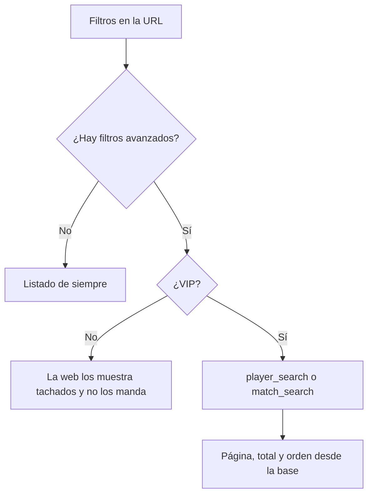

# Plan: exportar tus stats y buscador avanzado para VIP

> Planeación original. Estado: **aprobado** por Daniel (2026-11-24): puntos 1 a 3 de la revisión de `kyan/vip`, en `main`.

Parte de los prototipos de Kyan `2026-10-29-exportar-stats` y `2026-10-29-buscador-avanzado` (rama `origin/kyan/vip`).

## Decisiones tomadas

| Tema | Decisión |
|---|---|
| Exportar: de quién | Solo la tarjeta propia. Página nueva **Mi perfil › Tarjeta** (`/profile/card`), con un botón desde el perfil propio |
| Exportar: sin VIP | Vista previa con marca de agua. Descargar, compartir y el estilo dorado, con VIP |
| Dónde se controla | La imagen se dibuja en el navegador con datos que ya son públicos, así que el candado es de la pantalla. La API no guarda ni genera nada |
| Períodos | Temporada activa, últimos 30 días e histórico. Solo mixes |
| Buscador de jugadores | Página `/players` (hoy dice "Próximamente"). Texto y orden, gratis; los filtros avanzados, VIP |
| Buscador de partidas | Dentro de `/matches`, con un botón **Filtros avanzados**. El tipo, el texto y el mapa siguen siendo gratis, como hoy |
| Filtros de partidas | Jugador, **con** (mismo bando), **contra** (otro bando), desde, hasta, diferencia de rondas, solo con demo, y el orden por más parejas o mejor MVP. Con y Contra piden elegir antes el jugador |
| Incluir canceladas | Fuera: el listado solo muestra las jugadas y su botón ya está anotado como pendiente |
| Control del VIP | La API responde `403 VIP_REQUIRED` a un filtro avanzado sin VIP. Los filtros que la API ya tenía públicos (tipo, texto, mapa, jugador y fechas) siguen públicos en la API |
| Búsquedas guardadas | En la cuenta, hasta 5 de jugadores y 5 de partidas. Guardar es VIP; ver y borrar las propias, no |
| Mapa favorito | El más jugado en mixes, juntando las versiones de un mapa (`mirage_rc1` y `mirage` son el mismo) |
| País | Respeta la privacidad del perfil: uno privado no aparece al filtrar por país |

## 1. El flujo completo

## 2. Base (replanteo 141)

- Vista `player_search` (`security_invoker`): la ficha con ELO, stats, HS %, país, equipo, VIP, última partida y mapa favorito.
- `match_search(...)` (`security invoker`): filtra `match_list` con todo, más favoritas, con, contra, diferencia, demo y los dos órdenes nuevos; devuelve los ids de la página y los contadores por tipo.
- `player_card(p_player, p_from)`: las stats de la tarjeta.
- Tabla `saved_searches` con RLS del dueño, `saved_search_save` (VIP, tope de 5 por tipo) y `saved_search_delete`.

## 3. API

| Ruta | Qué |
|---|---|
| `GET /api/v1/players/search` | Buscador de jugadores. Texto y orden públicos; el resto, VIP |
| `GET /api/v1/matches` | `with`, `against`, `max_diff`, `demo` y los órdenes `close` y `mvp` (VIP) |
| `GET /api/v1/me/card` | Stats de la tarjeta por período |
| `GET`, `PUT /api/v1/me/searches` y `DELETE /api/v1/me/searches/{id}` | Búsquedas guardadas |

## 4. Web

- `features/card`: el dibujo en canvas y el PDF de Kyan, con los datos reales.
- `features/search`: `/players` y las piezas de filtros que también usa Partidas.

## 5. Requisitos antes de empezar

Que las fotos de perfil se puedan leer con CORS desde el canvas. Si una no se puede, va la inicial.

## 6. Orden de implementación

1. Replanteo 141, su inversa y sus pruebas en la base local.
2. API y pruebas.
3. Web y pruebas.
4. Manual, términos y privacidad, y documentación.
