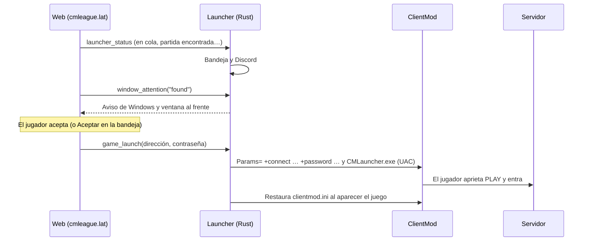
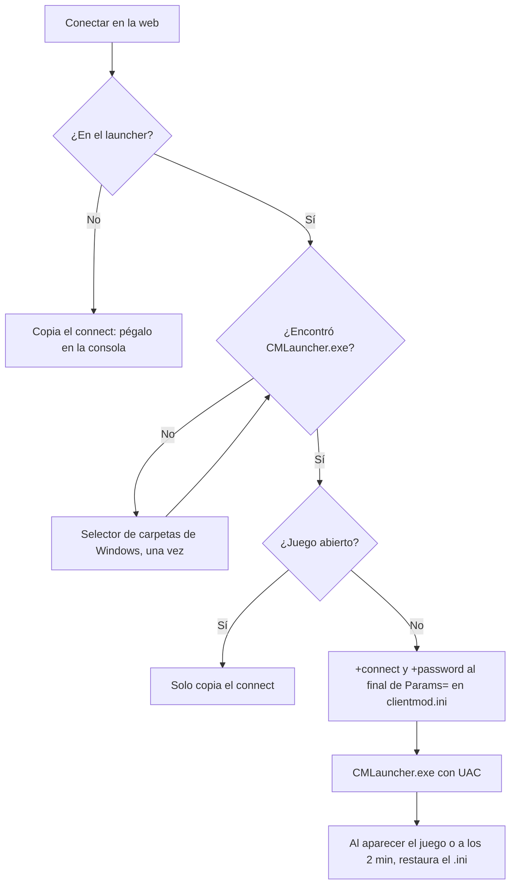
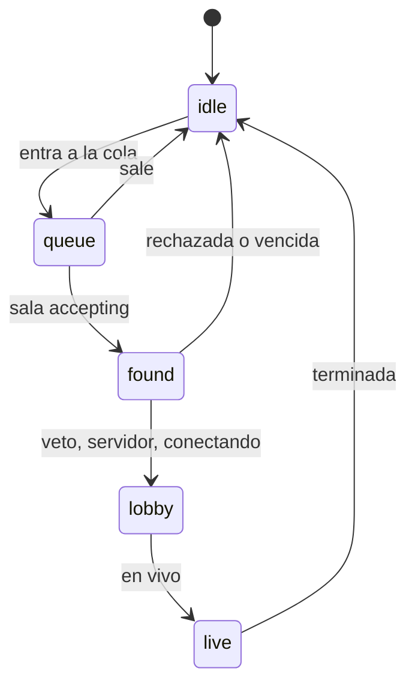

# Launcher de escritorio: documentación

> Estado al 2026-11-26: **sin publicar.** Rama `feat/launcher` (worktree `v34frag-launcher`), que sale de `main` y trae lo de Kyan (`claude/relaxed-einstein-sl0cme`, hasta `29a6600a`) con la revisión de Daniel de la sección "Decisiones y revisión". Después siguió en `claude/relaxed-einstein-sl0cme` sobre esa copia (`16aee34`): la página de descarga completa y los arreglos de Configuración del 2026-11-26 (ver "Incidentes" en la guía). Lo que falta está en [`GUIA_IMPLEMENTACION.md`](GUIA_IMPLEMENTACION.md).

## Qué hace

El launcher de CMLeague es una aplicación de Windows hecha con Tauri 2 (`launcher/`). Abre la web de la liga (`https://cmleague.lat/play`) en una ventana propia, con la misma sesión y las mismas secciones, como el cliente de FACEIT. No es un anticheat.

Suma lo que el navegador no puede hacer:

- abrir ClientMod conectado a la sala;
- avisos de Windows;
- la bandeja del sistema con el estado del matchmaking y "Aceptar partida";
- Discord Rich Presence;
- actualizaciones automáticas firmadas;
- una configuración propia que no toca la web;
- el tema de la tienda;
- links `cmleague://`.

La web detecta que está dentro del launcher (`web/frontend/src/lib/launcher.ts`) y le habla por el IPC de Tauri. Fuera del launcher, la web se comporta como antes. El único cambio en el navegador es que los "Conectar", que usaban `steam://connect` y no abren ClientMod, ahora copian el `connect` para pegarlo en la consola.

## Decisiones y revisión (2026-11-25 y 2026-11-26)

El `PLAN.md` no se edita. Esto lo cambia:

| Tema | Decisión | Por qué |
|---|---|---|
| Enfoque | La web entera en una ventana, no una interfaz chica aparte | Kyan lo hizo así; Daniel lo aprobó el 2026-11-25. Ahorra otro login, otro socket y `CORS_ORIGINS` |
| Firma de Windows | **Sin firma** por ahora. El aviso de SmartScreen ("Windows protegió su PC") se explica en `/launcher` y en el manual. Un certificado OV (US$ 65 a 300 al año) se compra al abrirlo a todos | Daniel, 2026-11-25. Desde 2024 ni el EV quita el aviso, y Azure Artifact Signing no está disponible para personas fuera de EE. UU. y Canadá |
| Actualización automática | Sí, con `tauri-plugin-updater` y su propia llave (gratis, distinta de la firma de Windows) | Daniel, 2026-11-25. El arreglo de seguridad de abajo tiene que llegar a los que ya lo instalaron |
| Dónde se publica | **R2 de Daniel**, en `https://descargas.cmleague.lat/launcher/` (el instalador y `latest.json`). GitHub Actions lo sube con un token que solo escribe en ese bucket, y solo al correrlo a mano con **Publicar en R2** | Daniel, 2026-11-25. Para subir al VPS haría falta una llave SSH del servidor de producción en GitHub. Reemplaza `/srv/cmleague/descargas` y el cambio al `Caddyfile` de la rama de Kyan, que no se traen |
| Carpeta de ClientMod | Solo con el selector de carpetas de Windows (`game_pick_dir`), nunca una ruta que mande la web o la ventana de Configuración. Solo carpetas de un disco de la PC: `is_local_dir` rechaza `\equipo\carpeta` y la ruta real no puede ser de red (también detrás de un enlace o una unidad mapeada). `settings_set` no cambia `clientmod_dir` | `CMLauncher.exe` se abre como administrador. Con `game_set_dir(dir)` abierto a la web, un script inyectado en cmleague.lat podía apuntar a un `CMLauncher.exe` ajeno en la red y el jugador aceptaría el UAC que espera |
| Links de afuera | Solo `https`, `http` y `mailto` (`can_open_outside`). No `steam://` ni `discord://` | La app no pregunta antes de abrir un programa, como el navegador. Un `steam://run/...` en una bio se abriría con un clic. Los "Conectar" no pasan por ahí |
| Prueba de Configuración en GitHub Actions | `CMLEAGUE_AUTOPRUEBA` solo existe con `--features autoprueba`, en un build aparte del workflow | Era código de prueba dentro del instalador que se reparte |
| Promoción antes de publicar | `LAUNCHER.published = false` (`web/frontend/src/config/site.ts`) apaga el link "Launcher para Windows" de Jugar y el "Ver el launcher" del aviso de Conectar. `/launcher` se puede abrir y dice que todavía no está publicado | Para no mandar a nadie a una app que no se puede bajar |
| Manual | `jugador/launcher.md` (la de Kyan) con `oculta: true` hasta publicarlo. `buscar-partida.md` y `capitan/jugar-pcw.md` ya cuentan que **Conectar** y **Entrar** copian el connect en el navegador | El validador del manual no deja enlazar una página oculta; el link al launcher se suma al publicarlo |

## Abrir ClientMod conectado

ClientMod se abre siempre con `CMLauncher.exe`, nunca con `hl2.exe`. En la PC de Agus, `hl2.exe` ni existe en la raíz: el juego y cinco procesos de ayuda corren todos como `CMLauncher.exe`, y el juego arranca con EasyAntiCheat (`ClientModEAC.exe`).

- **Juego abierto:** se reconoce por un `CMLauncher.exe` con la ventana `CS:S v34 ClientMod` (`tasklist`).
- **`clientmod.ini`:** se edita a nivel de bytes, para no cambiarle la codificación, y se restaura exactamente.
- **Validación:** la dirección y la contraseña se validan en Rust (`valid_address`, `valid_password`), así no pueden meter otro comando en la línea del juego. Sin contraseña (SourceTV), solo `+connect`.
- **Carpeta:** se busca en `C:\CSSv34_ClientMod`, `C:\ClientMod`, `Program Files` y los mismos en `D:` y `E:`. La que elige el jugador con el selector de Windows se guarda en la configuración; tiene que ser de un disco de la PC (`is_local_dir`), igual que las comunes y la guardada.
- El `connect` siempre queda copiado como respaldo.

## Estado, bandeja, avisos y Discord

La web le cuenta el estado al launcher desde `GlobalMatchAlerts` (`launcherStatusOf`), que está en todas las pantallas con sesión.

| Estado | Bandeja | Discord |
|---|---|---|
| `idle` | "Sin buscar partida" | "En el juego · CS:S v34 ClientMod" con ClientMod abierto (el launcher lo mira solo cada 15 s), o "En el launcher" con el tiempo desde que se abrió. No depende de la web |
| `queue` | "Buscando partida · 5v5" | Igual, con el tiempo desde que entró |
| `found` | "¡Partida encontrada!" y **Aceptar partida** habilitado | Igual |
| `lobby` | "Preparando la partida · 5v5 · de_dust2" | Igual |
| `live` | "Jugando 5v5 · de_dust2 · 9-7" | Igual |

- **Aceptar partida en la bandeja:** llama a `window.__cmleagueLauncher.accept()`, que registra la web y acepta con su sesión.
- **Avisos de Windows** (`tauri-plugin-notification`): partida encontrada y servidor listo, solo si la ventana no está a la vista. Las actualizaciones también avisan.
- **Discord** (`discord-rich-presence`): corre en un hilo aparte y, si Discord no está abierto, lo vuelve a intentar cada 30 s. Necesita `CMLEAGUE_DISCORD_APP_ID` al compilar. Lo que cuenta la web manda sobre "En el juego" y "En el launcher".

## Configuración propia

Se guarda en `%APPDATA%\lat.cmleague.launcher\ajustes.json`. La ventana es una página local (`launcher/local/ajustes.html`) que se abre desde la bandeja o con `--ajustes`.

| Campo | De fábrica | Qué hace |
|---|---|---|
| `start_with_windows` | No | Abrir con Windows (`tauri-plugin-autostart`, con `--al-iniciar`) |
| `start_minimized` | Sí | Al abrirse con Windows, quedar en la bandeja |
| `close_to_tray` | Sí | La X manda a la bandeja; si no, cierra |
| `notifications` | Sí | Avisos de Windows |
| `bring_to_front` | Sí | Ventana al frente con la partida o el servidor |
| `discord_presence` | Sí | Rich Presence |
| `auto_update` | Sí | Buscar actualizaciones al abrir y cada 6 h |
| `shop_theme` | No | Tema de la tienda |
| `shop_theme_id` | Ninguno | Tema elegido; sin él, el del perfil |
| `clientmod_dir` | Ninguna | Carpeta de ClientMod |

Un `ajustes.json` viejo, con menos campos, toma los valores de fábrica para el resto.

## Permisos (capabilities)

| Quién | Puede |
|---|---|
| La web, solo `https://cmleague.lat` y `www` (`capabilities/web.json`) | Abrir el juego, contar el estado, traer la ventana, pintar la barra, elegir el tema del launcher y abrir Configuración |
| La ventana de Configuración (`capabilities/ajustes.json`) | Leer y guardar la configuración (menos la carpeta de ClientMod), abrir el selector de carpetas y las actualizaciones |

La web no puede leer ni cambiar el resto de la configuración, ni archivos, ni procesos, ni otras APIs de Tauri.

## Tema de la tienda

Si está prendido, `LauncherTheme` le pone a `<html>` la clase del tema (las de `cosmeticos.css`) y `dark`, y le pasa al launcher los colores de `--card` y `--primary` para la barra de título.

- **Cuál tema:** el elegido en **Perfil › Preferencias › Tema del launcher**, si sigue siendo tuyo según el `owned` del catálogo. Si no elegiste, el equipado en el perfil.
- **Dónde se elige:** la tarjeta `LauncherThemeCard` solo aparece dentro del launcher y lista solo los temas que tienes.

## Actualizaciones

`tauri-plugin-updater`, con la clave pública puesta al compilar (`CMLEAGUE_UPDATER_PUBKEY`). Busca en `https://descargas.cmleague.lat/launcher/latest.json` (R2 de Daniel). Se instala solo cuando el jugador lo elige, desde la bandeja o desde Configuración, así nunca corta una partida.

Sin la clave, el plugin no se registra. Además, `tauri.conf.json` lleva `plugins.updater.pubkey` vacío, porque sin ese campo la app se cerraba al arrancar.

## Links `cmleague://`

`tauri-plugin-deep-link` con el esquema `cmleague`. `cmleague://play` o `cmleague://match/<id>` abren esa página de la web. Solo se aceptan letras, números, `/`, `-` y `_`; la consulta y el fragmento se ignoran. Con el launcher ya abierto, el link le llega a la misma ventana (`single-instance`).

## Links de afuera y descargas

**Demos (Kyan, 2026-11-27):** "Ver demo" y "Descargar demo" (`<Worker de demos>/demo/<id>`, de `*.cmleague.lat` o del Worker `v34frag-demos`) los baja el launcher a `<ClientMod>\cstrike\<id>.dem` (`demos.rs`, con `reqwest`): primero a `.dem.part` y lo renombra al terminar. Si ya está, no la vuelve a bajar. Avisa al empezar y al terminar con el `playdemo <id>`; si el Worker responde un error ("todavía no está disponible", "ya venció"), lo muestra en el aviso. Sin ClientMod elegido ni encontrado, va a Descargas. Se apaga en Configuración con **Demos a la carpeta del juego** (`demos_to_game`, prendido de fábrica); apagada, la demo va al navegador como los demás links.

La ventana solo navega por `https://cmleague.lat` (y `www`). Cualquier otro link, incluidos los de demos si esa opción está apagada, Discord, Steam o YouTube, se abre en el navegador predeterminado (`tauri-plugin-opener`), que descarga la demo como siempre. Así la ventana no sale de la web. Los links que abren otra pestaña van al navegador, salvo que sean de `cmleague.lat`, que se abren en la misma ventana. Las descargas de la propia web (por ejemplo, un recap) van a la carpeta **Descargas**, con un aviso de Windows al terminar. Solo se abren afuera `https`, `http` y `mailto`: nunca `file:` ni protocolos de programas (`steam://`, `discord://`).

## Página de descarga

`/launcher` es pública y está armada como la portada de la web (`features/launcher/pages/LauncherPage.tsx`):

1. **Portada:** el título, **Descargar para Windows** con la versión y, a la derecha, un dibujo de la ventana con el aviso "¡Partida encontrada!" (`LauncherMockup.tsx`, decorativo, no es una captura).
2. **Qué hace:** seis tarjetas (Conectar con un clic, avisos, la misma web, Configuración propia, temas de la tienda y actualizaciones).
3. **Cómo empezar:** cuatro pasos, con el aviso de SmartScreen.
4. **Preguntas frecuentes** (que se abren al tocarlas): SmartScreen, si es un anticheat, ClientMod, si hay que actualizarlo con la web, el navegador y cómo desinstalarlo.
5. **"Listo para jugar":** la descarga otra vez.

Los botones (`DownloadButtons.tsx`) leen `latest.json` del mismo lugar que el actualizador y solo aceptan instaladores de `descargas.cmleague.lat/launcher/`. Con `LAUNCHER.published = false` no piden `latest.json` y dicen "Todavía no está publicado"; dentro del launcher, "Ya lo estás usando". Con `LAUNCHER.published`, **Jugar** la enlaza ("Launcher para Windows") cuando no estás en el launcher. El bucket tiene que permitir el GET de `latest.json` desde `https://cmleague.lat` (CORS).

## Qué cambia para cada rol

| Rol | Qué cambia | Página del manual |
|---|---|---|
| Jugador | Puede usar el launcher: aviso de partida, Aceptar desde la bandeja, Conectar abre ClientMod y Configuración propia. En el navegador, Conectar copia el `connect` | [`jugador/launcher.md`](../../manual/jugador/launcher.md) (nueva, oculta hasta publicarlo) y [`jugador/buscar-partida.md`](../../manual/jugador/buscar-partida.md) |
| Capitán | En las PCW, **Entrar** hace lo mismo que Conectar: abre ClientMod en el launcher y copia el `connect` en el navegador | [`capitan/jugar-pcw.md`](../../manual/capitan/jugar-pcw.md) (el navegador) y `jugador/launcher.md` |
| Streamer | "Ver en TV" copia el `connect` de la SourceTV en el navegador y abre ClientMod en el launcher | Sin cambios: `streamer/panel-y-retraso.md` ya habla del `connect` |
| Organizador, soporte, moderador, admin y dueño de un servidor externo | Nada | — |

No hay comandos del servidor nuevos.

## Términos y privacidad

- **`/privacidad`:** un párrafo nuevo, "Launcher de escritorio", en "Lo que guarda tu navegador", marcado "En preparación". Cuenta qué guarda en la PC, que escribe un momento en `clientmod.ini`, Discord si se activa, que consulta el almacenamiento de Cloudflare (`descargas.cmleague.lat`) por versiones nuevas, y que no lee otros programas ni toca el juego.
- **`/terminos`:** un párrafo en "Servicio recreativo, «tal cual está»": que el launcher se ofrece tal cual, que no es parte de ClientMod, que modifica `clientmod.ini` por un momento, que abre ClientMod como administrador porque ClientMod lo pide y que no es un anticheat. También "En preparación".
- Los dos están en la web (`features/legal/pages/`) y en `terms/*.html`. La marca se quita al publicar el launcher.

## Dónde está cada cosa

| Qué | Archivo / ubicación |
|---|---|
| Parte nativa | `launcher/src-tauri/src/` (`lib.rs`, `game.rs`, `status.rs`, `settings.rs`, `updater.rs`) |
| Permisos | `launcher/src-tauri/capabilities/web.json` y `ajustes.json` |
| Páginas locales | `launcher/local/ajustes.html` (Configuración) e `index.html` |
| Configuración de Tauri | `launcher/src-tauri/tauri.conf.json` (y `tauri.updater.ci.json` para el build firmado, que arma el workflow con `CMLEAGUE_UPDATER_PUBKEY`) |
| Compilación, prueba y capturas en Windows | `.github/workflows/launcher.yml` |
| Puente en la web | `web/frontend/src/lib/launcher.ts` |
| Tema y su tarjeta | `web/frontend/src/features/launcher/` |
| Página de descarga | `web/frontend/src/features/launcher/pages/LauncherPage.tsx`, ruta `/launcher` |
| Estado para la bandeja | `launcherStatusOf` en `web/frontend/src/features/matchmaking/MatchAlerts.tsx` |
| Descargas | R2 de Daniel, `https://descargas.cmleague.lat/launcher/`, subidas por el paso **Publicar en R2** del workflow |
| Cómo encender las actualizaciones y Discord | `launcher/README.md` |
