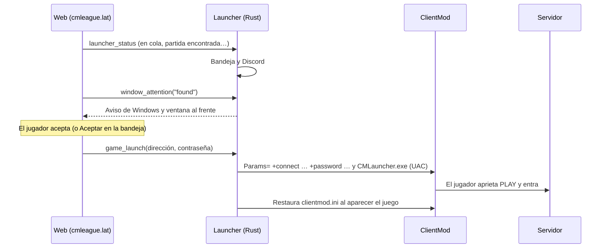
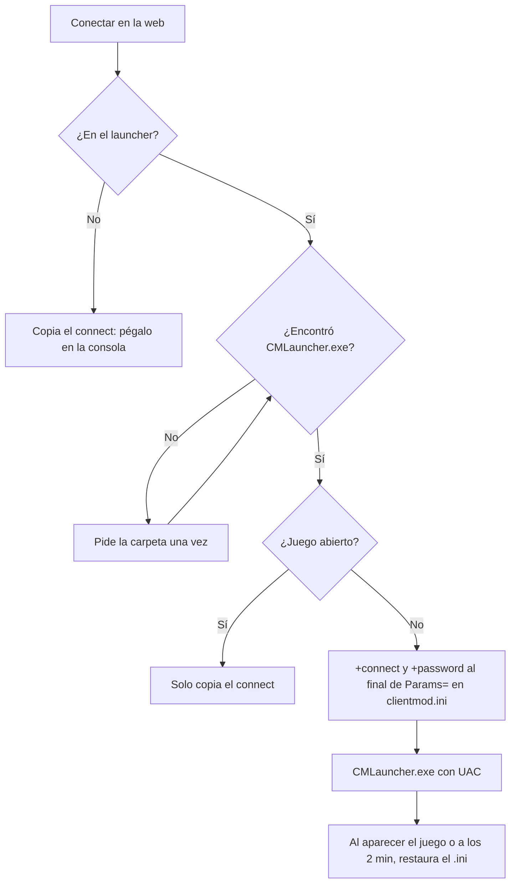
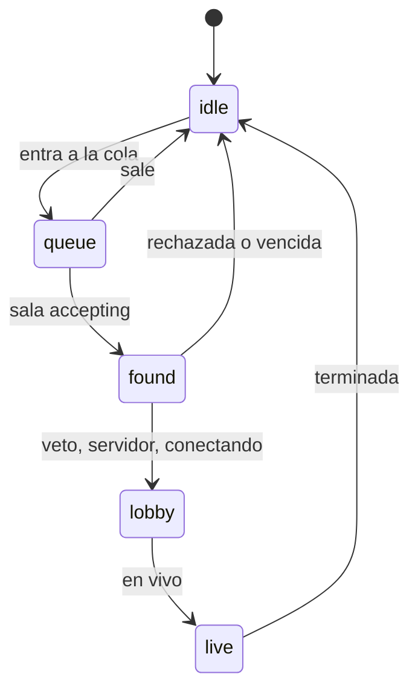

# Launcher de escritorio: documentación

## Qué hace

El launcher de CMLeague es una aplicación de Windows hecha con Tauri 2 (`launcher/`). Abre la web de la liga (`https://cmleague.lat/play`) en una ventana propia, con la misma sesión y las mismas secciones, como el cliente de FACEIT. No es un anticheat.

Suma lo que el navegador no puede hacer:

- abrir ClientMod conectado a la sala;
- avisos de Windows;
- la bandeja del sistema con el estado del matchmaking y "Aceptar partida";
- Discord Rich Presence;
- actualizaciones automáticas firmadas;
- una configuración propia que no toca la web;
- el tema de la tienda;
- links `cmleague://`.

La web detecta que está dentro del launcher (`web/frontend/src/lib/launcher.ts`) y le habla por el IPC de Tauri. Fuera del launcher, la web se comporta como antes. El único cambio en el navegador es que los "Conectar", que usaban `steam://connect` y no abren ClientMod, ahora copian el `connect` para pegarlo en la consola.

## Abrir ClientMod conectado

ClientMod se abre siempre con `CMLauncher.exe`, nunca con `hl2.exe`. En la PC de Agus, `hl2.exe` ni existe en la raíz: el juego y cinco procesos de ayuda corren todos como `CMLauncher.exe`, y el juego arranca con EasyAntiCheat (`ClientModEAC.exe`).

- **Juego abierto:** se reconoce por un `CMLauncher.exe` con la ventana `CS:S v34 ClientMod` (`tasklist`).
- **`clientmod.ini`:** se edita a nivel de bytes, para no cambiarle la codificación, y se restaura exactamente.
- **Validación:** la dirección y la contraseña se validan en Rust (`valid_address`, `valid_password`), así no pueden meter otro comando en la línea del juego. Sin contraseña (SourceTV), solo `+connect`.
- **Carpeta:** se busca en `C:\CSSv34_ClientMod`, `C:\ClientMod`, `Program Files` y los mismos en `D:` y `E:`. La que elige el jugador se guarda en la configuración.
- El `connect` siempre queda copiado como respaldo.

## Estado, bandeja, avisos y Discord

La web le cuenta el estado al launcher desde `GlobalMatchAlerts` (`launcherStatusOf`), que está en todas las pantallas con sesión.

| Estado | Bandeja | Discord |
|---|---|---|
| `idle` | "Sin buscar partida" | "En el juego · CS:S v34 ClientMod" con ClientMod abierto (el launcher lo mira solo cada 15 s), o "En el launcher" con el tiempo desde que se abrió. No depende de la web |
| `queue` | "Buscando partida · 5v5" | Igual, con el tiempo desde que entró |
| `found` | "¡Partida encontrada!" y **Aceptar partida** habilitado | Igual |
| `lobby` | "Preparando la partida · 5v5 · de_dust2" | Igual |
| `live` | "Jugando 5v5 · de_dust2 · 9-7" | Igual |

- **Aceptar partida en la bandeja:** llama a `window.__cmleagueLauncher.accept()`, que registra la web y acepta con su sesión.
- **Avisos de Windows** (`tauri-plugin-notification`): partida encontrada y servidor listo, solo si la ventana no está a la vista. Las actualizaciones también avisan.
- **Discord** (`discord-rich-presence`): corre en un hilo aparte y, si Discord no está abierto, lo vuelve a intentar cada 30 s. Necesita `CMLEAGUE_DISCORD_APP_ID` al compilar. Lo que cuenta la web manda sobre "En el juego" y "En el launcher".

## Configuración propia

Se guarda en `%APPDATA%\lat.cmleague.launcher\ajustes.json`. La ventana es una página local (`launcher/local/ajustes.html`) que se abre desde la bandeja o con `--ajustes`.

| Campo | De fábrica | Qué hace |
|---|---|---|
| `start_with_windows` | No | Abrir con Windows (`tauri-plugin-autostart`, con `--al-iniciar`) |
| `start_minimized` | Sí | Al abrirse con Windows, quedar en la bandeja |
| `close_to_tray` | Sí | La X manda a la bandeja; si no, cierra |
| `notifications` | Sí | Avisos de Windows |
| `bring_to_front` | Sí | Ventana al frente con la partida o el servidor |
| `discord_presence` | Sí | Rich Presence |
| `auto_update` | Sí | Buscar actualizaciones al abrir y cada 6 h |
| `shop_theme` | No | Tema de la tienda |
| `shop_theme_id` | Ninguno | Tema elegido; sin él, el del perfil |
| `clientmod_dir` | Ninguna | Carpeta de ClientMod |

Un `ajustes.json` viejo, con menos campos, toma los valores de fábrica para el resto.

## Permisos (capabilities)

| Quién | Puede |
|---|---|
| La web, solo `https://cmleague.lat` y `www` (`capabilities/web.json`) | Abrir el juego, contar el estado, traer la ventana, pintar la barra, elegir el tema del launcher y abrir Configuración |
| La ventana de Configuración (`capabilities/ajustes.json`) | Leer y guardar la configuración, la carpeta de ClientMod y las actualizaciones |

La web no puede leer ni cambiar el resto de la configuración, ni archivos, ni procesos, ni otras APIs de Tauri.

## Tema de la tienda

Si está prendido, `LauncherTheme` le pone a `<html>` la clase del tema (las de `cosmeticos.css`) y `dark`, y le pasa al launcher los colores de `--card` y `--primary` para la barra de título.

- **Cuál tema:** el elegido en **Perfil › Preferencias › Tema del launcher**, si sigue siendo tuyo según el `owned` del catálogo. Si no elegiste, el equipado en el perfil.
- **Dónde se elige:** la tarjeta `LauncherThemeCard` solo aparece dentro del launcher y lista solo los temas que tienes.

## Actualizaciones

`tauri-plugin-updater`, con la clave pública puesta al compilar (`CMLEAGUE_UPDATER_PUBKEY`). Busca en `https://cmleague.lat/descargas/launcher/latest.json`. Se instala solo cuando el jugador lo elige, desde la bandeja o desde Configuración, así nunca corta una partida.

Sin la clave, el plugin no se registra. Además, `tauri.conf.json` lleva `plugins.updater.pubkey` vacío, porque sin ese campo la app se cerraba al arrancar.

## Links `cmleague://`

`tauri-plugin-deep-link` con el esquema `cmleague`. `cmleague://play` o `cmleague://match/<id>` abren esa página de la web. Solo se aceptan letras, números, `/`, `-` y `_`; la consulta y el fragmento se ignoran. Con el launcher ya abierto, el link le llega a la misma ventana (`single-instance`).

## Página de descarga

`/launcher` es pública. Lee `latest.json` del mismo lugar que el actualizador y ofrece **Descargar para Windows**, que solo acepta instaladores de `cmleague.lat/descargas/launcher/`, y **Ya lo tengo: abrirlo**. Sin publicar, dice "Todavía no está publicado". **Jugar** la enlaza ("Launcher para Windows") cuando no estás en el launcher.

## Qué cambia para cada rol

| Rol | Qué cambia | Página del manual |
|---|---|---|
| Jugador | Puede usar el launcher: aviso de partida, Aceptar desde la bandeja, Conectar abre ClientMod y Configuración propia. En el navegador, Conectar copia el `connect` | [`jugador/launcher.md`](../../manual/jugador/launcher.md) (nueva) y [`jugador/buscar-partida.md`](../../manual/jugador/buscar-partida.md) |
| Capitán | En las PCW, **Entrar** hace lo mismo que Conectar: abre ClientMod en el launcher y copia el `connect` en el navegador | Sin página propia: lo cuenta `jugador/launcher.md` |
| Streamer | "Ver en TV" copia el `connect` de la SourceTV en el navegador y abre ClientMod en el launcher | Sin cambios: `streamer/panel-y-retraso.md` ya habla del `connect` |
| Organizador, soporte, moderador, admin y dueño de un servidor externo | Nada | — |

No hay comandos del servidor nuevos.

## Términos y privacidad

- **`/privacidad`:** un párrafo nuevo, "Launcher de escritorio", en "Lo que guarda tu navegador", marcado "En preparación". Cuenta qué guarda en la PC, que escribe un momento en `clientmod.ini`, Discord si se activa, que pregunta a `cmleague.lat` por versiones nuevas, y que no lee otros programas ni toca el juego.
- **`/terminos`:** un párrafo en "Servicio recreativo, «tal cual está»": que el launcher se ofrece tal cual, que no es parte de ClientMod y que modifica `clientmod.ini` por un momento. También "En preparación".
- Los dos están en la web (`features/legal/pages/`) y en `terms/*.html`. La marca se quita al publicar el launcher.

## Dónde está cada cosa

| Qué | Archivo / ubicación |
|---|---|
| Parte nativa | `launcher/src-tauri/src/` (`lib.rs`, `game.rs`, `status.rs`, `settings.rs`, `updater.rs`) |
| Permisos | `launcher/src-tauri/capabilities/web.json` y `ajustes.json` |
| Páginas locales | `launcher/local/ajustes.html` (Configuración) e `index.html` |
| Configuración de Tauri | `launcher/src-tauri/tauri.conf.json` (y `tauri.updater.conf.json` para el build firmado) |
| Compilación, prueba y capturas en Windows | `.github/workflows/launcher.yml` |
| Puente en la web | `web/frontend/src/lib/launcher.ts` |
| Tema y su tarjeta | `web/frontend/src/features/launcher/` |
| Página de descarga | `web/frontend/src/features/launcher/pages/LauncherPage.tsx`, ruta `/launcher` |
| Estado para la bandeja | `launcherStatusOf` en `web/frontend/src/features/matchmaking/MatchAlerts.tsx` |
| Descargas en el VPS | `/srv/cmleague/descargas/launcher/`, servido por `deploy/vps/Caddyfile` |
| Cómo encender las actualizaciones y Discord | `launcher/README.md` |
