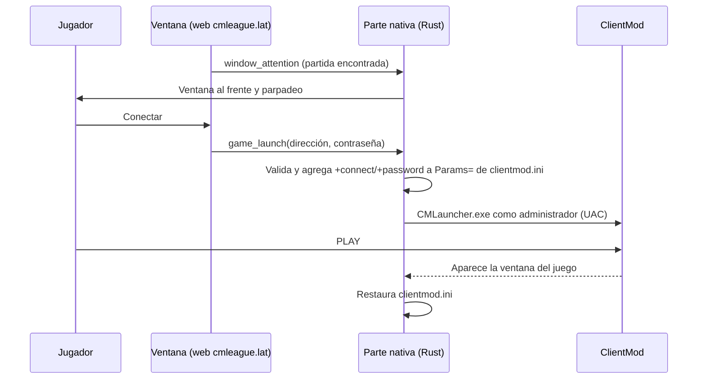
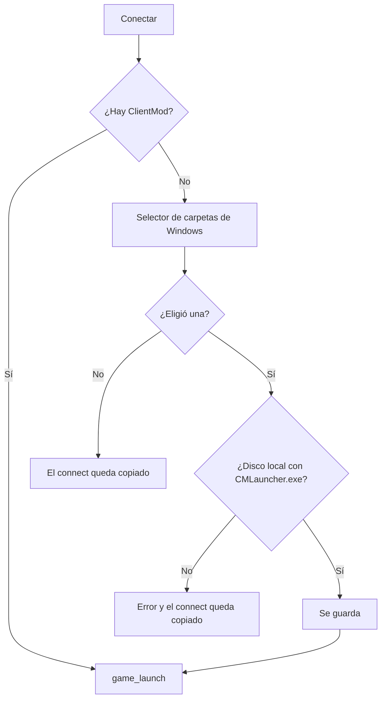

# Launcher de escritorio de CMLeague: documentación

> Estado al 2026-11-25: **en curso, sin publicar.** La app compila en GitHub Actions; falta probarla con ClientMod, la actualización automática, la página `/launcher` y publicar el instalador. Lo que falta está en [`GUIA_IMPLEMENTACION.md`](GUIA_IMPLEMENTACION.md) y en `docs/PENDIENTES.md`.

## Qué hace

Es una app de Windows, al estilo del cliente de FACEIT, que muestra **la web de CMLeague en una ventana propia** (`https://cmleague.lat/play`). Tiene la misma sesión, las mismas secciones y el mismo matchmaking que el navegador, más lo que el navegador no puede hacer:

- **Abrir ClientMod conectado a la sala.** `steam://connect` no sirve, porque ClientMod no es de Steam. Dentro del launcher, **Conectar** (sala del matchmaking), **Volver a la partida** y **Entrar** (PCW) abren el juego.
- **Traer la ventana al frente** cuando aparece la partida o el servidor está listo, aunque esté minimizada o en la bandeja, y hacerla parpadear en la barra de tareas.
- **Bandeja del sistema:** cerrar la ventana no cierra el launcher, así sigues en la cola y te avisa.

No es un anticheat ni instala ClientMod.

## Decisiones (después del plan)

El `PLAN.md` no se edita. Estas decisiones lo cambian:

| Tema | Decisión | Quién y cuándo |
|---|---|---|
| Enfoque | La web entera en una ventana propia, no una interfaz chica aparte. Así no hace falta otro login, otro socket, `CORS_ORIGINS` ni el protocolo `cmleague://` | Kyan lo hizo; Daniel lo aprobó el 2026-11-25 |
| Firma de Windows | **Sin firma** por ahora: SmartScreen muestra "Windows protegió tu PC" y se explica en `/launcher` ("Más información" → "Ejecutar de todas formas"). Un certificado OV (US$ 65 a 300 al año) se compra al abrirlo a todos. El EV ya no quita el aviso desde 2024, y Azure Artifact Signing no está disponible para personas fuera de EE. UU. y Canadá | Daniel, 2026-11-25 |
| Actualización automática | **Sí**, con el plugin de actualización de Tauri y su propia llave de firma (gratis, distinta del certificado de Windows). Lo que cambia en la web llega solo; el `.exe` nuevo solo hace falta cuando cambia la parte nativa | Daniel, 2026-11-25 |
| Dónde se publica | **R2 de Daniel**, carpeta `launcher/`: el instalador y el `latest.json` del actualizador. GitHub Actions sube con un token que solo escribe en ese bucket (no con una llave SSH del VPS) | Daniel, 2026-11-25 |
| Descarga | Página `/launcher` en la web, con el botón, la versión (de `latest.json`) y el aviso de SmartScreen | Daniel, 2026-11-25 |
| Carpeta de ClientMod | La elige el jugador con el **selector de carpetas de Windows**; la web no puede mandar una ruta. Solo carpetas de un disco de la PC, nunca de la red | 2026-11-25, revisión de seguridad |

## Los comandos nativos

Solo `https://cmleague.lat/*` y `https://www.cmleague.lat/*` pueden llamarlos, y solo estos cuatro (`launcher/src-tauri/capabilities/web.json`, declarados en `build.rs`). La web no tiene acceso a archivos, procesos ni otras APIs de Tauri.

| Comando | Qué hace |
|---|---|
| `game_detect` | Dónde está ClientMod: la carpeta guardada o la primera de las comunes (`C:\CSSv34_ClientMod`, `C:\ClientMod`, `Program Files`, y lo mismo en `D:` y `E:`) que tenga `CMLauncher.exe` |
| `game_pick_dir` | Abre el selector de carpetas de Windows y guarda la elegida en `clientmod_dir.txt` (carpeta de configuración de la app). Devuelve `null` si el jugador lo cerró |
| `game_launch` | Valida la dirección (`host:puerto`, sin espacios ni `;`) y la contraseña (sin espacios, `;` ni comillas, hasta 64), agrega `+connect` y `+password` a `Params=` de `clientmod.ini`, abre `CMLauncher.exe` con UAC y restaura el `.ini` cuando aparece el juego o a los 2 minutos. Con el juego abierto no hace nada más que avisar: el `connect` ya quedó copiado |
| `window_attention` | Muestra la ventana, la saca de minimizada, le da el foco y la hace parpadear |

### Por qué la carpeta no puede venir de la web

`CMLauncher.exe` se abre como administrador. Si la web pudiera mandar la carpeta, un script inyectado en cmleague.lat podría apuntar a `\\equipo\carpeta\CMLauncher.exe` y abrir un programa ajeno con permisos de administrador; el jugador vería el aviso de UAC que espera y lo aceptaría. Por eso:

1. La web solo pide `game_pick_dir`, sin argumentos: la carpeta la elige el jugador en el selector de Windows.
2. `is_local_dir` acepta solo `X:\...`, y la ruta real (resuelta con `canonicalize`, que sigue enlaces y unidades de red) no puede ser `\\?\UNC\`. Vale también para la carpeta guardada y las comunes.

## La web

`web/frontend/src/lib/launcher.ts` detecta el launcher (`window.__TAURI_INTERNALS__`) y le habla por el IPC de Tauri, sin sumar `@tauri-apps/api`. **Fuera del launcher no hace nada**: los links siguen siendo `steam://connect/...`.

| Dónde | Qué cambia dentro del launcher |
|---|---|
| `features/matchmaking/room/RoomOverview.tsx` (**Conectar**) | Abre ClientMod |
| `features/matchmaking/ReconnectBanner.tsx` (**Volver a la partida**) | Abre ClientMod |
| `features/pcw/components/SeriesPanel.tsx` (**Entrar**) | Abre ClientMod |
| `features/matchmaking/alert.ts` (partida encontrada y servidor listo) | Trae la ventana al frente |

Siempre copia `connect <ip:puerto>; password <contraseña>` antes de abrir el juego, por si hay que pegarlo en la consola.

## Qué cambia para cada rol

| Rol | Qué cambia | Página del manual |
|---|---|---|
| Jugador | Puede usar la app para jugar el matchmaking: la partida encontrada lo trae al frente y **Conectar** abre ClientMod | `jugador/app-de-escritorio.md` (oculta hasta publicarla), y al publicarla `jugador/buscar-partida.md` |
| Capitán | **Entrar** de la PCW abre ClientMod dentro de la app | Al publicarla, `capitan/jugar-pcw.md` |
| Organizador, soporte, moderador, admin, streamer y dueño de un servidor externo | Nada | — |

## Términos y privacidad

Con la marca "En preparación" (`Wip` en la web, `` en `terms/`) hasta publicar el instalador:

- **Privacidad, "Lo que guarda tu navegador":** la app guarda lo mismo que la web en la PC y la carpeta de ClientMod, no manda datos nuevos, escribe por un momento la dirección y la contraseña de la sala en `clientmod.ini`, y al abrirse consulta en Cloudflare (R2) si hay una versión nueva.
- **Términos, "Servicio recreativo, «tal cual está»":** la app es opcional y gratuita, se ofrece en las mismas condiciones, no es parte de ClientMod ni un anticheat, modifica `clientmod.ini` por un momento y abre ClientMod como administrador. En "Propiedad intelectual" se suma la aplicación de escritorio.

## Dónde está cada cosa

| Qué | Dónde |
|---|---|
| Parte nativa | `launcher/src-tauri/src/lib.rs` |
| Ventana, URL e instalador | `launcher/src-tauri/tauri.conf.json` |
| Permisos de la web | `launcher/src-tauri/capabilities/web.json` y `build.rs` |
| Página sin conexión | `launcher/offline/index.html` |
| Build del instalador | `.github/workflows/launcher.yml` (artefacto `cmleague-launcher-windows`, 14 días) |
| Puente de la web | `web/frontend/src/lib/launcher.ts` |
| Cómo compilar y probar | `launcher/README.md` |
