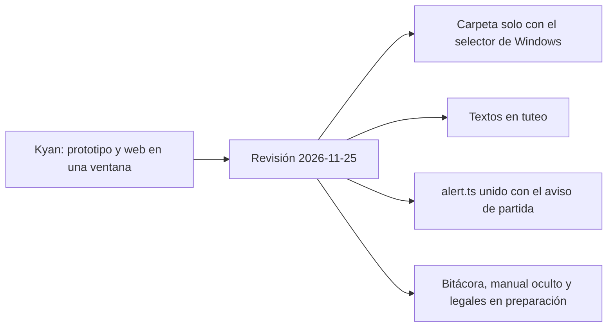

# Launcher de escritorio de CMLeague: guía de implementación

> Estado al 2026-11-25: rama `feat/launcher` (worktree `v34frag-launcher`), que sale de `main` y trae de `claude/relaxed-einstein-sl0cme` (Kyan, `acf5825`) solo `launcher/`, el workflow y los cambios de la web. **Sin publicar.**

## Qué se hizo



1. **Rama limpia.** La de Kyan sale de un `main` viejo (`be8a9da9`). Se tomaron sus archivos con `git checkout acf5825 -- …`; `RoomOverview.tsx` va como parche, porque copiarlo entero borraba el preveto VIP. `alert.ts` se unió a mano con el aviso de partida encontrada (`27261262`).
2. **Seguridad (2026-11-25).** `game_set_dir(dir)` recibía la ruta desde la web y después se abría `CMLauncher.exe` de ahí como administrador. Pasó a `game_pick_dir`, sin argumentos, con el selector de carpetas de Windows (`FolderBrowserDialog` por PowerShell, sin sumar dependencias de Rust), y `is_local_dir` rechaza rutas de red, también detrás de enlaces o unidades mapeadas. Pruebas: `carpetas_de_red` y `carpeta_local` (esta solo en Windows).
3. **Textos:** "pegá", "pegalo" y "apretá" pasaron a tuteo.
4. **Pruebas de la web en el worktree:** `pnpm lint`, `tsc -b`, prettier y `pnpm test` (882 de 882). Rust no está instalado en la PC de Daniel: sus pruebas corren en GitHub Actions (`cargo test` antes de armar el instalador).

## Qué falta, en orden

1. **Probar en la PC de Daniel**, que tiene ClientMod en `C:\CSSv34_ClientMod` (con `Params=-console`) y en `D:\CSSv34_ClientMod`. Con el juego cerrado y ningún mix en juego:
   1. Hacer una copia de `clientmod.ini`.
   2. Agregar al final de `Params=` el `+connect <ip:puerto> +password <contraseña>` de un servidor vacío (por ejemplo el de una sala de prueba).
   3. Abrir `CMLauncher.exe`, aceptar el UAC y tocar PLAY: ¿entra solo al servidor?
   4. Restaurar la copia de `clientmod.ini`.
   5. Con `Get-Process CMLauncher | Select Id, MainWindowTitle`, anotar el título de la ventana del launcher de ClientMod **antes** de tocar PLAY. Con el juego abierto es `CS:S v34 ClientMod` (visto el 2026-11-25); si el del launcher es el mismo, `game_running` se confunde y hay que cambiarlo.
2. **Instalar el `.exe` de GitHub Actions** (artefacto `cmleague-launcher-windows`) y probar dentro de la ventana:
   - Conectar, Volver a la partida y Entrar (PCW), con y sin ClientMod en las carpetas comunes (el selector de carpetas, y que rechace una carpeta de red).
   - Que la partida encontrada traiga la ventana desde la bandeja y desde minimizada.
   - Que suene el aviso y salga la notificación de Windows (la web usa la API `Notification` del navegador; en la ventana de Tauri puede no estar).
   - Que los links de afuera (Discord, perfil de Steam) se abran en el navegador y no dentro de la ventana.
   - Que la sesión siga al cerrar y volver a abrir la app.
3. **Actualización automática:** `tauri-plugin-updater`, la llave de firma del actualizador (secreto de GitHub, la guarda Daniel) y el `latest.json`.
4. **Publicar en R2:** Daniel crea un token de R2 que solo escribe en `launcher/` y lo guarda como secreto de GitHub; el workflow sube el instalador y `latest.json`. Decidir la URL pública (`cmleague.lat/launcher/…` o un subdominio).
5. **Página `/launcher`** en la web: botón, versión, qué hace y el aviso de SmartScreen.
6. **Al publicarla:**
   - Sacar `oculta: true` de `docs/manual/jugador/app-de-escritorio.md` y sumar una línea en `jugador/buscar-partida.md` (sección 4, Conectar) y en `capitan/jugar-pcw.md` (sección 2).
   - Quitar "En preparación" de los párrafos de la app en `/privacidad` y `/terminos` (web y `terms/`).
   - Changelog (`CHANGELOG_DISCORD.txt` de esta carpeta).
7. **Ramas:** la web también va en `feat/frontend-fase-1`. El launcher no toca la base, la API, el VPS ni el plugin, así que no va en `feat/mm-claim-en-sala`.

## Desplegar la web

Los cambios de la web no cambian nada fuera de la app, así que se pueden desplegar antes de publicarla. Con `feat/launcher` en `main`:

```bash
deploy/vps/desplegar.sh web
```

No toca la API, la base ni los servidores de juego (#1, #2 y #3).

## Vuelta atrás

`git revert` de los commits de la web y volver a desplegarla. La app sin la web nueva sigue abriendo la web, pero Conectar vuelve a `steam://connect`.
