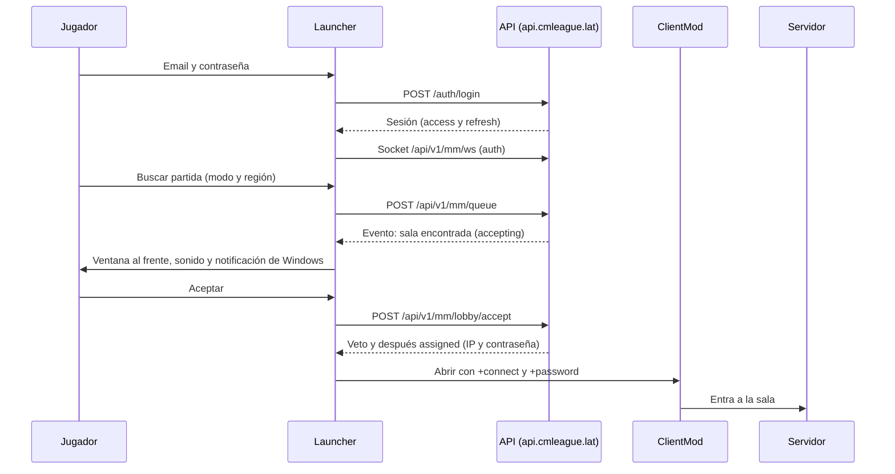
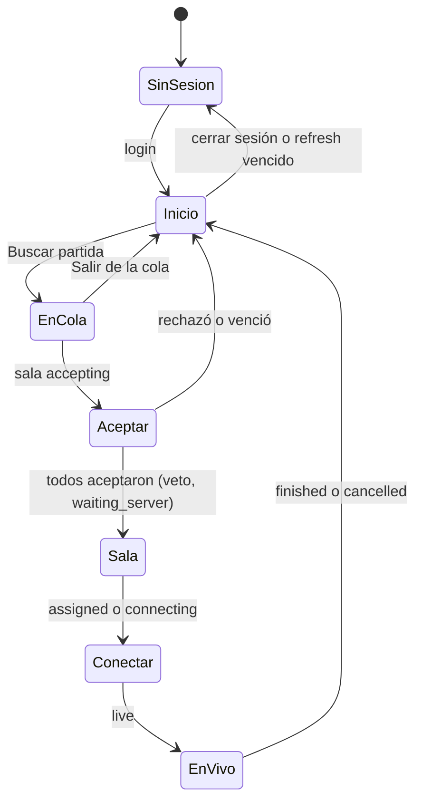
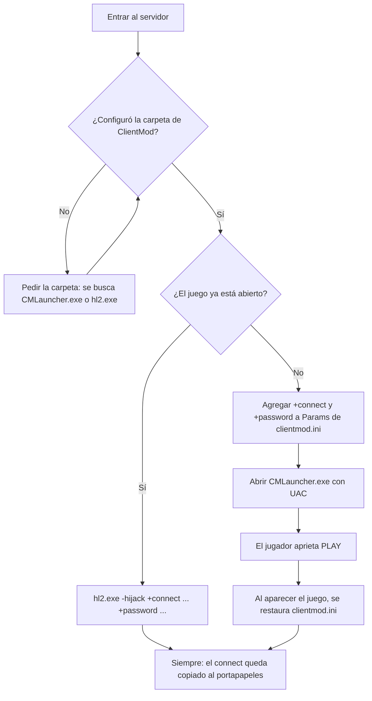

# Plan: launcher de escritorio de CMLeague

> Planeación original. Estado: **propuesta**, pendiente de aprobación de Daniel y Kyan.

Es una aplicación de Windows, al estilo del cliente de FACEIT, para buscar partida del matchmaking sin tener la web abierta, aceptarla con un aviso que se ve encima de todo y entrar al servidor con un clic, sin copiar el `connect`.

## Decisiones tomadas

| Tema | Decisión | Por qué |
|---|---|---|
| Alcance de la versión 1 | Iniciar sesión, cola, aviso y aceptar partida, y abrir ClientMod conectado a la sala | Es lo que pidió el jugador. El anticheat y el instalador de ClientMod quedan para después (ver sección 8) |
| Tecnología | **Tauri 2** (Rust + el WebView2 de Windows) con una interfaz en React + Vite + TypeScript | El instalador pesa unos 10 MB y usa poca RAM mientras se juega. La interfaz usa el mismo stack que la web. Abrir el juego, la bandeja y el protocolo propio necesitan código nativo, y Rust lo da sin otro runtime |
| Interfaz | Propia y chica (`launcher/src`), no la web entera | La web trae más de 30 secciones que no hacen falta. El launcher hace pocas cosas y tiene un botón "Abrir la web" para el resto. Los tipos del matchmaking se copian de `web/frontend/src/features/matchmaking/types.ts` (solo lo que usa) |
| Inicio de sesión | Email y contraseña contra `POST /auth/login` y renovación con `POST /auth/refresh`, igual que la web | La web solo tiene ese método (no hay Discord ni Steam). No hace falta tocar la API |
| Tiempo real | El mismo socket `GET /api/v1/mm/ws` con el mismo protocolo (`auth`, `ping`/`pong`, `ready`, eventos) | Ya existe. Además, el socket abierto cuenta como "presencia": con el launcher abierto no te sacan de la cola al cerrar la web (replanteo 63) |
| Aceptar | Siempre con un clic del jugador. El autoaceptar sigue siendo el de VIP (`PUT /api/v1/mm/auto-accept`), en la API | No se crea otra forma de autoaceptar por fuera de las reglas de la liga |
| Abrir el juego | Ver la sección 4. **No se usa `steam://connect`**: ClientMod no es de Steam y ese link no lo abre | Es el problema que tienen hoy los botones "Conectar" de la web |
| Protocolo propio | El launcher registra `cmleague://connect/<ip:puerto>/<contraseña>` | Con el launcher instalado, el botón "Conectar" de la web pasa a abrir el juego de verdad (sección 6) |
| Dónde se guarda la sesión | En la versión 1, en el almacenamiento del WebView (`localStorage`), igual que la web con "Recordarme". Antes de publicar, en el Administrador de credenciales de Windows (crate `keyring`) | El prototipo no necesita más. Publicarlo con el token en un archivo legible sería peor que la web |
| Actualizaciones | Fuera de la versión 1. Después, con `tauri-plugin-updater` y los instaladores en R2 (`cmleague.lat/launcher/…`) | Hace falta una clave de firma y un lugar donde publicar. Se deja preparado |
| Firma del instalador | Sin firma de código en la versión 1 (Windows muestra el aviso de SmartScreen) | Un certificado cuesta plata por año. Se decide antes de abrirlo a todos |
| Paquetes | **pnpm** con `pnpm-workspace.yaml` (antigüedad mínima de 7 días, `trustPolicy: no-downgrade`, `allowBuilds`), igual que `web/backend` | Convención del repo |
| Dónde vive | Carpeta `launcher/` en la raíz del repo | Es un proyecto aparte, como `cloudflare/demo-worker` o `render/` |

## 1. El flujo completo



El launcher no tiene lógica propia del matchmaking. Le pide el estado a la API, lo muestra y manda las mismas acciones que la web. Todo lo que decide quién juega, en qué servidor y con qué contraseña sigue en la base (replanteo `48` y siguientes).

## 2. Estados que muestra



- **Inicio:** modo y región (de `modes` y `regions` del estado), jugadores en la cola y partidas en vivo.
- **En cola:** tiempo en la cola, posición y espera estimada (`queue.eta_s`).
- **Aceptar:** cuenta regresiva hasta `lobby.accept_deadline`, quién aceptó (`players[].accepted`) y los botones Aceptar y Rechazar.
- **Sala:** veto en curso (solo se muestra, el veto se hace en la web en la versión 1) y servidor.
- **Conectar:** botón grande "Entrar al servidor", botón "Copiar connect" y la cuenta regresiva hasta `connect_deadline`.
- Una penalidad (`penalty`) o un aviso de la API (por ejemplo "Tu anticheat no está activo") se muestra tal cual llega.

La ventana se puede cerrar a la bandeja del sistema. En la bandeja sigue conectado, sigue en la cola y avisa.

## 3. El aviso de partida encontrada

Es lo más importante, porque el jugador está haciendo otra cosa (en otro juego, en el navegador, con la ventana minimizada).

1. La ventana del launcher se restaura, pasa al frente y queda "siempre visible" hasta que acepta, rechaza o vence.
2. Notificación de Windows (`tauri-plugin-notification`) con "Partida encontrada".
3. El sonido de partida: el que el jugador eligió en la web (`profile.sounds`), o uno por defecto incluido en el launcher.
4. Parpadeo del ícono en la barra de tareas (`request_user_attention`).

## 4. Abrir ClientMod conectado

ClientMod se abre con `CMLauncher.exe`, que pide permisos de administrador (UAC), toma los parámetros de `clientmod.ini` (línea `Params=`) y espera un clic en PLAY. Lo aprendimos armando los clips ([`2026-11-04-render-sin-launcher`](../2026-11-04-render-sin-launcher/)). `steam://connect` no sirve porque ClientMod no está en Steam.



- **Detectar la carpeta:** se buscan `CMLauncher.exe` y `hl2.exe` en las rutas comunes (`C:\Program Files (x86)\ClientMod`, `C:\ClientMod`, y los mismos en `D:` y `E:`). Si no aparece, el jugador la elige una vez y queda guardada.
- **Juego cerrado:** se respalda `clientmod.ini`, se agregan `+connect <ip:puerto> +password <contraseña>` al final de `Params=` (sin tocar lo demás) y se abre `CMLauncher.exe` con `ShellExecute` y el verbo `runas`, que muestra el aviso de UAC. Cuando aparece la ventana del juego, o al minuto, se restaura el `.ini`. Así la contraseña de la sala no queda guardada y el próximo arranque normal no se conecta solo.
- **Juego abierto:** `-hijack` le pasa la línea de comandos a la instancia que ya está corriendo. **Hay que probar si la v34 de ClientMod lo respeta.** Si no, se copia el `connect` y se avisa: "Pegalo en la consola (º)".
- **Siempre:** el `connect <ip:puerto>; password <contraseña>` queda en el portapapeles, como respaldo.
- La contraseña viene de `lobby.server.password`, que la API solo les da a los 10 de la sala. El launcher no la guarda en disco salvo en el `.ini` durante el arranque.

**A probar en la PC de Daniel antes de dar esto por hecho:** que `CMLauncher.exe` respete `+connect` en `Params=`, que `-hijack` funcione con el juego abierto y que ClientMod no tenga un parámetro propio para conectar (por ejemplo, en `CMLauncher.exe` por línea de comandos), que sería lo más limpio.

## 5. Cambios en la API y la base

**Ninguno en la base.** En la API, solo configuración:

- `CORS_ORIGINS` del VPS suma `http://tauri.localhost`, que es el origen del WebView de Tauri 2 en Windows. Sin eso, el navegador interno bloquea los pedidos. Es una variable del `.env` de la API (`deploy/vps/api.env.example`), no un cambio de código.
- El socket no revisa el origen, así que no hace falta nada.

Lo que sí convendría más adelante (no en la versión 1): un `client` en el `auth` del socket (`web` o `launcher/0.1.0`) para saber cuántos usan el launcher, y una versión mínima del launcher que la API pueda exigir.

## 6. Cambios en la web

1. Los botones "Conectar" del matchmaking (`labels.ts`, `connectUrl`), de las PCW (`SeriesPanel.tsx`) y de `NowBar.tsx` hoy arman `steam://connect/...`, que con ClientMod no hace nada. Pasan a:
   - `cmleague://connect/<ip:puerto>/<contraseña>` si el jugador marcó "Tengo el launcher" (preferencia guardada en el navegador), y
   - si no, a copiar `connect <ip:puerto>; password <contraseña>` al portapapeles con el aviso "Pegalo en la consola del juego".
   - El link de SourceTV ("Ver en CM League TV") también usa `steam://` y tiene el mismo problema: se arregla igual.
2. Una página de descarga (`/launcher`), enlazada desde Jugar y desde la guía de primera vez, con el instalador y su versión.

La web va solo en `feat/frontend-fase-1` (regla de las ramas del matchmaking). El launcher no es web ni matchmaking de la base, así que va en la rama que diga Daniel.

## 7. El proyecto `launcher/`

```
launcher/
├── README.md               cómo correrlo y compilarlo
├── package.json            pnpm; vite, react, @tauri-apps/api, @tauri-apps/cli
├── pnpm-workspace.yaml     7 días, no-downgrade, allowBuilds
├── index.html, vite.config.ts, tsconfig.json
├── src/                    interfaz
│   ├── api.ts              login, refresh y fetch con el token
│   ├── socket.ts           socket del matchmaking (mismo protocolo que la web)
│   ├── game.ts             puente a los comandos de Rust
│   ├── types.ts            lo que usa de los tipos del matchmaking
│   └── App.tsx, main.tsx, styles.css
└── src-tauri/              parte nativa (Rust)
    ├── tauri.conf.json     ventana, bandeja, protocolo cmleague://, CSP
    ├── capabilities/       permisos de la interfaz
    └── src/lib.rs          game_detect, game_launch, game_running y la bandeja
```

La URL de la API se elige al compilar (`VITE_API_URL`, por defecto `https://api.cmleague.lat`), igual que la web.

## 8. Fuera de la versión 1 (más adelante)

| Qué | Nota |
|---|---|
| Ser el agente del anticheat | La base ya lo tiene diseñado (replanteos `45` a `47`: vínculo por código, latidos, `ac_devices`). El launcher es el lugar natural, pero cambia `/privacidad` y pide revisar el diseño de Kyan (`2026-10-30-anticheat-backend`, en sus ramas). Requerimiento aparte |
| Instalar ClientMod y los mapas de la liga | Hoy se instala desde `clientmod.ru`. Redistribuirlo pide permiso de sus autores |
| Grupo, amigos, chat y veto dentro del launcher | En la versión 1 se hacen en la web |
| Actualización automática | `tauri-plugin-updater` y una clave de firma |
| Firma de código | Certificado. Sin él, SmartScreen avisa al instalar |
| macOS y Linux | ClientMod es de Windows |

## 9. Qué cambia para cada rol

| Rol | Qué cambia | Página del manual |
|---|---|---|
| Jugador | Puede usar el launcher para buscar, aceptar y entrar. El botón "Conectar" de la web deja de usar Steam | `jugador/launcher.md` (nueva), `jugador/buscar-partida.md`, `jugador/jugar-en-el-servidor.md`, `jugador/instalar-clientmod.md` |
| Capitán | El "Conectar" de las PCW deja de usar Steam | `capitan/` (la página de la PCW) |
| Organizador, moderador, admin, streamer, dueño de un servidor externo | Nada | — |

## 10. Términos y privacidad

- **Privacidad:** el launcher no junta datos nuevos: usa la misma cuenta y la misma API que la web. Guarda en la PC del jugador la sesión y la carpeta de ClientMod, y escribe un momento en `clientmod.ini`. Se agrega un párrafo "Aplicación de escritorio" con eso, marcado "En preparación" hasta publicarlo.
- **Términos:** una línea de que el launcher se ofrece tal cual, que modifica `clientmod.ini` solo para conectarte y que no es parte de ClientMod. También "En preparación" hasta publicarlo.
- Si después pasa a ser el agente del anticheat, la privacidad cambia de verdad (procesos y capturas), y eso va en su propio requerimiento.

## 11. Requisitos antes de empezar

- **Windows con Rust (`rustup`), las Build Tools de Visual Studio (C++) y WebView2** para compilar el instalador. Se puede compilar en la PC de Daniel (que lo instale él) o en GitHub Actions con un runner de Windows.
- ClientMod instalado en esa PC para probar la sección 4.
- Sumar `http://tauri.localhost` a `CORS_ORIGINS` en la API del VPS.
- Decidir el nombre visible ("CMLeague Launcher"), el ícono y si se paga la firma de código.

## 12. Orden de implementación

1. Esqueleto de `launcher/` que compile: login, estado, cola, aceptar y "Entrar al servidor" con portapapeles (**prototipo**, hecho con este plan).
2. Probar en la PC de Daniel cómo abrir ClientMod conectado (sección 4) y cerrar el mecanismo.
3. Bandeja, aviso al frente, sonido y notificación de Windows.
4. Protocolo `cmleague://` y los cambios de la web (sección 6).
5. Sesión en el Administrador de credenciales de Windows.
6. `CORS_ORIGINS` en el VPS, instalador y prueba con una partida real en el #1, el #2 y el #3.
7. Manual, `/privacidad` y `/terminos`, `DOCUMENTACION.md`, `GUIA_IMPLEMENTACION.md` y `CHANGELOG_DISCORD.txt`.
