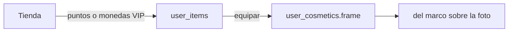

# 7 marcos nuevos en la tienda: documentación

## Qué hace

Suma 7 marcos de perfil animados a la tienda, en la colección `cs`. **Bosque** y **Siesta** son para todos, a 550 puntos. Los otros 5 son exclusivos de VIP, a 450 monedas VIP. Llevan la etiqueta **Nuevo** durante 3 días.

Se hicieron con la guía de arte, con marcos de la tienda de puntos de Steam como referencia de estilo. Son diseños propios.

## Los marcos

| Id | Precio | Peso | Generador |
|---|---|---|---|
| `marco-fauces` | 450 monedas VIP | 81 KB | `docs/generar_fauces.mjs`: boca de monstruo que respira |
| `marco-siesta` | 550 puntos | 119 KB | `docs/generar_siesta.mjs`: pixel art, borde garabateado y una oveja que se duerme y se despierta de un susto |
| `marco-siesta-azul` | 450 monedas VIP | 119 KB | El mismo, con el trazo `#2c2a72` (el blanco casi no se ve en tema claro) |
| `marco-mar-de-nubes` | 450 monedas VIP | 15 KB | `docs/generar_nocturno.mjs`: pixel art, nubes que corren, luna y estrellas |
| `marco-bosque` | 550 puntos | 172 KB | `docs/generar_bosque.mjs`: siluetas que se mecen |
| `marco-sabueso` | 450 monedas VIP | 26 KB | `docs/generar_sabueso.mjs`: detective de dibujo animado con lupa |
| `marco-terminal` | 450 monedas VIP | 7 KB | `docs/generar_terminal.mjs`: monitor de fósforo verde, con velo sobre la foto |

Los archivos están en `web/frontend/public/cosmetics/marcos/`, con el nombre del id sin `marco-`. Orden 4090 a 4150. El precio es el inicial: el admin lo cambia en Administración › Tienda.

## Reglas de dibujo

- Fauces, Siesta, Bosque y Terminal pisan el borde de la foto (12,5 % por lado, esquinas al 8 %); sus generadores lo comprueban o lo rellenan. Mar de nubes lo pisa abajo y Sabueso no tiene borde: como en sus referencias, el resto del contorno queda libre.
- El velo de Terminal sale de medir el `.png` animado de la referencia. Tiñe la foto, pero no la pasa a un solo color: el marco se dibuja con `` encima.
- Sabueso y Fauces tapan a propósito una parte de la foto.

## Qué cambia para cada rol

| Rol | Qué cambia | Página del manual |
|---|---|---|
| Jugador | 2 marcos para todos y 5 VIP | `jugador/tienda-y-cosmeticos.md` (sin cambios por los marcos: los describe en general) |
| Admin | 7 artículos más en Administración › Tienda | `admin/tienda-y-puntos.md` (sin cambios) |

## Términos y privacidad

Sin cambios. Son imágenes de la tienda, con las mismas reglas de compra que las demás.

## Dónde está cada cosa

| Qué | Archivo / ubicación |
|---|---|
| Catálogo | `web/frontend/public/cosmetics/catalogo.json` (versión 18) |
| Migración | `supabase/replanteo/143_tienda_marcos_nuevos.sql` |
| Inversa | `docs/bitacora/2026-10-14-replanteo-modelo-datos/reversas/143_tienda_marcos_nuevos.sql` |
| Script que generó las tres | `docs/bitacora/2026-11-24-marcos-nuevos/pruebas/generar_143.mjs` |
