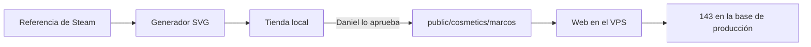

# Plan: 7 marcos nuevos en la tienda

> Planeación original. Estado: **aprobado** por Daniel el 2026-11-24. Los marcos se hicieron y se vieron en la tienda local durante la misma sesión, antes de escribir este plan.

## Decisiones tomadas

| Tema | Decisión |
|---|---|
| Cómo se hacen | Con la guía de arte (`docs/guia_y_flujo_de_arte_conceptual_estilo_steam.md`), por el camino SVG, sin gastar créditos. Una referencia de Steam por marco, fuera del repo. |
| Qué se publica | Fauces, Siesta, Siesta azul, Mar de nubes, Bosque, Sabueso y Terminal. |
| Diseños propios | Ninguno copia el de Steam: otra boca, una oveja en vez de la chibi, un sabueso con gorra a cuadros, otro monitor. |
| Precio | **Bosque y Siesta**, para todos, a 550 puntos. Los otros 5, exclusivos de VIP a 450 monedas VIP, como los demás marcos VIP. |
| Descartados | Bosque verde (no le gustó a Daniel) y el avatar Dama de póker. |
| Colección y orden | `cs`, orden 4090 a 4150, después de Pintura (4080). |
| Base | Replanteo `143` (la `139` a la `142` están tomadas o reservadas por otros pedidos), con su inversa. Los mismos datos en `catalogo.json` (versión 18), generados desde una sola lista. |

## 1. El flujo completo

## 2. Archivos

Los 7 SVG van en `web/frontend/public/cosmetics/marcos/` y sus generadores en `docs/`.

## 3. Requisitos antes de empezar

- Acceso SSH al VPS. Sin ninguna sala del matchmaking armándose (si ya empezó la partida, se puede).

## 4. Orden de implementación

1. Commit en `main` solo con lo de este pedido y el filtro "Nuevo" (`2026-11-24-tienda-filtro-nuevo`), que se despliega junto.
2. Worktree limpio, API y web.
3. `143` en la base de producción, después de la web.
