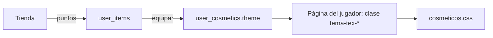

# 20 temas de perfil con textura: documentación

## Qué hace

Suma a la tienda 20 temas de perfil en la colección nueva **Texturas**: la mitad para todos, con puntos, y la otra mitad solo VIP, con monedas VIP (Daniel, 2026-11-25; los VIP salieron por sorteo). A diferencia de los anteriores, cambian el color de las tarjetas, les ponen una textura, pintan el fondo de la página y usan un segundo color en las barras de las estadísticas. Cinco llevan una cinta arriba de la tarjeta del nick y tres se mueven.

## Los temas

| Precio | Temas |
|---|---|
| 350 puntos, para todos | Ficha de una hora, Paño verde, Dominó, Ajedrez, Historieta, Dos tintas, Fileteado, Azulejo, Fibra de carbono |
| 450 puntos, para todos (animado) | Monitor de tubo |
| 300 monedas VIP, solo VIP | Pantallazo azul, Cuaderno de clase, Baraja española, Plano técnico, Curvas de nivel, Salar, Bus pintado, Zona de obra, y los animados Páramo y Luciérnagas |

Los VIP cuestan 300 monedas VIP, como los demás temas VIP, y se comportan como lo VIP comprado: si se vence el VIP, quedan congelados hasta volver a serlo.

Ids `tema-tex-*`, orden 4160 a 4350. El precio es el inicial: el admin lo cambia en Administración › Tienda.

## Cómo se dibujan

Cada tema define sus colores y estas variables; unas reglas comunes las dibujan (`[class*="tema-tex-"]`):

| Variable | Qué es |
|---|---|
| `--tex` | Capas de fondo de las tarjetas |
| `--tex-pagina` | Fondo de la página del jugador (opcional) |
| `--tex-2` | Color de las barras de las estadísticas |
| `--tex-cinta`, `--tex-alto` | La cinta de arriba de la tarjeta del nick |

- La textura va completa en la tarjeta del nick y en las muestras de la tienda. En las demás tarjetas va debajo de un velo del color de la tarjeta (66 %).
- Los botones del encabezado llevan fondo sólido: el suyo es translúcido y sobre la textura no se leía.
- El movimiento está solo en la tarjeta del nick y en las muestras, y se apaga con movimiento reducido.
- **Cuaderno de clase** es el único tema claro, también para quien usa el modo oscuro. Redefine texto, victoria, derrota y niveles, y pone los efectos de nombre sobre una etiqueta oscura, porque están hechos para fondo oscuro.

## Qué cambia para cada rol

| Rol | Qué cambia | Página del manual |
|---|---|---|
| Jugador | 20 temas más y la colección Texturas: 10 con puntos y 10 solo VIP con monedas VIP | `jugador/tienda-y-cosmeticos.md` (sección Temas) |
| Admin | 20 artículos más en Administración › Tienda | Sin cambios |

## Términos y privacidad

Sin cambios. Son artículos de la tienda, con las mismas reglas de compra que los demás.

## Dónde está cada cosa

| Qué | Archivo / ubicación |
|---|---|
| Estilos | `web/frontend/src/features/shop/cosmeticos.css` (final del archivo) |
| Colección | `web/frontend/src/features/shop/types.ts` |
| Catálogo | `web/frontend/public/cosmetics/catalogo.json` (versión 19) |
| Migración e inversa | `supabase/replanteo/144_tienda_temas_con_textura.sql` y `reversas/144_tienda_temas_con_textura.sql` |
| Script que generó migración, inversa y catálogo | `docs/bitacora/2026-11-24-temas-con-textura/pruebas/generar_144.mjs` |
