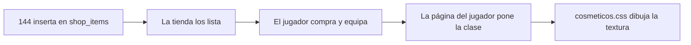

# Plan: 20 temas de perfil con textura en la tienda

> Planeación original. Estado: **aprobado** por Daniel el 2026-11-24, que eligió 20 de los 24 de la maqueta (artifact "Temas nuevos para la tienda"). Primero en local; el commit y el despliegue, cuando él lo pida.

## Decisiones tomadas

| Tema | Decisión |
|---|---|
| Por qué | Los 44 temas de puntos de hoy solo cambian un color sobre tarjetas casi negras. En la copia local, 31 no los compró nadie. |
| Qué se agrega | Monitor de tubo, Pantallazo azul, Ficha de una hora, Cuaderno de clase, Paño verde, Baraja española, Dominó, Ajedrez, Plano técnico, Curvas de nivel, Historieta, Dos tintas, Salar, Páramo, Luciérnagas, Fileteado, Azulejo, Bus pintado, Fibra de carbono y Zona de obra. |
| Descartados | Cafetal, Cancha, Chapa oxidada y Placa madre. |
| Precio | Para todos: 350 puntos los 17 fijos y 450 los 3 animados (Monitor de tubo, Páramo y Luciérnagas), los primeros temas de puntos con movimiento. El borde que brilla y late sigue siendo solo VIP. |
| Colección | Nueva: `texturas` ("Texturas"). |
| Cómo | Solo CSS en `cosmeticos.css`, con el prefijo `tema-tex-`: cada tema define sus variables y unas reglas comunes las dibujan. No se toca `PlayerProfile.tsx`. |
| Legibilidad | La textura va completa en la tarjeta del nick; en las demás lleva un velo del color de la tarjeta, porque tienen números y tablas. |
| Claro | Cuaderno de clase es el único claro: redefine también texto, victoria, derrota y niveles. |
| Base | Replanteo `144` con su inversa; `catalogo.json` versión 19. Los tres, desde una sola lista. |

## 1. El flujo completo

## 2. Orden de implementación

1. CSS y colección.
2. Migración, inversa y catálogo.
3. `144` en la base local y revisión visual: tienda y página del jugador, en claro, oscuro y teléfono.
4. Pruebas de la web, manual, changelog e índices.
5. Con el visto bueno de Daniel: commit, push, web y `144` en producción.
