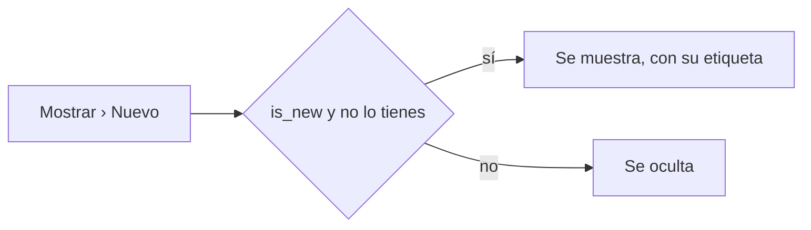

# Filtro "Nuevo" en la tienda: documentación

## Qué hace

En la Tienda, **Mostrar › Nuevo** deja solo lo que lleva la etiqueta **Nuevo**: lo que entró hace menos de 3 días y no tienes. Funciona como "Lo mío": respeta el tipo, la colección, la búsqueda y el orden.

## Reglas

- La etiqueta y el filtro usan la misma función (`isNew` de `ShopPage.tsx`). La regla de los 3 días es la de la etiqueta ([`2026-11-20-tienda-etiqueta-nuevo`](../2026-11-20-tienda-etiqueta-nuevo/DOCUMENTACION.md)).
- Muestra lo nuevo del tipo elegido. Los números de los tipos y de las colecciones siguen contando todo el catálogo, igual que con los demás filtros.
- Si no hay nada nuevo del tipo: "No hay nada nuevo de este tipo por ahora.". Con una búsqueda o una colección elegida: "Nada coincide con el filtro.".
- Las Ofertas de la semana siguen arriba, sin filtrar. El Inventario no cambia.

## API

`GET /api/v1/shop/items` acepta `is_new` (`true` o `false`; otro valor, 400), sobre `shop_catalog.is_new` (replanteo `132`). No mira si lo tienes: para eso está `owned`. La web no lo usa: carga el catálogo entero y filtra ahí, como con "Lo mío".

## Qué cambia para cada rol

| Rol | Qué cambia | Página del manual |
|---|---|---|
| Jugador | Puede ver solo lo nuevo de la tienda | `jugador/tienda-y-cosmeticos.md` (actualizada) |
| Los demás | Nada | — |

## Términos y privacidad

Sin cambios.

## Dónde está cada cosa

| Qué | Dónde |
|---|---|
| Web | `web/frontend/src/features/shop/ShopPage.tsx` (`isNew`, `Show`, el selector y el mensaje) |
| API | `web/backend/src/schemas/shop.ts` (`ShopItemQuery`) y `web/backend/src/routes/shop.ts` |
| Tipos | `web/backend/src/db/types.ts` (`shop_catalog`) y `web/frontend/src/api/schema.d.ts` |
| Pruebas | `web/backend/test/unit/shop-routes.test.ts` y `web/frontend/src/features/shop/Inventory.test.tsx` ("Mostrar › Nuevo") |
