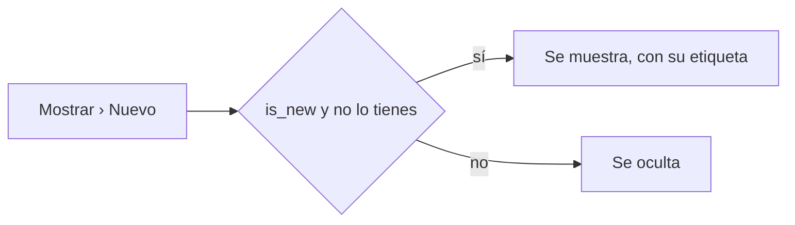

# Plan: filtro "Nuevo" en la tienda

> Planeación original. Estado: **pedido por Daniel** el 2026-11-24.

## Decisiones tomadas

| Tema | Decisión |
|---|---|
| Dónde | En **Mostrar** (el selector de "Lo mío"), opción **Nuevo**, después de "Lo mío". |
| Qué muestra | Lo que lleva la etiqueta **Nuevo**: `is_new` y que no tengas. Una sola función decide las dos cosas, para que no se separen. |
| Tipo y colección | Se respetan, igual que en "Lo mío": muestra lo nuevo del tipo elegido. |
| Sin nada nuevo | Mensaje propio ("No hay nada nuevo de este tipo por ahora."). |
| Inventario | Sin cambios: no tiene el selector Mostrar. |
| API | `GET /shop/items` suma `is_new` (`true` o `false`), como los demás filtros del listado. La web ya carga el catálogo entero y filtra ahí, igual que "Lo mío". |
| Base | Sin cambios: `shop_catalog.is_new` ya existe (replanteo `132`). |

## 1. El flujo completo

## 2. Cambios

- API: `ShopItemQuery.is_new` y el filtro sobre `shop_catalog`.
- Web: `isNew()`, la opción del selector, el filtro y el mensaje.
- Manual: `jugador/tienda-y-cosmeticos.md`.

## 3. Requisitos antes de empezar

Ninguno.

## 4. Orden de implementación

1. API y su prueba.
2. Web y su prueba.
3. Manual, bitácora y changelog.
