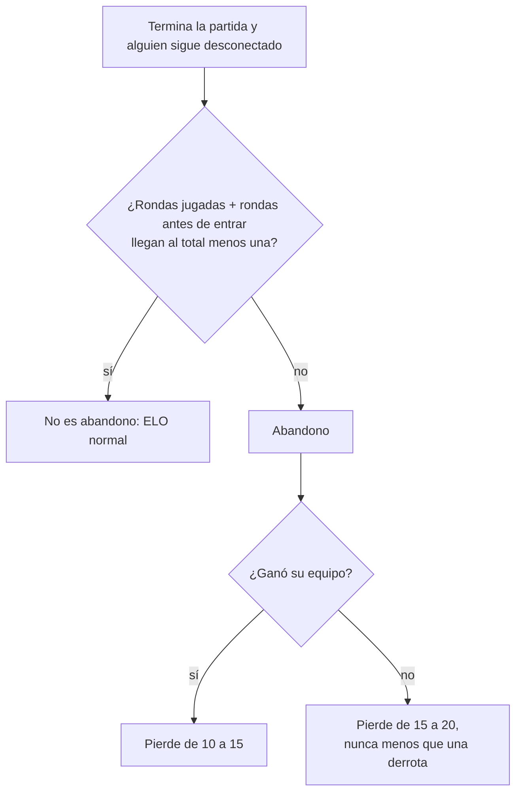

# Abandono del reemplazo y ELO de quien abandona si su equipo gana: documentación

## Qué hace

Corrige tres cuentas del abandono en el matchmaking. Salió de la partida de Tuscan del 2026-11-25 (8-16), donde Artemis entró de reemplazo en la ronda 16, jugó hasta la 23, se fue en la última y perdió 18 de ELO, con sanción.

## Las tres reglas

| Regla | Antes | Ahora |
|---|---|---|
| Irse en la última ronda siendo reemplazo | Se comparaban sus rondas con el total de la partida: le contaba como abandono | Se suman las rondas de antes de que entrara |
| Reemplazo que abandona de verdad | Las rondas de antes de que entrara contaban como no jugadas, en su pérdida y en el ajuste de los equipos | No cuentan. La parte no jugada es `(total − antes de entrar − jugadas) / total` |
| Abandono con el equipo ganando | Se cobraba como derrota: `elo_apply_match` y `elo_recompute_player` le pasan siempre `p_res = 0` al que abandona, así que la regla de la `78` nunca se aplicó (11 casos desde el 2026-11-09, con −18 a −24) | De `abandon_win_min` a `abandon_win_max` (10 a 15), según el resultado real (`winner_side`) |

Lo demás no cambia: el abandono con derrota nunca cuesta menos que una derrota normal, y el que abandona cuenta con peso 1 en el promedio de su equipo.

## Desde cuándo

`mm_config.abandon_rules_from` guarda el momento en que se aplicó el replanteo. Las dos reglas del ELO valen para las partidas desde ahí. Las anteriores dan lo mismo si se recalcula el ELO: varias ya se compensaron a mano y se cobrarían dos veces. La columna no se edita desde la web. La regla de la última ronda actúa al guardar cada resultado, así que no toca partidas viejas.

## Base

| Objeto | Qué es |
|---|---|
| `mm_rounds_before(p_game, p_player)` | Rondas jugadas antes de que la ficha entrara de reemplazo (`joined_round − 1`; si falta, `left_round − 1`), o 0. Solo funciones internas |
| `mm_left_last_round` | Suma `mm_rounds_before` |
| `mm_elo_delta` | El resultado real y las rondas previas, dentro de la función |
| `mm_config.abandon_rules_from` | La fecha de corte |

Al estar dentro de `mm_elo_delta`, vale igual para `elo_apply_match`, `elo_recompute_player` y `my_elo_breakdown` (`142`), que no cambian.

## Lo que no cubre

- Quien juega desde el principio, se pierde una ronda en el medio y se va en la última: le siguen faltando dos, y cuenta como abandono.
- Los abandonos anteriores quedan como están. Artemis (+18) y 1GRIM (+40) los compensó Daniel a mano.

## Qué cambia para cada rol

| Rol | Qué cambia | Página del manual |
|---|---|---|
| Jugador | Si entra de reemplazo, irse en la última ronda no es abandono, y si abandona antes solo cuenta desde que entró. Si abandona y su equipo gana, pierde de 10 a 15 | `jugador/buscar-partida.md` y `jugador/elo-y-estadisticas.md` |
| Admin | Nada que configurar: los topes de siempre ahora se aplican | `admin/matchmaking.md` |
| Los demás | Nada | — |

## Términos y privacidad

Sin cambios: los términos ya decían que irse en la última ronda no es abandono y que se pierde menos si tu equipo gana. No se guarda ni se publica ningún dato nuevo.

## Dónde está cada cosa

| Qué | Archivo / ubicación |
|---|---|
| Base | `supabase/replanteo/145_mm_abandono_reemplazo.sql` |
| Inversa | `docs/bitacora/2026-10-14-replanteo-modelo-datos/reversas/145_mm_abandono_reemplazo.sql` |
| Pruebas | `pruebas/probar_145.sh` y `prueba_145.sql` |
| Tipos | `web/backend/src/db/types.ts` |
| Changelog | `CHANGELOG_DISCORD.txt` (2.9.73) |
