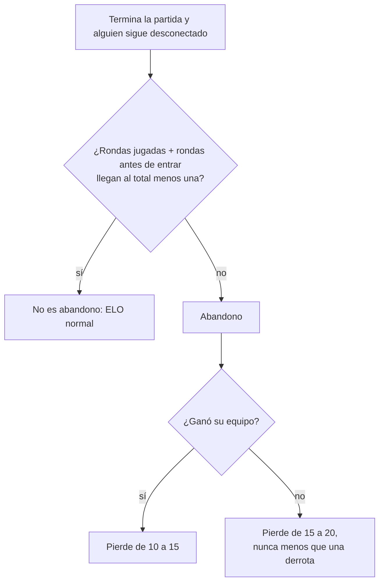

# Plan: abandono del reemplazo y ELO de quien abandona si su equipo gana

> Planeación original. Estado: **aprobada** por Daniel (2026-11-25).

## Decisiones tomadas

| Tema | Decisión |
|---|---|
| Origen | Daniel preguntó por qué Artemis perdió 18 de ELO con 8 rondas de 24 en la partida de Tuscan del 2026-11-25 (`a38ff23f-8987-4955-ae3f-6752aaeb341d`) |
| Última ronda | A un reemplazo se le cuentan, además de las rondas que jugó, las de antes de que entrara. Con eso, irse en la última ronda deja de ser abandono también para él |
| Abandono de un reemplazo | Si abandona de verdad, las rondas de antes de que entrara no cuentan como no jugadas, ni en su pérdida ni en el ajuste de los equipos |
| Abandono con victoria | Se aplica la regla del replanteo `78` (de 10 a 15), que hasta hoy nunca se usó |
| Partidas anteriores | No cambian. Varias ya se compensaron a mano (Artemis, 1GRIM y otros) y un recálculo del ELO las cobraría dos veces. Los puntos 2 y 3 rigen desde una fecha guardada en la base, como `min_delta_from` y `formula_from` |
| Compensaciones | Las hizo Daniel a mano (Artemis +18, 1GRIM +40). Este requerimiento no toca el ELO de nadie |

## 1. El flujo completo

## 2. Base (replanteo `145`)

- `mm_rounds_before(juego, ficha)`: las rondas jugadas antes de que la ficha entrara de reemplazo (`joined_round - 1`; si falta, `left_round - 1`), o 0.
- `mm_left_last_round`: suma `mm_rounds_before`.
- `mm_config.abandon_rules_from`: la fecha desde la que rigen las reglas nuevas del ELO. Se llena al aplicar el replanteo.
- `mm_elo_delta`: para una partida desde esa fecha, el que abandona usa el resultado real de su equipo (`winner_side`), porque quienes la llaman le pasan siempre "perdió"; y la parte no jugada descuenta `mm_rounds_before`.

Se arregla dentro de `mm_elo_delta` y no en quienes la llaman: así valen para `elo_apply_match`, `elo_recompute_player` y `my_elo_breakdown` (replanteo `142`, sin desplegar) sin tocarlas.

## 3. Web

Solo el manual. La API no cambia.

## 4. Requisitos antes de empezar

Acceso a la base del VPS para desplegar.

## 5. Orden de implementación

1. Replanteo `145`, su inversa y las pruebas con rollback en la base local.
2. Manual y bitácora.
3. Con permiso de Daniel: respaldo y replanteo en producción, sin mixes en vivo.
