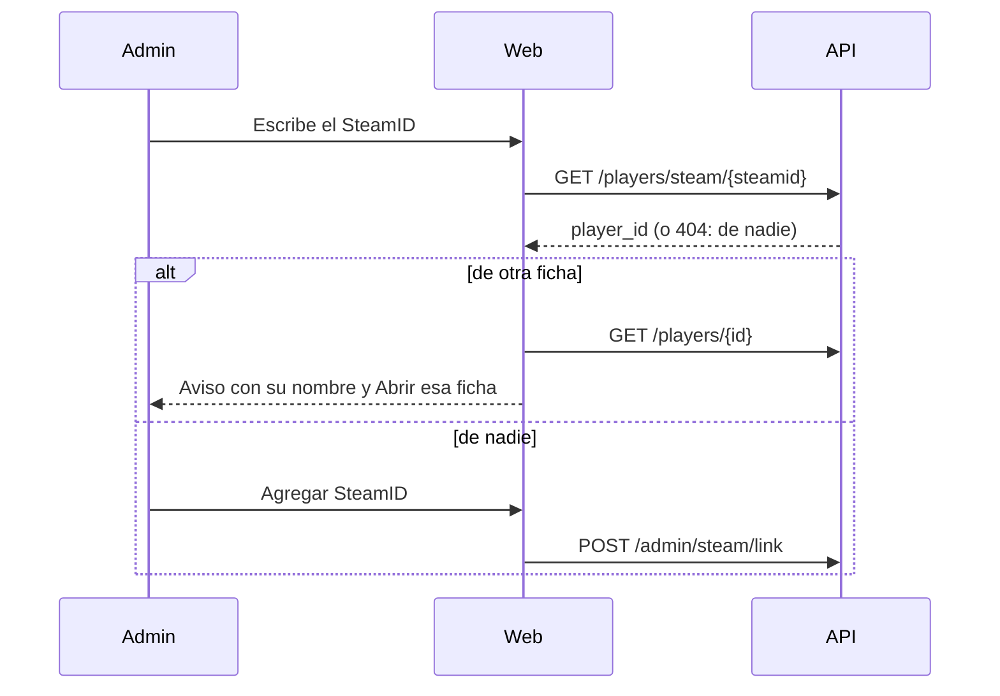

# Agregar un SteamID a mano desde la ficha

## Qué se hizo

En Administración › Jugadores › Fichas, la sección **SteamID** del detalle tiene un botón nuevo, **Agregar SteamID**. Se escribe el SteamID (`STEAM_0:X:Y`, SteamID64 o el link `/profiles/` del perfil) y, antes de confirmar, la web dice de quién es:

- **De nadie:** se agrega. Queda como principal si la ficha no tenía, o como adicional (hasta 4).
- **De otra ficha:** aviso con el nombre de esa ficha y el botón **Abrir esa ficha**. No deja agregarlo.
- **De esta ficha:** lo dice y no deja confirmar.

## Por qué

El 2026-11-25, gttt. no podía vincular `STEAM_0:0:637057701` con `!claim` ("Ese SteamID es de otra ficha"). Estaba en una tercera ficha sin cuenta, "hyd @ it's gtt.", y la web no dejaba ni escribir un SteamID ni ver de quién era. Se pasó por SQL en el VPS (`steam_detach` y `steam_attach` del replanteo `21`).

## Piezas

| Pieza | Cambio |
|---|---|
| `src/lib/steam.ts` | `steam64()` también acepta el link del perfil y espacios alrededor. Lo usa además el buscador del diálogo de baneo |
| `features/admin/players/api/queries.ts` | `steamOwnerOptions()`: de qué ficha es un SteamID (`GET /players/steam/{steamid}`; 404 = de ninguna) |
| `features/admin/players/components/FichasTab.tsx` | `AddSteamDialog` y el botón en `SteamIds` |
| API y base | Sin cambios. `link_steam_id` sigue rechazando el de otra ficha por si dos admins lo hacen a la vez |

## Qué cambia para cada rol

| Rol | Cambio |
|---|---|
| Admin | Puede agregar un SteamID escrito a mano a una ficha y ve en qué ficha está si ya es de otra. Manual: `admin/usuarios-y-fichas.md` (sección "Agregar un SteamID a mano") |
| Demás roles | Sin cambios |

## Términos y privacidad

Sin cambios: no se guarda ni se publica ningún dato nuevo.
