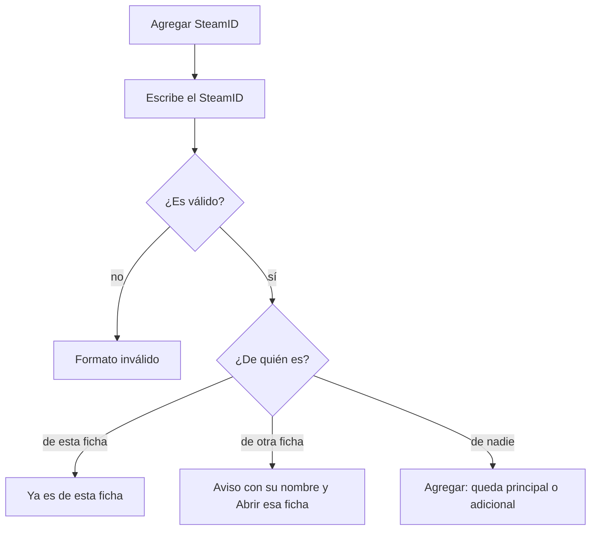

# Plan: agregar un SteamID a mano desde la ficha

> Planeación original. Estado: **pedido por Daniel** el 2026-11-25.

## Por qué

El 2026-11-25, gttt. no pudo vincular `STEAM_0:0:637057701` con `!claim`: le salía "Ese SteamID es de otra ficha". Estaba como principal en una tercera ficha sin cuenta ("hyd @ it's gtt."), no en la que Daniel había limpiado. En Administración › Jugadores, la ficha solo tenía "Sumar uno sin vincular", que lista los SteamID sin ficha. Ese no aparecía y no había forma de escribirlo a mano. Se resolvió por SQL en el VPS.

## Decisiones tomadas

| Tema | Decisión |
|---|---|
| Dónde | En la sección **SteamID** del detalle de la ficha, botón **Agregar SteamID** al lado de "Sumar uno sin vincular". Solo si la ficha tiene menos de 4 |
| Qué se escribe | `STEAM_0:X:Y`, SteamID64 o el link del perfil de Steam (`/profiles/<SteamID64>`) |
| Aviso si es de otra ficha | Antes de confirmar, la web pregunta de quién es. Si es de otra ficha, muestra su nombre y un botón **Abrir esa ficha**, y no deja agregarlo. Para pasarlo, se quita allá y se agrega acá |
| Si ya es de esta ficha | Lo dice y no deja confirmar |
| API y base | Sin cambios. `POST /admin/steam/link` (`link_steam_id`) ya vincula y rechaza el de otra ficha; `GET /players/steam/{steamid}` ya dice de qué ficha es |
| Mover en un paso | No por ahora: quitar y agregar son dos acciones que ya existen, y la web lleva a la otra ficha |

## 1. El flujo

## 2. Cambios

- Web: `steamFromInput()` en `src/lib/steam.ts` (con prueba) y el diálogo en `FichasTab.tsx`.
- Manual: `admin/usuarios-y-fichas.md`.

## 3. Orden de implementación

1. Helper y su prueba.
2. Diálogo y su prueba.
3. Manual y bitácora.
