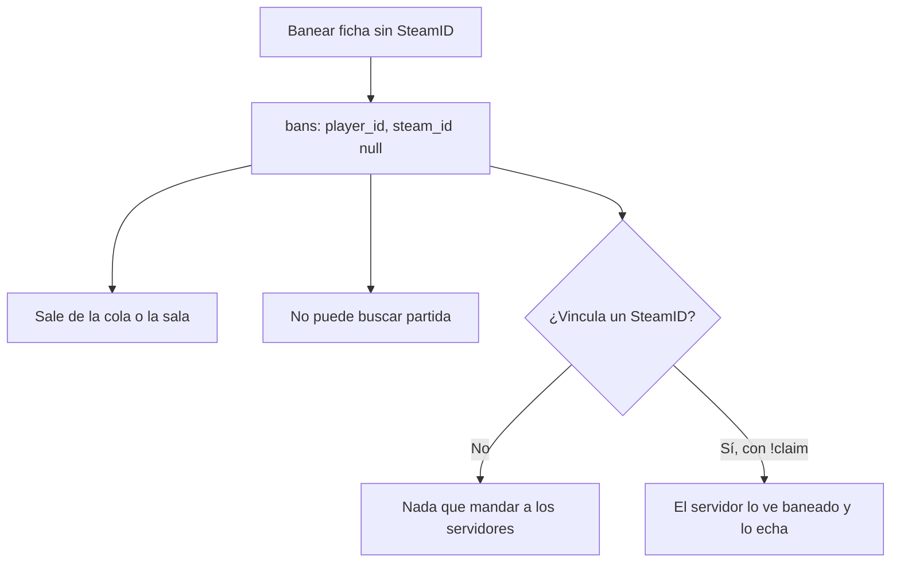

# Banear una ficha sin SteamID: documentación

## Qué hace

Un moderador, un admin o el soporte pueden banear una ficha que todavía no tiene SteamID vinculado. Antes la base lo rechazaba ("La ficha no tiene SteamID: no se puede banear en los servidores") y el buscador de **Banear** escondía esas fichas.

Desde los replanteos 49 y 52, el matchmaking le crea la ficha a quien no la tiene y el SteamID se vincula con `!claim` en el servidor de la primera sala. Así que una ficha sin SteamID puede buscar partida, y el baneo es lo que la saca y no la deja volver.

El baneo de una ficha sin SteamID:

- **En el matchmaking:** vale en el acto. La saca de la cola o de la sala (`mm_ban_kick`) y no la deja entrar (`mm_block_reason`, "Tenés un baneo activo en los servidores").
- **En los servidores:** no hay SteamID que echar. Si la ficha vincula uno (con `!claim`), el servidor la ve baneada al conectarse (`csstv_ban_check`) y la sincronización (`csstv_bans_since`) le manda el SteamID nuevo.

## La tabla `bans`

| Columna / regla | Antes | Ahora (replanteo 147) |
|---|---|---|
| `steam_id` | Obligatorio | Opcional: `null` en el baneo de una ficha sin SteamID. Es el SteamID que tenía al banearla; los que sume después los alcanza por la ficha |
| `bans_steam_id_check` | `is_steam64(steam_id)` | `steam_id is null or is_steam64(steam_id)` |
| `bans_destino` | — | Tiene que haber ficha o SteamID |

## Funciones de la base

| Función | Qué cambia |
|---|---|
| `ban_active_target(ficha, SteamID)` | Nueva. Los baneos activos de la ficha o del SteamID (`ban_active_for` solo busca por SteamID) |
| `ban_insert` | Acepta la ficha sin SteamID. El candado, el "ya tiene un permanente" y el reemplazo del baneo anterior usan `ban_active_target` |
| `ban_support_count(ficha, SteamID)` | Nueva firma: cuenta los baneos de soporte también por la ficha. La de un parámetro queda, sin uso |
| `ban_support_quota`, `ban_create` | Los límites del soporte (cupo y "ya está baneado") valen también sin SteamID; antes se salteaban |
| `ban_steams` | Sin el `null` de una ficha sin SteamID |
| `csstv_bans_since` | No manda filas sin SteamID y suma los baneos activos de las fichas que vincularon su SteamID principal después del cursor (`players.steam_added_at`; antes solo miraba los secundarios) |

Sin cambios: `mm_block_reason`, `mm_user_banned` y `mm_ban_kick` (ya miraban `bans.player_id`), `ban_list` y la API, que ya admitían `steam_id` nulo. Una fusión de la ficha vacía con una vieja (`player_merge_empty`, al hacer `!claim`) pasa el baneo a la ficha que queda.

## Web

En Administración › Baneos › **Banear**, el buscador muestra todas las fichas. Las que no tienen SteamID dicen "Ficha sin SteamID: no puede buscar partida y, cuando vincule uno, tampoco entrar a los servidores". Desde Usuarios › una cuenta › **Banear** ahora funciona aunque la ficha no tenga SteamID.

Las cuentas que todavía no tienen ficha (nunca buscaron partida) siguen sin poder banearse: no tienen nada que banear y la ficha se les crea al entrar a la cola.

## Qué cambia para cada rol

| Rol | Qué cambia | Página del manual |
|---|---|---|
| Moderador | Puede banear una ficha sin SteamID | `moderador/banear-jugador.md` |
| Admin | Lo mismo (usa la página del moderador) | `moderador/banear-jugador.md` |
| Soporte | Lo mismo, con sus límites | `soporte/banear-jugador.md` |
| Jugador | Si lo banean antes de vincular un SteamID, no puede buscar partida | Sin cambios (`jugador/buscar-partida.md` ya dice que la web avisa del baneo) |

## Términos y privacidad

- `/terminos` y `terms/terminos.html`: "Un baneo alcanza a tu ficha, aunque todavía no tenga SteamID, y a todos sus SteamID, también a los que sumes después".
- `/privacidad`: sin cambios (no se guarda ni se publica ningún dato nuevo).

## Dónde está cada cosa

| Qué | Archivo / ubicación |
|---|---|
| Replanteo | `supabase/replanteo/147_baneo_ficha_sin_steamid.sql` |
| Inversa | `docs/bitacora/2026-10-14-replanteo-modelo-datos/reversas/147_baneo_ficha_sin_steamid.sql` |
| Prueba | `pruebas/prueba_147.sql` |
| Buscador del diálogo | `web/frontend/src/features/admin/bans/components/BanDialog.tsx` |
| Descripción de la API | `web/backend/src/schemas/bans.ts` (`BanCreate.player_id`, `Ban.steam_id`) |
