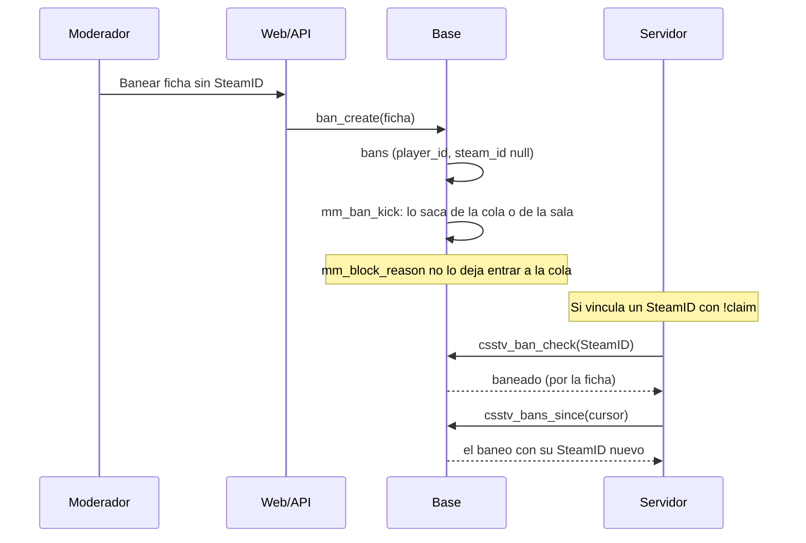

# Plan: banear una ficha sin SteamID

> Planeación original. Estado: **propuesta**, pendiente de aprobación.

Daniel (2026-11-25): "No le puedo dar un ban al jugador aura67 y creo que es porque no han vinculado ninguna SteamID. Debería poder banearlo incluso si no tiene SteamID vinculada, porque así evito que entren a matchmaking".

Hoy no se puede por dos lados:

- **La base:** `ban_insert` (replanteo 31) corta con "La ficha no tiene SteamID: no se puede banear en los servidores", y `bans.steam_id` es `not null`. Toda la tabla se pensó para los servidores, que solo conocen SteamID.
- **La web:** el buscador de **Banear** en Administración › Baneos esconde las fichas sin SteamID (`.filter((p) => p.has_steam)`). Desde Usuarios › cuenta › **Banear** el botón aparece, pero la base devuelve el error.

Desde el replanteo 52 el matchmaking le crea la ficha a quien no la tiene y desde el 49 el SteamID se vincula con `!claim` en el servidor de la primera sala, así que una ficha sin SteamID puede entrar a la cola.

## Decisiones tomadas

| Tema | Decisión | Por qué |
|---|---|---|
| Qué se banea | La ficha, aunque no tenga SteamID. `bans.steam_id` pasa a ser opcional; tiene que haber ficha o SteamID | Es lo que pide Daniel; el baneo de ficha ya valía "para los SteamID que sume después" |
| Matchmaking | No cambia nada: `mm_block_reason`, `mm_user_banned` y `mm_ban_kick` ya miran `bans.player_id` | Lo sacan de la cola y no lo dejan entrar |
| Servidores | Cuando la ficha vincula su primer SteamID (con `!claim`), el baneo le llega al servidor: `ban_active_for` ya lo encuentra por la ficha, y `csstv_bans_since` suma las fichas cuyo SteamID principal se vinculó después del cursor (hoy solo mira los secundarios) | Que no pueda jugar en el servidor apenas vincula |
| Sincronización | `csstv_bans_since` no manda filas sin SteamID | El plugin no puede hacer nada con ellas |
| Reemplazo y permanentes | `ban_insert` busca los baneos activos de la ficha también por `player_id` (función nueva `ban_active_target`), así un baneo nuevo reemplaza al anterior y un moderador no pisa uno permanente | Con `ban_active_for(null)` no encontraría ninguno |
| Soporte | `ban_create` y `ban_support_quota` cuentan los baneos de soporte y el baneo activo por la ficha cuando no hay SteamID | Hoy se saltean los límites si no hay SteamID |
| Cuentas sin ficha | Fuera de este plan. No tienen ficha que banear; la ficha se crea al entrar a la cola por primera vez y desde ahí ya se puede banear | Más cambio (otro tipo de destino en la API y la web) para un caso que hoy no aparece en el buscador |
| Ficha borrada | `check (player_id is not null or steam_id is not null)`: no queda un baneo que no alcanza a nadie | Hoy no hay forma de borrar fichas desde la web; las fusiones (`player_merge_empty`) mueven el baneo a la ficha que queda |

## 1. El flujo completo

## 2. Base de datos: replanteo `147_baneo_ficha_sin_steamid.sql`

- `bans.steam_id` sin `not null`, con `check (player_id is not null or steam_id is not null)`.
- `ban_active_target(p_player, p_steam)`: baneos activos de la ficha (por `ban_owner`) o del SteamID.
- `ban_insert`: acepta la ficha sin SteamID; el candado, el permanente y el reemplazo usan `ban_active_target`.
- `ban_support_count(p_player, p_steam)` nueva firma (la vieja de un parámetro queda y llama a la nueva) y `ban_support_quota`/`ban_create` la usan aunque no haya SteamID.
- `ban_steams` sin el `null`; `csstv_bans_since` filtra los `null` y suma `players.steam_added_at > cursor`.
- `ban_list` sin cambios (ya admite `steam_id` nulo).
- Inversa en `docs/bitacora/2026-10-14-replanteo-modelo-datos/reversas/147_baneo_ficha_sin_steamid.sql` (aborta si hay baneos sin SteamID).

## 3. API

Solo la descripción de `player_id` en `BanCreate` ("Necesita SteamID" sale) y el `openapi` regenerado.

## 4. Web

- `BanDialog`: el buscador muestra todas las fichas; las que no tienen SteamID dicen "Ficha sin SteamID: no puede buscar partida; el baneo le llega a los servidores cuando vincule uno".
- Textos del detalle (`BanPanel`) para un baneo de ficha sin SteamID.

## 5. Manual, términos y privacidad

- `moderador/banear-jugador.md` y `soporte/banear-jugador.md`: se puede banear una ficha sin SteamID.
- `/terminos` y `terms/terminos.html`: "Un baneo alcanza a tu ficha, aunque todavía no tenga SteamID, y a todos sus SteamID…". `/privacidad`: sin cambios (no se guarda ningún dato nuevo).

## 6. Requisitos antes de empezar

- Túnel a la base de producción para aplicar la `147` (lo aplica Daniel o se aplica con su confirmación).
- Web y API desplegadas después de la base.

## 7. Orden de implementación

1. Replanteo `147` y su inversa; fila en `supabase/replanteo/README.md`.
2. Probarlo en la copia local (`begin … rollback` con una ficha sin SteamID).
3. API (descripción) y web (`BanDialog`, `BanPanel`).
4. Manual y términos.
5. `DOCUMENTACION.md`, `GUIA_IMPLEMENTACION.md` y fila en `docs/bitacora/README.md`.
6. Aplicar en producción y desplegar la web (con confirmación de Daniel).
