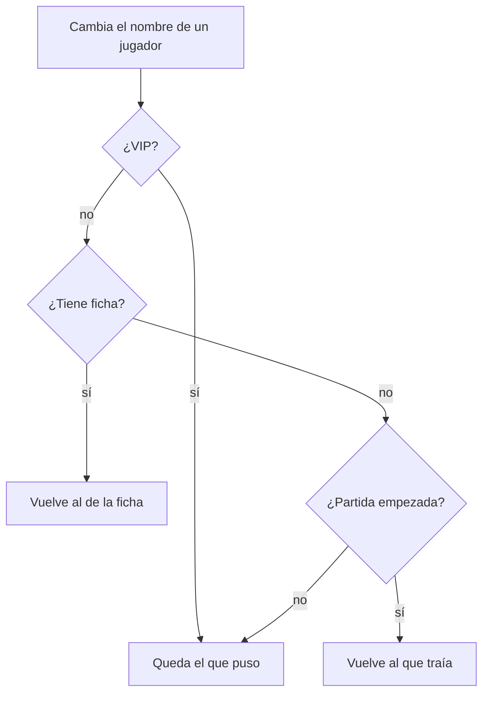

# El nombre de los jugadores, en un solo plugin: documentación

## Qué hace

El reporter pasa a ser el único plugin nuestro que toca los nombres. Antes `csstv_qol` bloqueaba los cambios con la partida empezada, y al llegar el nick de la ficha en vivo los dos se peleaban sin fin. Además, el nick se limpia antes de ponerlo en el juego. Es el paso previo al replanteo `134`, que prende el nombre de la web.

## Las reglas

| Jugador | En el calentamiento | Cuchillo, LO3, en vivo y medio tiempo |
|---|---|---|
| Con ficha pública | El nick de la ficha; si se lo cambia, vuelve | Igual |
| VIP | El que quiera | El que quiera (antes `csstv_qol` lo bloqueaba) |
| Sin ficha, ficha privada o la web no responde | El que quiera | El que traía |

- `csstv_web_names` y `csstv_lock_names` (1 por defecto) apagan cada parte. `csstv_lock_names` reemplaza a `csstv_qol_lock_names`.
- Si el motor le pone `(1)` por estar repetido, se acepta.
- Como mucho 5 reposiciones cada 10 s por jugador. Pasado el tope se anota en el log y se espera 10 s: así otro plugin que toque los nombres no arma un bucle.

## Los caracteres raros (`WebNick_Clean`)

La web acepta alias de 2 a 24 caracteres, casi cualquiera (`alias_check` solo rechaza `<`, `>` y los de control). El juego guarda **31 bytes**: una letra común ocupa 1, una acentuada 2, la mayoría de los símbolos 3 y un emoji 4.

| Qué trae el alias | En el juego |
|---|---|
| Letras, números, acentos, ñ, ™, símbolos comunes, otros alfabetos | Igual |
| Emojis y letras "decoradas" (4 bytes) | Se sacan |
| Invisibles, dirección del texto, marcas apiladas | Se sacan |
| `%` y `~`, `#` al principio | Se sacan: el motor los saca solo |
| `&` al principio o antes de `#`, espacio duro | Se sacan o pasan a espacio: el anticheat (`kacr_client_nameprotect 1`) podría echar al jugador |
| `"`, `\`, `{`, `}` | Pasan a `'`, `/`, `(`, `)` |
| Espacios de más | Uno solo, y ninguno en las puntas |
| Más de 31 bytes | Se corta sin partir un carácter |
| Quedan menos de 2 caracteres | Sigue con su nombre, y se anota en el log |

El alias de la web no cambia. De 163 fichas públicas con SteamID (2026-11-25), 12 tienen algo fuera de lo común y solo dos se ven distintas en el juego: `🌷͙֒ Artemis ഒ˚₊🎀` queda `Artemis ഒ˚₊`, y `"colapinto peek"` queda `'colapinto peek'`. Ninguna pasa los 31 bytes.

## Qué cambia para cada rol

| Rol | Qué cambia | Página del manual |
|---|---|---|
| Todos | Nada hasta aplicar la `134`. El manual y los legales van con ella | — |

## Términos y privacidad

Sin cambios acá. Con la `134` hay que sumar el nombre de la ficha en los servidores.

## Dónde está cada cosa

| Qué | Archivo |
|---|---|
| Los nombres | `server/addons/sourcemod/scripting/csstv/webnick.inc` (reporter 2.10.3) |
| Sin el bloqueo | `server/addons/sourcemod/scripting/csstv_qol.sp` (1.6.0, sobre la 1.5.0) |
| Configuración | `server/cfg/sourcemod/csstv_reporter.cfg` y `csstv_qol.cfg` |
| Pruebas | `pruebas/probar_local.sh` y `pruebas/nombres.py` |
