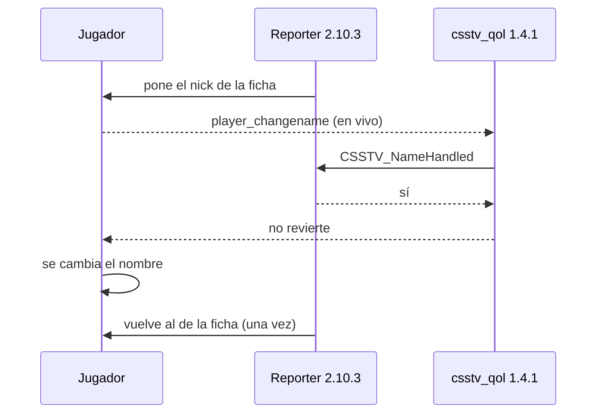

# Plan: el nombre de la web sin choque con csstv_qol

> Planeación original. Estado: **aprobada** por Daniel (2026-11-25), pasos 1 a 3. El despliegue se confirma aparte.

## Decisiones tomadas

| Tema | Decisión |
|---|---|
| Problema | Si el nick de la ficha llega con la partida en vivo, el reporter lo pone y `csstv_qol` 1.4.0 lo revierte, sin fin (66 cambios de nombre por segundo en el servidor local). Por eso no se aplicó la `134` |
| Reporter | **2.10.3**, sobre la 2.10.2 de los servidores: native `CSSTV_NameHandled(client)`, verdadera si el jugador tiene nick de la ficha o es VIP |
| `csstv_qol` | **1.4.1**, la que estaba sin commit (`archivo/reporter-2.11.0`): en vivo no revierte a quien maneja el reporter |
| VIP | Se puede cambiar el nombre también en vivo. La 1.4.0 se lo bloqueaba, contra la regla del 2026-11-22 |
| Sin ficha o privada | Como hoy: en vivo no se cambia el nombre |
| Protección general | Si el motor deja otro nombre que el pedido (repetido, por ejemplo), se acepta ese. Y como mucho 5 reposiciones cada 10 s por jugador; después espera |
| Lo demás del 2.11.0 | No va: `names.inc` hace lo mismo que `webnick.inc` |

## 1. El flujo completo

## 2. Pruebas (servidor local, con los plugins del #1, bots y `csstv_send 0`)

1. La versión de hoy entra en bucle (control).
2. La nueva: el nick llega en vivo, en el cuchillo y en el calentamiento.
3. Cambios de nombre en vivo: con ficha, VIP y sin ficha.
4. Nombre repetido y nombres raros (`%`, `#`, emojis, muy largos).
5. Reporter 2.10.3 con `csstv_qol` 1.4.0: la protección general frena el bucle.

## 3. Orden

1. Código, pruebas y bitácora.
2. Con permiso de Daniel: los dos `.smx` a #1, #2 y #3 (cargan en el próximo cambio de mapa), y después la `134`, el manual y los legales.
