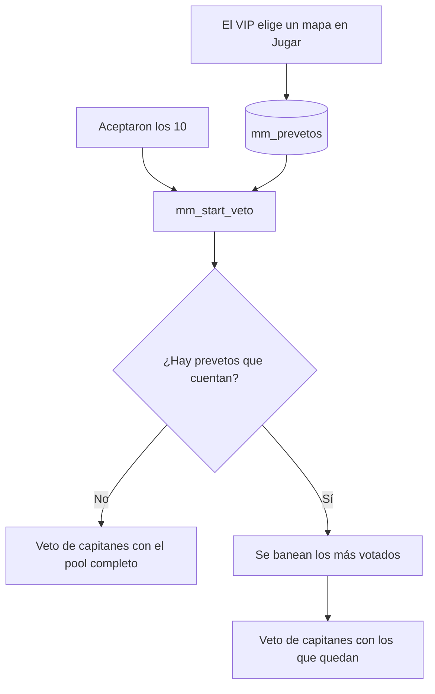

# Preveto de mapas para VIP: documentación

## Qué hace

Cada VIP elige en Jugar un mapa del pool activo del matchmaking. Cuando aceptaron los 10 y empieza el veto, la base cuenta los prevetos de los VIP vigentes de la sala y banea los mapas más votados, hasta el máximo configurado. Después, los capitanes vetan como siempre con los que quedan.

El máximo se cambia en Administración › Matchmaking › General. Empieza en 2; en 0 la función está apagada.

## Reglas

| Tema | Regla |
|---|---|
| Cuántos elige cada VIP | Un mapa por modo. Queda guardado hasta que lo cambie o lo saque |
| Qué mapas puede elegir | Los del pool del modo (`mm_mode_maps`) |
| Quién cuenta | Los VIP de los dos equipos, vigentes al empezar el veto |
| Cuáles caen | Los de más votos. Entre empatados, al azar. Un mapa sin votos no cae, así que pueden caer menos que el máximo |
| Cuántos caen | El menor entre el máximo configurado y el tamaño del pool menos 2: siempre quedan al menos 2 para los capitanes |
| Turnos | No gastan turno: empieza a banear el equipo con menor ELO promedio. Si cae una cantidad impar de mapas, cambia qué equipo hace el último baneo |
| VIP vencido | Su mapa queda guardado y no cuenta |
| Mapa fuera del pool | No cuenta hasta que vuelva |
| En 0 | Jugar no muestra la opción y no cae ningún mapa. Los elegidos quedan guardados |
| Quién votó | No se publica. La sala muestra cada mapa con sus votos |
| PCW y torneos | Sin cambios |

Con un solo VIP que haya votado en la sala, se puede deducir quién fue.

## Datos y funciones

| Qué | Para qué |
|---|---|
| `mm_config.vip_preveto_max` | El máximo, de 0 a 10. Lo cambia `mm_set_config` |
| `mm_prevetos (user_id, mode, map)` | El mapa de cada VIP. Sin lectura directa; se borra con la cuenta |
| `mm_set_preveto(modo, mapa)` | Elige (solo VIP, `42501` si no) o saca (mapa nulo, cualquiera) |
| `mm_preveto_slots(modo)` | Cuántos pueden caer en ese modo. Interna |
| `match_vetos.vip_votes` | Los votos del mapa prevetado. Nulo en los baneos del veto. Un preveto no lleva `side` ni `by_user` |
| `mm_start_veto` | Inserta los prevetos como los primeros baneos |
| `mm_lobby_json` | Cada baneo suma `vip_votes`; un preveto va con `team` nulo y `auto` falso |
| `mm_my_profile` | Suma `preveto`: nulo si está apagado; si no, `allowed` y, para los VIP, los modos con su máximo, el mapa elegido y el pool |
| `mm_set_mode_maps` | Emite `mm.config`, para que las opciones se actualicen solas |
| `manual_valores` | `mm.preveto_max` |

API: `PUT /api/v1/mm/preveto` con `{mode, map}` (`map: null` lo saca). Devuelve el estado completo.

## Qué cambia para cada rol

| Rol | Qué cambia | Página del manual |
|---|---|---|
| Jugador | Con VIP, elige un mapa a prevetar. Todos ven en la sala los mapas prevetados | `jugador/buscar-partida.md` |
| Capitán | Lo mismo que el jugador: en el veto de la sala del matchmaking hay menos mapas | `jugador/buscar-partida.md` |
| Admin | El máximo de mapas prevetados por partida | `admin/matchmaking.md` |
| Organizador, soporte, moderador, streamer y dueño de un servidor externo | Nada | — |

## Términos y privacidad

- Términos, sección VIP: se suma el preveto a las ventajas y un punto que dice cómo funciona y que influye en qué mapa se juega.
- Privacidad: el mapa elegido es una preferencia del matchmaking que se guarda, y la sala muestra los votos sin decir quién votó.

## Dónde está cada cosa

| Qué | Archivo / ubicación |
|---|---|
| Base | `supabase/replanteo/146_mm_preveto_vip.sql` |
| API | `web/backend/src/routes/mm.ts` |
| Selector de Jugar | `web/frontend/src/features/matchmaking/PrevetoPicker.tsx` |
| Veto y su historial | `VetoBoard.tsx` y `room/RoomOverview.tsx` |
| Configuración | `admin/GeneralForm.tsx`, en `/admin` › Matchmaking › General |
| Pruebas de la base | `pruebas/preveto_146.sql` |
