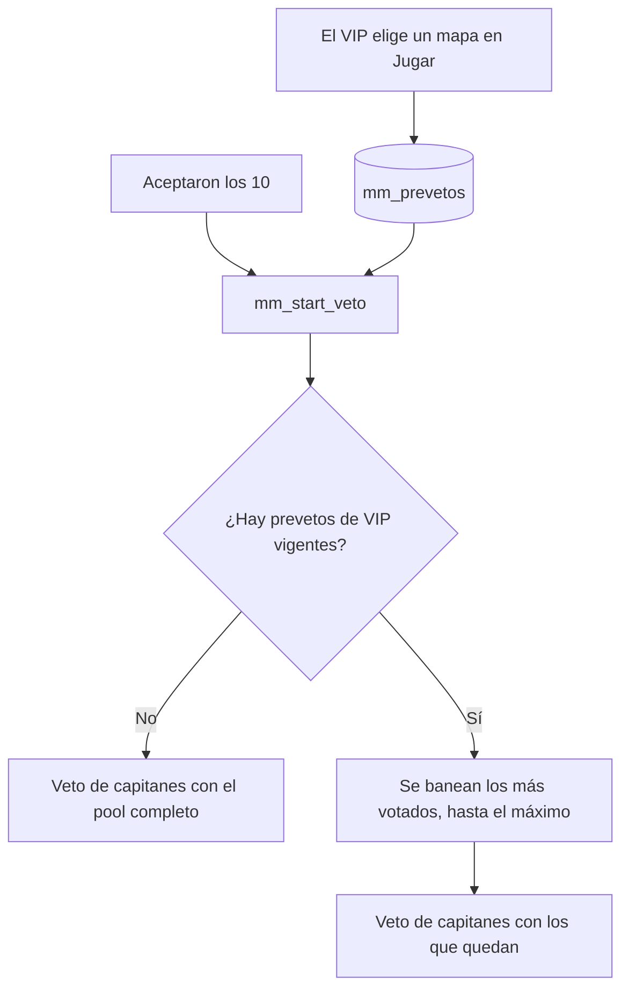

# Plan: preveto de mapas para VIP

> Planeación original. Estado: **aprobado** por Daniel (2026-11-25, en el pedido). Se implementa en `main`.

## Decisiones tomadas

| Tema | Decisión |
|---|---|
| Configuración | `mm_config.vip_preveto_max`: cuántos mapas se prevetan como máximo por partida. Empieza en 2 y va de 0 a 10. En 0 se apaga: los VIP no ven la opción y en la sala no se preveta nada (Daniel) |
| Qué elige el VIP | Un mapa (Daniel), **por modo**, porque cada modo tiene su pool. Queda guardado y vale para todas sus partidas hasta que lo cambie o lo saque |
| De dónde salen los mapas | Del pool activo del matchmaking de ese modo (`mm_mode_maps`, Administración › Matchmaking › Mapas) (Daniel). Si un admin saca el mapa del pool, el preveto no cuenta hasta que vuelva |
| Cuándo se cuentan | Al empezar el veto, cuando aceptaron todos. Cuentan los VIP de los dos equipos que estén vigentes en ese momento |
| Qué se banea | Los mapas con más prevetos, hasta el máximo. Entre empatados, al azar (Daniel). Un mapa sin prevetos nunca se preveta, así que pueden ser menos que el máximo |
| Cuántos mapas quedan | Siempre quedan al menos 2 para el veto de los capitanes, aunque el máximo sea mayor que el pool |
| Quién empieza después | Igual que hoy: el equipo con menor ELO promedio. Los prevetos no gastan turnos |
| Quién votó qué | No se muestra. La sala dice qué mapas cayeron por preveto y con cuántos votos |
| VIP vencido | Su mapa queda guardado pero no cuenta, como el autoaceptar |
| Dónde se elige | En Jugar, en la barra del costado, debajo del modo. Sin VIP se ve con candado y abre "Cómo ser VIP" |
| PCW y torneos | Sin cambios: solo el matchmaking |

## 1. El flujo completo

## 2. Base (replanteo 146)

- `mm_config.vip_preveto_max`, en `mm_set_config` y `manual_valores()`.
- Tabla `mm_prevetos (user_id, mode, map)`, sin lectura directa.
- `mm_set_preveto(modo, mapa)`: elegir exige VIP, la función encendida y que el mapa esté en el pool. Con mapa nulo lo saca (cualquiera).
- `match_vetos.vip_votes`: cuántos prevetos tuvo el mapa. Nulo en los baneos de siempre.
- `mm_start_veto` inserta los prevetos como los primeros baneos, sin bando.
- `mm_lobby_json` suma `vip_votes` a cada baneo, y `mm_my_profile` suma `preveto`.
- `mm_set_mode_maps` avisa con `mm.config`, para que las opciones se actualicen solas.

## 3. API

`PUT /api/v1/mm/preveto` con `{mode, map}`.

## 4. Web

Selector en Jugar, los prevetos marcados en el veto y en el historial de la sala, y el campo en Administración › Matchmaking › General.

## 5. Requisitos antes de empezar

Ninguno.

## 6. Orden de implementación

1. Replanteo 146, su inversa y la prueba en una base aparte.
2. API y web, con pruebas.
3. Manual, términos, privacidad y documentación.
