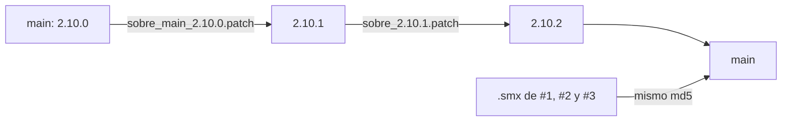

# Plan: el reporter de los servidores, en main

> Planeación original. Estado: **aprobada** por Daniel (2026-11-25).

## Decisiones tomadas

| Tema | Decisión |
|---|---|
| Pedido | Daniel (2026-11-25): llevar a `main` el reporter que corre en los servidores, "ya que ese es el que estamos usando" |
| Qué versión | La **2.10.2** de Kyan (`kyan/pruebas`, commit `7c0567ae`): la 2.10.0 de `main` más los parches de la 2.10.1 y la 2.10.2. No la 2.12.1 de esa rama, que trae la repetición 2D y no está en los servidores |
| Binario | El `.smx` exacto de #1, #2 y #3 (147137 bytes, md5 `c3862c08307a4e775a3e73a0f1022a7f`) |
| Servidores | No se toca ninguno: ya lo tienen |
| Manual | Cuchillo por vida y `!ready` automático, que funcionan hoy. El nombre de la web no, porque falta el replanteo `134` en producción |
| Reporter 2.11.0 sin commit (`2026-11-13-nombre-de-la-ficha-en-mix`) | Se guarda en una rama de archivo. Qué se hace con él se decide aparte |

## 1. El flujo completo

## 2. Orden

1. Aplicar los dos parches sobre `main` y verificar el código contra el binario.
2. Copiar las dos carpetas de la bitácora de Kyan, sin los `.smx`.
3. Manual, commit y push a `main`.
