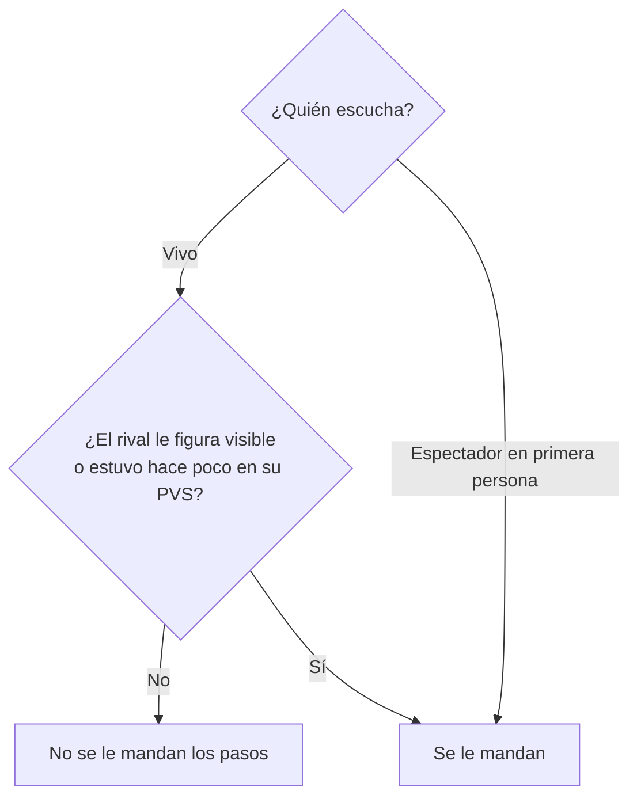

# Prueba sin `Anti_Wallhack_Lite`: documentación

## Qué hace

Desde el 2026-11-25, #1, #2 y #3 no cargan `Anti_Wallhack_Lite` (desde su próximo cambio de mapa). Queda sin ningún anti-wallhack del lado del servidor: el de KACR ya estaba apagado. El resto de KACR sigue.

## Por qué se sospecha de él

El vivo oye mal y los espectadores oyen bien (dato de los jugadores, 2026-11-25). Coincide con lo que hace el binario:

- Al **vivo** se le calcula la visibilidad de cada rival, y se le descartan los pasos como se explica en [`2026-11-25-sin-silencio-en-el-clutch`](../2026-11-25-sin-silencio-en-el-clutch/DOCUMENTACION.md).
- Al **espectador** solo le copia la visibilidad del jugador que mira si su `m_iObserverMode` es `4`. El plugin supone que 4 es la primera persona, pero en la v34 la primera persona es **3** y 4 es la de persecución (medido en [`2026-11-02-qol-tanda-4`](../2026-11-02-qol-tanda-4/)). Por eso el espectador en primera persona ve y oye a todos como visibles.

El silencio del clutch y `voice_overdrive` no explican esa diferencia: el primero es solo voz, y el segundo también afectaría a los espectadores, que oyen a los mismos muertos. Falta confirmarlo en el juego.

## Qué cambia para cada rol

Nada para los usuarios en los comandos ni en la web.

## Términos y privacidad

Sin cambios.

## Dónde está cada cosa

| Qué | Dónde |
|---|---|
| El plugin | `addons/sourcemod/plugins/disabled/Anti_Wallhack_Lite.smx` de cada servidor (md5 `373446f5…`) |
| Scripts | [`pruebas/`](pruebas/) |
