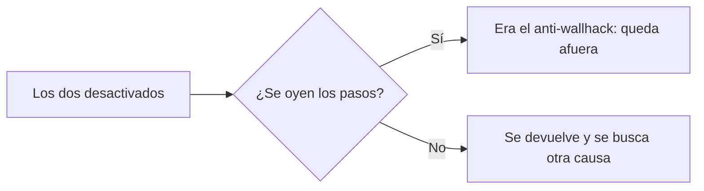

# Plan: prueba sin `Anti_Wallhack_Lite`

> Planeación original. Estado: **aprobada** (pedido de Daniel, 2026-11-25).

Los jugadores no oyen los pasos cuando quedan solos. Daniel pide desactivar `Anti_Wallhack_Lite` en los tres servidores, además del silencio del clutch ([`2026-11-25-sin-silencio-en-el-clutch`](../2026-11-25-sin-silencio-en-el-clutch/)), para ver qué pasa con los dos desactivados.

## Decisiones tomadas

| Tema | Decisión | Por qué |
|---|---|---|
| Cómo | Mover el `.smx` a `plugins/disabled/` en #1, #2 y #3, sin recargar | Es reversible y no corta una partida |
| KACR | `kacr_eyes_antiwall` sigue en `"0"` | Ocultaba jugadores igual ([`2026-10-22-anti-wallhack-y-humo`](../2026-10-22-anti-wallhack-y-humo/)) |
| Changelog | No | Avisaría que no hay anti-wallhack |

## 1. El flujo

## 2. Requisitos antes de empezar

`SFTP_CSS_API_KEY` del panel.

## 3. Orden de implementación

1. Mover el archivo en los tres y comprobarlo.
2. Después de un cambio de mapa, `sm plugins list`.
3. Uno o dos mixes y preguntar a los jugadores.
