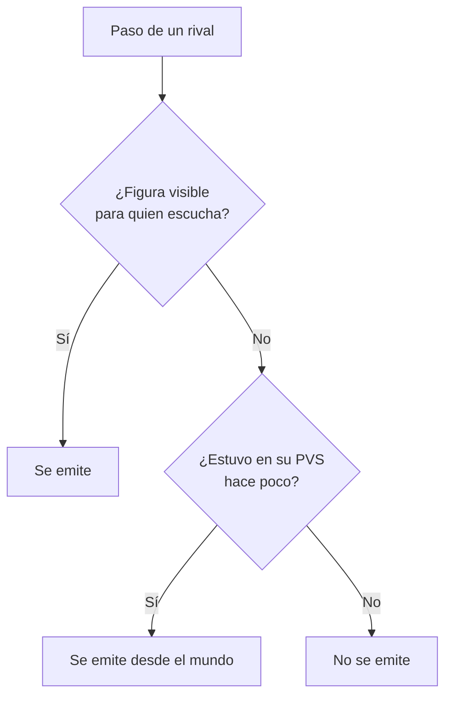

# Sin silencio en el clutch: documentación

## Qué hace

Desde `csstv_qol` **1.5.0** no existen el silencio del clutch, `!voz` ni `csstv_qol_clutch_mute`. Quien queda último vivo siempre escucha a sus compañeros muertos (`sm_deadtalk 2` en `live.cfg`). El aviso "1 vs N" y el silencio de los espectadores siguen igual.

## Los pasos que no se oyen: qué se encontró

**El silencio del clutch no lo explica.** Solo usaba `SetListenOverride`, que decide a quién se oye **por voz**; no toca los sonidos del juego. Además, desde la 1.4.0 (2026-11-10) estaba apagado salvo que el jugador escribiera `!voz`.

**`Anti_Wallhack_Lite` 1.3.0 sí descarta pasos.** Está en los tres servidores (md5 `373446f5…`). Se leyó el binario (`Hook_NormalSound` y `Hook_SetTransmit`); no se probó en el juego.

- Intercepta todos los sonidos de los jugadores, los bloquea y los vuelve a emitir él.
- En el canal de los pasos (`SNDCHAN_BODY`) solo se lo manda a un destinatario si el rival figura como visible, o si estuvo en su área visible (PVS) hace poco.
- "Visible" se recalcula solo mientras el rival está en el PVS. Si sale del PVS estando oculto, queda en "no visible", y vencido el plazo sus pasos no se mandan a ese jugador hasta que vuelva a entrar en su PVS.
- Los que sí reemite salen del mundo (entidad 0) y no del jugador. En el motor, dos sonidos de la misma entidad y canal se pueden cortar entre sí (esto es por cómo funciona el motor, no se midió).

El código no mira si el jugador quedó solo: es probable que ahí se note más porque no hay otros sonidos. Coincide con las quejas del 2026-10-18 y con que el 2026-11-02 ya se había sacado del #1 por "el error del sonido".

**Por qué el espectador oye bien y el vivo no:** ver [`2026-11-25-sin-anti-wallhack-prueba`](../2026-11-25-sin-anti-wallhack-prueba/DOCUMENTACION.md), donde se desactiva a prueba.

## Qué cambia para cada rol

| Rol | Qué cambia | Página del manual |
|---|---|---|
| Jugador | Ya no existe `!voz` | `jugador/comandos-en-el-servidor.md` |
| Capitán, organizador, moderador, admin, streamer, dueño de un servidor externo | Nada | — |

## Términos y privacidad

Sin cambios.

## Dónde está cada cosa

| Qué | Dónde |
|---|---|
| Código | `server/addons/sourcemod/scripting/csstv_qol.sp` |
| Configuración | `server/cfg/sourcemod/csstv_qol.cfg` |
| Anti-wallhack | `addons/sourcemod/plugins/Anti_Wallhack_Lite.smx` de cada servidor (de terceros, sin fuente) |
