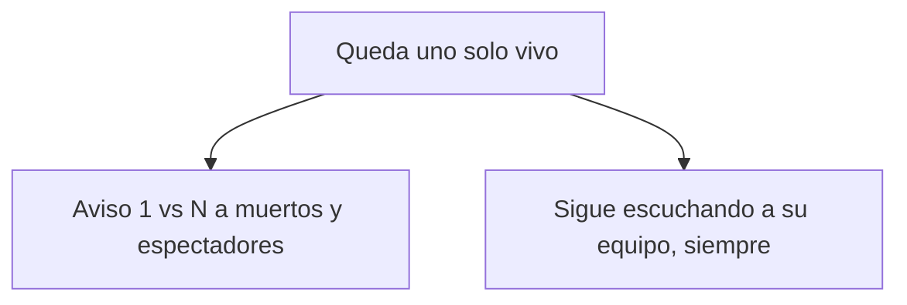

# Plan: sacar el silencio del clutch (`!voz`)

> Planeación original. Estado: **aprobada** (pedido de Daniel, 2026-11-25).

Pedido de Daniel (2026-11-25): varios jugadores reportan que no escuchan los pasos cuando quedan solos contra uno o más rivales. Sospecha del silencio de los compañeros al quedar solo; no lo considera útil y pide sacarlo de los servidores.

## Decisiones tomadas

| Tema | Decisión | Por qué |
|---|---|---|
| Silencio del clutch y `!voz` | Se sacan del código, no se apagan por cfg | Con `csstv_qol_clutch_mute "0"`, `!voz` seguiría respondiendo que silencia |
| El resto de `csstv_qol` | Igual, incluidos el aviso "1 vs N" y el silencio de los espectadores | El silencio del clutch es una parte del plugin, no un plugin aparte |
| Versión | `csstv_qol` 1.4.0 → **1.5.0**, armada sobre lo que corre en los servidores | El worktree tiene la 1.4.1 (nombres de la ficha), que no está desplegada y no tiene que salir con esto |
| `Anti_Wallhack_Lite` | No se toca | No se pidió; se informa lo encontrado y decide Daniel |

## 1. El flujo

## 2. Requisitos antes de empezar

`SFTP_CSS_API_KEY` del panel y `spcomp` 1.8 del servidor local.

## 3. Orden de implementación

1. Sacar el código y compilar.
2. Subir el `.smx` y el cfg a #1, #2 y #3, con respaldo y sin recargar.
3. Manual, bitácora, changelog y `PENDIENTES.md`.
