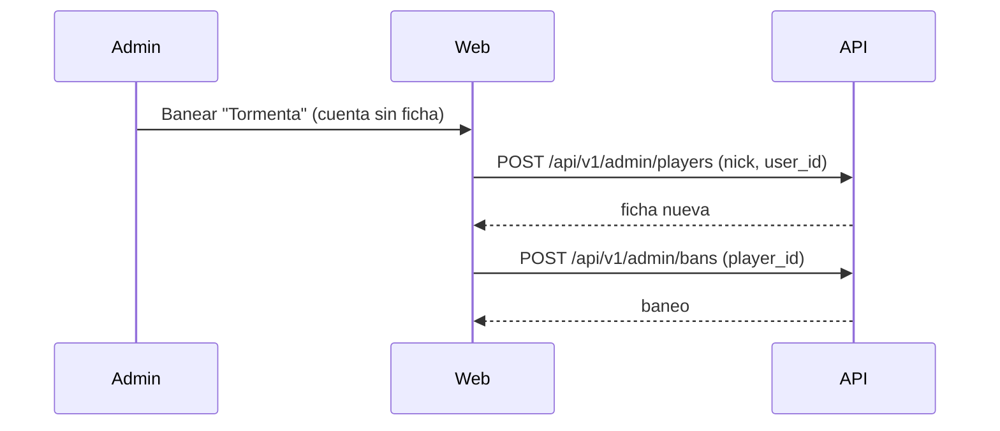

# Banear una cuenta sin ficha: documentación

## Qué hace

Un admin puede banear una cuenta que todavía no tiene ficha de jugador (nunca buscó partida). En **Banear**, al buscar, aparecen también las cuentas sin ficha; al elegir una, la web le crea la ficha con su alias y banea esa ficha. Desde ese momento, si la cuenta intenta buscar partida, ya está baneada. Lo mismo desde el panel de la cuenta, en Administración › Usuarios.

Además, el diálogo de baneo, la página de Baneos y el manual del moderador ya no dicen que el baneo echa del servidor: hoy saca del matchmaking, y en los servidores hay que usar `!ban` en cada uno.

## Qué cambia para cada rol

| Rol | Qué cambia | Página del manual |
|---|---|---|
| Admin | Puede banear cuentas sin ficha, desde Baneos o desde la cuenta | `admin/usuarios-y-fichas.md`, `moderador/banear-jugador.md` |
| Moderador | El texto del diálogo y del manual dice que el baneo no echa del servidor (usar `!ban` ahí) | `moderador/banear-jugador.md` |
| Los demás | Nada | — |

## Términos y privacidad

Sin cambios.

## Dónde está cada cosa

| Qué | Archivo |
|---|---|
| Diálogo | `web/frontend/src/features/admin/bans/components/BanDialog.tsx` (y su prueba) |
| Página de Baneos | `web/frontend/src/features/admin/bans/pages/AdminBansPage.tsx` |
| Panel de la cuenta | `web/frontend/src/features/admin/users/components/AccountsTab.tsx` |
