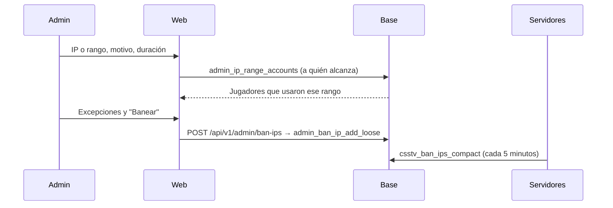

# Banear una IP o rango sin ficha desde la web: documentación

## Qué hace

Un admin banea una IP o un rango sin banear a ninguna ficha, desde la pestaña **IPs sin ficha** de Baneos (antes "IPs del servidor"), como hace `!banip` en el juego. Vale en la web (cola, aceptar, grupos y registro) y en los tres servidores, con las mismas excepciones que los demás baneos por IP.

## Reglas

- **Solo admins.**
- **Motivo obligatorio. Duración:** 1 hora, 1 día, 7 días o 30 días; la base acepta de 1 minuto a 30 días (Daniel: "con tope de 30 días"). Sin permanente.
- **Rangos** de hasta `/16` en IPv4 o `/32` en IPv6, guardados como su red.
- **Excepciones:** de entrada, marcadas para los que no están baneados.
- **La pestaña** muestra los de la web ("desde la web") y los `!banip` del juego ("en <servidor>"), para levantarlos o cambiar las excepciones.

## Datos y funciones (replanteo `152`)

| Qué | Para qué |
|---|---|
| `admin_ban_ip_add_loose(ip, motivo, minutos, fichas, cuentas)` | Guarda en `ban_ips` sin `ban_id`, con `source` `web`, y sus excepciones |

## Qué cambia para cada rol

| Rol | Qué cambia | Página del manual |
|---|---|---|
| Admin | **Banear IP o rango** en la pestaña **IPs sin ficha** | `moderador/banear-jugador.md`, `admin/comandos-en-el-servidor.md` (nombre de la pestaña) |
| Los demás | Nada | — |

## Términos y privacidad

Sin cambios: `/terminos` ya dice que un baneo por IP desde la web dura hasta 30 días.

## Dónde está cada cosa

| Qué | Archivo |
|---|---|
| Base | `supabase/replanteo/152_baneo_ip_sin_ficha_web.sql` (inversa en `docs/bitacora/2026-10-14-replanteo-modelo-datos/reversas/`) |
| API | `web/backend/src/routes/admin-ban-ips.ts` (`POST /api/v1/admin/ban-ips`) |
| Web | `web/frontend/src/features/admin/bans/components/ServerIpBansPanel.tsx` y `RangeExceptions.tsx` |
