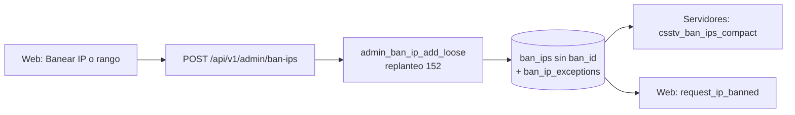

# Plan: banear una IP o rango desde la web sin banear una ficha

> Planeación original. Aprobado por Daniel el 2026-11-26.

Hasta ahora, en la web una IP o rango solo se podía banear atado al baneo de una ficha ([`2026-11-26-baneo-por-ip`](../2026-11-26-baneo-por-ip/)). En el juego, `!banip` ya banea una IP sola ([`2026-11-26-baneos-en-los-servidores`](../2026-11-26-baneos-en-los-servidores/), replanteo `151`). Daniel pidió poder hacerlo también desde la web: "agrégalo con tope de 30 días".

## Decisiones

| Tema | Decisión |
|---|---|
| Dónde | Pestaña de Baneos de los baneos por IP sin ficha (hoy "IPs del servidor", pasa a **IPs sin ficha**): botón **Banear IP o rango** |
| Quién | Solo admins |
| Datos | IP o rango (hasta `/16` en IPv4, `/32` en IPv6), motivo (obligatorio) y duración |
| Duración | **Como mucho 30 días** (Daniel). Sin permanente. Opciones: 1 hora, 1 día, 7 días, 30 días |
| Antes de confirmar | El mismo aviso de a quién alcanza, con **Exceptuar** marcado para los no baneados |
| Vale en | La web (cola, aceptar, grupos, registro) y los tres servidores (copia local del reporter 2.12.0, en 5 minutos como mucho) |

## Cambios

1. **Base (replanteo `152`):** `admin_ban_ip_add_loose(ip, motivo, minutos, fichas exceptuadas, cuentas exceptuadas)`, solo admin, minutos entre 1 y 43 200.
2. **API:** `POST /api/v1/admin/ban-ips`.
3. **Web:** formulario en la pestaña, reusando la lista de excepciones de **IPs y rangos**.
4. **Manual:** `moderador/banear-jugador.md`. **Legales:** sin cambios (ya dicen "desde la web, hasta 30 días").
