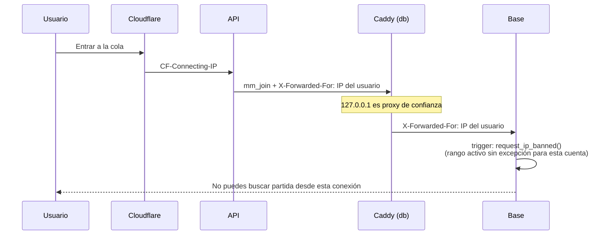

# Baneo por IP y por rango desde la web: documentación

## Qué hace

Un admin puede atar a un baneo de ficha IPs sueltas o rangos (`181.21.*.*`). Desde ahí nadie puede entrar a la cola del matchmaking, aceptar una partida, unirse a un grupo ni crear una cuenta por la web, aunque use otra cuenta. Cada IP o rango tiene **excepciones** por ficha o cuenta: esa persona sigue jugando desde ahí (por ejemplo, alguien que comparte proveedor con el cheater).

Para ver de dónde se conecta cada uno, la web guarda la IP de cada cuenta al iniciar sesión, al renovar la sesión y al entrar a la cola (90 días, solo admins). Junto con las IPs que ya registran los servidores, el admin ve las IPs de la ficha y quién más las usó.

## Reglas

- **Rangos:** de una IP suelta a `/16` en IPv4 (`x.y.*.*`) o `/32` en IPv6. Se guardan como su red (`181.21.162.7/24` → `181.21.162.0/24`).
- **Duración:** la del baneo, como mucho 30 días. Levantar el baneo levanta sus IPs.
- **Excepciones:** por ficha (vale también para su cuenta) o por cuenta sin ficha. Al banear un rango, la web propone exceptuar a los que no están baneados. La ficha baneada nunca queda exceptuada.
- **Qué frena:** triggers en `mm_queue` (entrar a la cola), `mm_party_members` (unirse a un grupo) y `mm_lobby_players` (aceptar), solo con un pedido de una persona (`auth.uid()`); el worker y los servidores no se frenan. El registro lo frena la API (`request_ip_banned`); sin sesión no hay excepción posible.
- **La IP real:** `request_ip()` lee el primer valor de `X-Forwarded-For` que llega a PostgREST. Caddy confía en `127.0.0.1` (la API) y en Cloudflare; las IPs privadas o de Docker dan null.
- **Límite:** con una VPN, los datos del celular o IPv6, la persona puede usar otra IP.

## Datos y funciones (replanteos `149` y `150`)

| Qué | Para qué |
|---|---|
| `account_ips` | IP de cada cuenta en la web, con primera y última vez y veces. 90 días. Solo admins |
| `ban_ips` | IPs y rangos de un baneo, con vencimiento |
| `ban_ip_exceptions` | Excepciones por ficha o cuenta |
| `request_ip()`, `ip_banned(ip)`, `ip_banned_for(ip, usuario)`, `request_ip_banned()` | La IP del pedido y si está baneada (con excepciones) |
| `account_ip_seen()` | Registra la IP de la cuenta (la llama la API) |
| `admin_ban_ip_candidates`, `admin_ip_range_accounts`, `admin_ban_ip_add`, `admin_ban_ips_set`, `admin_ban_ips`, `admin_ban_ip_lift`, `admin_ban_ip_exception_add`, `admin_ban_ip_exception_remove` | Administración |

## Qué cambia para cada rol

| Rol | Qué cambia | Página del manual |
|---|---|---|
| Admin | Sección **IPs y rangos** en el detalle de un baneo activo: IPs de la ficha, a quién afecta un rango, excepciones | `moderador/banear-jugador.md` |
| Jugador | Un baneo puede alcanzar su conexión; si comparte internet con un baneado, escribe por Discord | `jugador/baneos-y-sanciones.md` |
| Los demás | Nada | — |

## Términos y privacidad

- **`/privacidad`:** se guarda la IP con la que se usa la web (90 días, solo admins), para cuentas duplicadas y baneos por IP.
- **`/terminos`:** un baneo puede alcanzar una IP o un rango por hasta 30 días (cola, aceptar y crear cuentas).

## Dónde está cada cosa

| Qué | Archivo |
|---|---|
| Base | `supabase/replanteo/149_baneo_por_ip.sql`, `150_excepciones_baneo_ip.sql` (inversas en `docs/bitacora/2026-10-14-replanteo-modelo-datos/reversas/`) |
| Caddy | `deploy/vps/Caddyfile` (`trusted_proxies` y `client_ip_headers`) |
| API | `web/backend/src/routes/admin-ban-ips.ts`, `lib/supabase.ts` (`X-Forwarded-For`), `lib/ratelimit.ts` (`forwardedIp`), `routes/auth.ts`, `routes/mm.ts` |
| Web | `web/frontend/src/features/admin/bans/components/BanIpsSection.tsx` |
