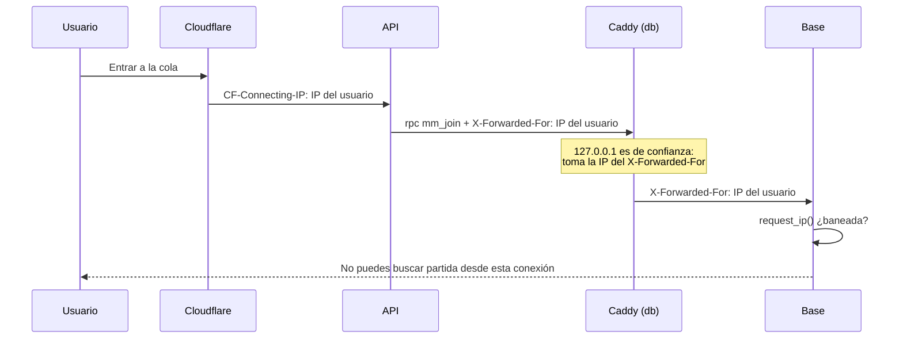

# Plan: baneo por IP desde la web

> Planeación original. Estado: **propuesta**, pendiente de aprobación.

Un cheater baneado se crea cuentas nuevas y vuelve a buscar partida. Pedido por Daniel el 2026-11-26: banear también su IP, para que desde su conexión no pueda buscar partida ni crear cuentas. Complementa [`2026-11-26-correos-bloqueados`](../2026-11-26-correos-bloqueados/) y va antes de [`2026-11-26-baneos-en-los-servidores`](../2026-11-26-baneos-en-los-servidores/), que sumará la IP al entrar a los servidores.

## Decisiones tomadas

| Tema | Decisión | Por qué |
|---|---|---|
| Duración | La de la ficha, con un tope de **30 días** | Daniel. Muchas IPs son compartidas (CGNAT, cibers) o cambian |
| Quién | **Solo admins** | Daniel. Son los únicos que ven las IPs |
| IP que usó otra ficha | La web **avisa** qué otras fichas la usaron y el admin **elige** | Daniel |
| De dónde salen las IPs | De los **servidores** (`player_ips`, ya existe) y de la **web**: se empieza a guardar la IP de cada cuenta al iniciar sesión, al renovar la sesión y al entrar a la cola. Solo la ven los admins y se borra a los **90 días** | Daniel: "servidores y también la web" |
| Qué frena | Entrar a la cola, aceptar una partida, la sala (veto y conectar) y **crear cuentas** por la web | Daniel. Los servidores van en el plan de los baneos en los servidores |
| Dónde se controla | En la base, con la IP real del pedido (`request.headers`), así no se saltea llamando a la base directo. Crear cuentas, en la API (Supabase Auth directo no ve la IP) | Como los correos: el control tiene que estar donde no se pueda esquivar |
| Mensaje | "No puedes buscar partida desde esta conexión. Si crees que es un error, escríbenos por Discord." | |
| Límite conocido | Con una VPN o los datos del celular cambia de IP | Es una barrera más, no la única |

## 1. Cómo llega la IP real a la base

Hoy Caddy le pasa a la base (`db.cmleague.lat`) la IP de quien llama. Con un pedido por Cloudflare es la del usuario; pero cuando llama la API (desde el mismo VPS, `127.0.0.1`), la base ve `127.0.0.1`.

- **Caddy** (bloque global): `127.0.0.1` pasa a ser proxy de confianza, y la IP del cliente se toma de `CF-Connecting-IP` y, si no está, de `X-Forwarded-For`. Así, la IP que la API manda vale solo si el pedido viene del propio VPS. Desde Cloudflare manda `CF-Connecting-IP`, que el cliente no puede falsificar.
- **API:** los clientes de Supabase mandan `X-Forwarded-For` con `clientIp(c)`.
- **Base:** `request_ip()` lee el primer valor de `x-forwarded-for` de `request.headers` (PostgREST). Sin header (timers, conexiones directas), null: no frena nada.

## 2. La base (replanteo `149`)

- `account_ips`: `user_id`, `ip` (`inet`), `first_seen_at`, `last_seen_at`, `times`. Una fila por cuenta e IP. Solo admins (RLS). Se borra lo de más de 90 días (`account_ips_purge()`, desde el timer de notificaciones).
- `account_ip_seen()`: registra `request_ip()` para `auth.uid()`. La llama la API al iniciar sesión, al renovar la sesión y al entrar a la cola.
- `ban_ips`: `ban_id` (del baneo de la ficha), `ip`, `expires_at` (el del baneo, como mucho 30 días), `created_by`, `created_at`, `lifted_at`. Activa = la del baneo sin levantar, sin vencer y la IP sin levantar. Levantar el baneo levanta sus IPs.
- `ip_banned(ip)` y `request_ip_banned()`.
- `mm_join`, `mm_accept`, `mm_party_respond` y las de la sala: al principio, si `request_ip_banned()`, `raise exception` con el mensaje. `mm_my_state` lo informa, para que la web lo muestre sin tener que probar.
- Admin: `admin_ban_ip_candidates(player)` (las IPs de la ficha, de los servidores y de la web, con primera y última vez y las otras fichas que la usaron), `admin_ban_ips_set(ban, ips[])` y `admin_ban_ip_lift(id)`.

## 3. La API

- `X-Forwarded-For` en los clientes de Supabase.
- `account_ip_seen` en login, renovar sesión y entrar a la cola (sin frenar si falla).
- Registro: `request_ip_banned()` antes de crear la cuenta → 403 "No puedes crear una cuenta desde esta conexión".
- Admin: `GET /api/v1/admin/players/{id}/ip-candidates`, `PUT /api/v1/admin/bans/{id}/ips` y `DELETE /api/v1/admin/bans/{id}/ips/{ip}`.

## 4. La web

- **Banear (admin):** en el diálogo de baneo, la sección **IPs de esta ficha**: cada IP con dónde se vio (servidor o web), cuándo y las otras fichas que la usaron (aviso), con casillas. El vencimiento muestra el tope de 30 días.
- **Detalle del baneo:** las IPs baneadas, con levantar una.
- **Jugar:** con la IP baneada, el mensaje en lugar de **Buscar partida**.
- **Registro:** el error si la IP está baneada.

## 5. Manual

- `admin/` y `moderador/` (banear): las IPs, solo admins, el tope y el aviso de IP compartida.
- `jugador/baneos-y-sanciones.md`: un baneo puede incluir la conexión.

## 6. Términos y privacidad

- **`/privacidad`:** se guarda la IP de cada cuenta al usar la web (iniciar sesión, entrar a la cola), la ven solo los admins, sirve para seguridad y para aplicar baneos, y se borra a los 90 días.
- **`/terminos`:** un baneo puede incluir la IP de la conexión, por hasta 30 días, para el matchmaking y para crear cuentas.

## 7. Despliegue

1. Respaldo y prueba del `149` contra producción con `rollback`.
2. `149`.
3. Caddy (`deploy/vps/Caddyfile`): validar y `reload` en el VPS (no corta conexiones).
4. API y web, cuando no haya salas.
5. Probar: entrar a la cola desde una IP baneada a propósito (la de una PC de prueba) y llamar a `mm_join` directo con un JWT (tiene que frenar igual).

## 8. Orden de implementación

1. Replanteo `149`, inversa y pruebas.
2. Caddy y API (con pruebas).
3. Web (con pruebas).
4. Manual y legales.
5. Despliegue y documentación.
