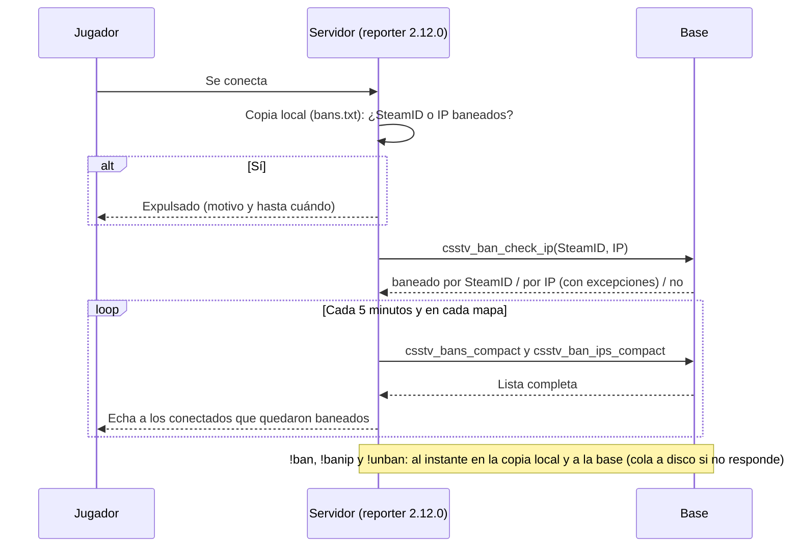

# Baneos en los servidores: documentación

## Qué hace

Desde el reporter 2.12.0 y el replanteo `151` hay **una sola lista de baneos** (la de la web), que vale en los tres servidores y en la plataforma, por SteamID, IP o rango, con las excepciones de los rangos:

| Dónde se banea | Qué pasa |
|---|---|
| Web, por ficha o SteamID | Saca del matchmaking y **echa de los tres servidores**: al entrar, y a quien está jugando en 5 minutos como mucho |
| Web, por IP o rango | Frena la cola y el registro, y en los servidores **no deja entrar desde ahí** (salvo a los exceptuados) |
| Servidor, `!ban` / `sm_addban` | Queda en la web como baneo de su SteamID (y de su ficha). Con el `!ban` de un admin, también su IP exacta por el mismo tiempo |
| Servidor, `!banip <IP, rango o #userid> <minutos> [motivo]` | Solo admins. Queda en la web como baneo por IP sin ficha (pestaña **IPs del servidor**) |
| `!unban <SteamID>`, `!unbanip <IP o rango>` | Levantan en todos lados |

## Reglas

- **Fuente de verdad:** la web. Con `csstv_bans 1` (por defecto), `!ban` ya no escribe `banned_user.cfg`. `csstv_bans 0` vuelve a los baneos de SourceMod, solo en ese servidor.
- **Permanente:** solo un admin (flag `z`). El servidor rechaza el `!ban <jugador> 0` de un moderador antes de que se anuncie.
- **IP del `!ban`:** solo con el de un admin, la IP exacta (`/32`) y con el vencimiento del baneo, sin el tope de 30 días de la web (Daniel, 2026-11-26). Levantar el baneo levanta esa IP.
- **`!banip`:** rangos de hasta `/16`. Al banear echa a los conectados desde ahí; las excepciones las respeta desde la próxima sincronización o al conectarse.
- **Copia local:** `data/csstv/bans.txt`. Si la base no responde, el servidor sigue echando con lo que conocía. Base caída y sin copia: deja entrar.
- **Cola:** si la web no responde, el pedido queda en `data/csstv/bans_pend.txt` y se reintenta al sincronizar.
- **Solo IPv4 en los servidores:** el juego solo usa IPv4; los rangos IPv6 de la web siguen valiendo en la web.
- **Diagnóstico:** `sm_csstv_bans` (cuántos tiene la copia y sincroniza ya) y `csstv_bans_test <SteamID> <IP>` (qué responde la copia).

## Datos y funciones (replanteo `151`)

| Qué | Para qué |
|---|---|
| `ban_ips` | `ban_id` opcional; suma `reason`, `created_by_steam`, `created_by_name`, `server_id`, `source`, `lifted_by_steam` y `lifted_by_name` |
| `ip_ban_match(ip, ficha, cuenta)` | La IP o rango que alcanza a esa IP, sin los que exceptúan a esa ficha o cuenta. La usan `ip_banned` e `ip_banned_for` |
| `csstv_ban_check_ip`, `csstv_bans_compact`, `csstv_ban_ips_compact`, `csstv_ban_ip_add`, `csstv_ban_ip_lift` | Para el plugin, con el token del servidor |
| `admin_ban_ips_loose()` | La pestaña **IPs del servidor** (`GET /api/v1/admin/ban-ips`) |

## Qué cambia para cada rol

| Rol | Qué cambia | Página del manual |
|---|---|---|
| Admin | `!banip` y `!unbanip`; su `!ban` banea también la IP; pestaña **IPs del servidor** | `admin/comandos-en-el-servidor.md`, `moderador/banear-jugador.md` |
| Moderador | Su `!ban` vale en los tres servidores y en la web; el de la web echa del servidor | `moderador/comandos-en-el-servidor.md`, `moderador/banear-jugador.md` |
| Jugador | Un baneo vale en todos lados; al entrar ve el motivo y hasta cuándo | `jugador/baneos-y-sanciones.md` |
| Los demás | Nada | — |

## Términos y privacidad

- **`/terminos`:** un baneo vale en todos los servidores y en el matchmaking, se ponga en la web o en un servidor; una IP baneada desde un servidor dura lo que el baneo.
- **`/privacidad`:** al conectarse, el servidor consulta con la web si el SteamID o la IP están baneados.

## Dónde está cada cosa

| Qué | Archivo |
|---|---|
| Plugin | `server/addons/sourcemod/scripting/csstv/bans.inc` (y `csstv_reporter.sp`, 2.12.0) |
| Base | `supabase/replanteo/151_baneos_servidor_ip.sql` (inversa en `docs/bitacora/2026-10-14-replanteo-modelo-datos/reversas/`) |
| API | `web/backend/src/routes/admin-ban-ips.ts` |
| Web | `web/frontend/src/features/admin/bans/components/ServerIpBansPanel.tsx` |
