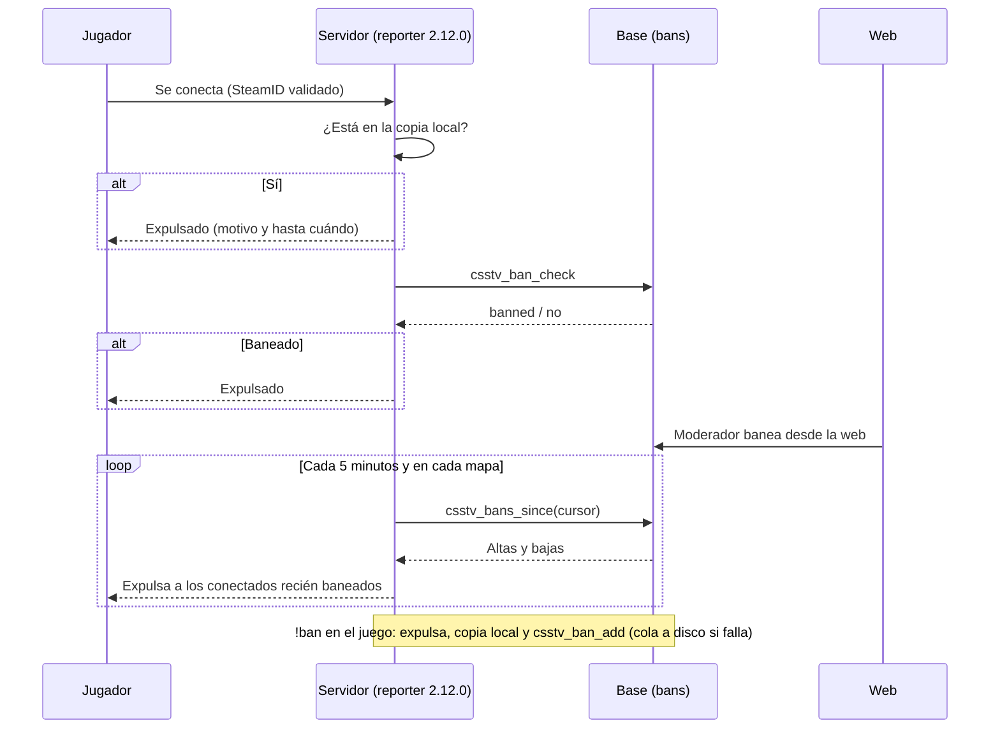

# Plan: baneos de la web aplicados en los servidores

> Planeación original. Estado: **propuesta**, pendiente de aprobación.

Hoy un baneo no vale en los tres servidores:

- **Desde la web** (tabla `bans`, replanteo `31`): saca al jugador del matchmaking (replanteo `107`), pero **no lo echa de los servidores**. El plugin que lo aplicaría, `csstv_bans`, quedó pendiente en [`2026-10-25-baneos-web`](../2026-10-25-baneos-web/) y nunca se hizo. El 2026-11-26 había **8 baneos activos** en la web sin aplicar en el juego.
- **Desde el juego**, `!ban` es el de SourceMod (`basebans`): escribe `cfg/banned_user.cfg` **solo del servidor donde se usa**. El 2026-11-26, el #1 tenía 2 SteamID baneados y el #2 y el #3 ninguno: un cheater baneado en el #1 podía entrar al #2 o al #3.

Pedido por Daniel el 2026-11-26 ("banear por IP y no solo por SteamID"). Al revisarlo apareció esto, y Daniel decidió hacer primero que los baneos se apliquen y dejar el baneo por IP para después (sección 7).

## Decisiones tomadas

| Tema | Decisión | Por qué |
|---|---|---|
| Alcance | Aplicar en los tres servidores los baneos de la web, que `!ban` y `!unban` del juego pasen por la web, e importar los del `banned_user.cfg` del #1. Sin baneo por IP | Daniel, 2026-11-26: "primero solo aplicar los baneos" |
| Dónde va | En el reporter (`csstv/bans.inc`), versión **2.12.0** | Ya tiene el token del servidor, el cliente HTTP y la cola a disco. Se saltea la 2.11.0, que es la del nombre de la ficha que quedó en `archivo/reporter-2.11.0` sin salir, para no confundirlas |
| Base | Sin cambios: `csstv_ban_check`, `csstv_bans_since`, `csstv_ban_add` y `csstv_ban_lift` están en producción desde el replanteo `31` | Revisado el 2026-11-26 |
| Fuente de verdad | La web (`bans`). `banned_user.cfg` deja de usarse para los SteamID | Un solo lugar para los tres servidores y el historial |
| Al conectarse | Primero la copia local (echa al instante) y después `csstv_ban_check` (el SteamID ya validado). Si está baneado: se lo echa con el motivo y hasta cuándo, y la dirección `cmleague.lat` | Echar antes de que juegue, aunque la base tarde |
| Copia local | `csstv_bans_since` al cargar el plugin, en cada mapa y cada 5 minutos, con cursor. Se guarda en `data/csstv/bans.json` | Si la base no responde, el servidor sigue echando a los baneados que ya conocía. Un baneo nuevo de la web echa a quien está jugando en 5 minutos como mucho |
| Base caída y sin copia | Deja entrar | No dejar a todos afuera por un problema nuestro |
| `!ban` y `sm_ban` del juego | Se toman con los forwards de SourceMod (`OnBanClient`, `OnBanIdentity`) y se devuelve `Plugin_Handled`: no se escribe `banned_user.cfg`. El reporter echa al jugador, lo suma a la copia local y llama a `csstv_ban_add` con el SteamID de quien banea. Si la web no responde, queda en la cola a disco y se reintenta | Que el baneo valga en los tres servidores y quede en la web |
| `!unban` | `OnRemoveBan`: `csstv_ban_lift` y se saca de la copia local | Igual |
| Permanente en el juego | Solo un admin (flag `z`); un moderador banea con minutos, como en la web | La regla de la web (replanteo `31`): permanente solo un admin |
| Inmunidad | Ninguna. Para apagarlo en un servidor: `csstv_bans 0` | Simple; un admin baneado por error se levanta desde la web |
| `sm_banip` | Sigue siendo el de SourceMod, por servidor | El baneo por IP va en el próximo requerimiento |
| Importación | Los 2 SteamID de `banned_user.cfg` del #1 pasan a `bans` como permanentes, con el motivo "Importado del `banned_user.cfg` del #1". Después se vacía ese archivo (con copia) | Que no queden baneos fuera de la web |

## 1. El flujo

## 2. El plugin (`csstv/bans.inc`, reporter 2.12.0)

- `csstv_bans` (1 por defecto; 0 apaga todo).
- `OnClientAuthorized` / `OnClientPostAdminCheck`: chequeo local y `csstv_ban_check`. Se ignora a los bots y al SourceTV.
- Sincronización con cursor y copia en `data/csstv/bans.json` (SteamID → motivo y vencimiento). Los vencidos se sacan solos.
- Forwards: `OnBanClient`, `OnBanIdentity` (SteamID) y `OnRemoveBan`. Los de IP se dejan pasar.
- Mensaje de expulsión: "Estás baneado de CMLeague hasta <fecha> (o permanente). Motivo: <motivo>. Más info en cmleague.lat".
- Log: una línea por expulsión y por `!ban` o `!unban`, como el resto del reporter.
- Pruebas con bots: `csstv_bans_fake <userid> <minutos> <motivo>`, como `csstv_webnick_fake`.

## 3. La base

Sin cambios. La importación de los 2 baneos del #1 se hace con `ban_insert` (como `csstv_ban_add`, con `source` `server`), en el despliegue.

## 4. La web y el manual

- La web no cambia. Opcional: en la ficha de un baneo, que diga que se aplica en los tres servidores.
- Manual:
  - `moderador/comandos-en-el-servidor.md` y `admin/comandos-en-el-servidor.md`: `!ban` y `!unban` valen en los tres servidores y quedan en la web; permanente solo un admin.
  - `moderador/banear-jugador.md` (y la de admin): un baneo de la web echa al jugador del servidor en 5 minutos como mucho y no lo deja volver a entrar.
  - `jugador/`: qué ve un baneado al entrar (si hay una página de sanciones).

## 5. Términos y privacidad

- **`/terminos`:** que un baneo vale en todos los servidores de CMLeague y en el matchmaking, sea de la web o del juego. Revisar el texto de sanciones actual.
- **`/privacidad`:** sin datos nuevos (no se usa la IP en este requerimiento). Revisar si menciona dónde se guardan los baneos.

## 6. Despliegue

1. Importar los 2 baneos del #1 (y revisar que no estén ya en `bans`).
2. Reporter 2.12.0 a **#1, #2 y #3** en la misma tanda, por la API del panel, con la versión anterior en `plugins/disabled/`. Sin recargar: entra en el próximo cambio de mapa. El de retake, si sigue, a `disabled/`.
3. Vaciar `banned_user.cfg` del #1 (con copia), después de que cargue la 2.12.0.
4. Comprobar en cada uno: `sm plugins info csstv_reporter.smx` (2.12.0), `csstv_bans` en 1 y que la copia local tenga los baneos activos.
5. Web y API (manual y legales).

## 7. Después: baneo por IP (decidido por Daniel el 2026-11-26)

| Tema | Decisión |
|---|---|
| Duración | Igual al baneo de la ficha, con un tope de **30 días** (IPs compartidas o que cambian) |
| Quién | **Solo admins** (son los únicos que ven las IPs) |
| IP que usó otra ficha | La web **avisa** qué otras fichas la usaron y quien banea **elige** si la incluye |

Va en su propio requerimiento, sobre este. Ya existe lo necesario para ver las IPs: `player_ips` y `admin_player_ips` (replanteo `38`).

## 8. Requisitos antes de empezar

- `spcomp` 1.8 (el mismo con el que se compiló la 2.10.3).
- El servidor local de pruebas (`E:\CSS DEDICATED SERVER\server`) contra la base local (manda a la real si no: `csstv_send 0`).
- Acceso a la API del panel de MVZG (`SFTP_CSS_API_KEY`).

## 9. Orden de implementación

1. `csstv/bans.inc` y el reporter 2.12.0.
2. Pruebas en local con bots: echar al conectarse, sincronización, `!ban`, `!unban`, permanente de moderador rechazado, base caída con y sin copia.
3. Manual y legales.
4. Despliegue (sección 6), sin ningún mix en curso al subir y con la confirmación de Daniel.
5. Documentación, guía y `PENDIENTES.md`.

## 10. Agregado antes de implementar (Daniel, 2026-11-26): IPs y rangos también en los servidores

Después de este plan se hizo el baneo por IP y por rango en la web ([`2026-11-26-baneo-por-ip`](../2026-11-26-baneo-por-ip/), replanteos `149` y `150`, con excepciones). Daniel pidió que todo valga en los dos sentidos y que no haga falta un plugin aparte de baneos por rango (lo sugirió un jugador, Venom): un baneo de la plataforma vale en los tres servidores, y uno del servidor vale en los tres servidores y en la plataforma, por SteamID o por IP.

| Tema | Decisión |
|---|---|
| Al conectarse | El servidor manda el SteamID **y la IP**; la base responde si está baneado por ficha, SteamID o IP/rango, con las excepciones del rango (por la ficha dueña del SteamID o su cuenta) |
| Copia local | También las IPs y rangos activos, con los SteamID exceptuados |
| `!banip <IP o rango> <minutos> <motivo>` y `!unbanip <IP o rango>` | Nuevos. **Solo admins** (flag `z`), como en la web. Un baneo por IP del servidor puede existir solo, sin ficha: `ban_ips` suma motivo, quién y desde qué servidor, y `ban_id` pasa a ser opcional |
| `!ban` a un jugador conectado (admin) | Además de la ficha o el SteamID, banea **su IP exacta por el mismo tiempo** que se le dio en el servidor (sin el tope de 30 días de la web) |
| Cambios desde la web | Los toma el servidor solo: consulta la base al conectarse alguien y sincroniza cada 5 minutos |
| Plugin de Venom | No hace falta: serían dos listas que no se hablan |

Va en el replanteo `151` y en el reporter 2.12.0.
