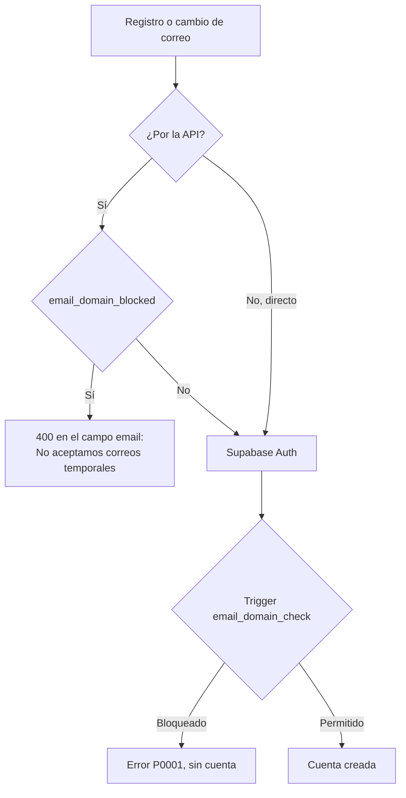

# Correos temporales bloqueados al registrarse: documentación

## Qué hace

Nadie puede crear una cuenta ni cambiar su correo a uno de un dominio de correos temporales. Están bloqueados los de la lista pública [disposable-email-domains](https://github.com/disposable-email-domains/disposable-email-domains) (10.455 el 2026-11-26) y los que agregan los admins. Bloquear un dominio bloquea también sus subdominios.

El control está en la base: un trigger en `auth.users` rechaza el alta y el cambio de correo, así que vale aunque alguien llame a Supabase Auth directo, sin la web. La API revisa antes, para mostrar el error en el campo del correo.

## Reglas

- **Dominio y subdominios:** se compara el dominio del correo y los que lo contienen (`mail.anonmart.com` → `anonmart.com`). Manda el más específico, así una excepción de un subdominio gana.
- **Origen:** `lista` (la lista pública) o `admin` (lo agregó un admin). La lista se carga con `pruebas/cargar_lista.py`, que solo agrega los que faltan.
- **Excepciones:** desbloquear uno de la lista lo deja `blocked = false` (Permitido): una carga nueva de la lista no lo vuelve a bloquear. Desbloquear uno agregado por un admin lo borra.
- **Cuentas que ya existían:** no se tocan. Administración las muestra para que un admin decida si banea su ficha.
- **Mensaje:** "No aceptamos correos temporales. Usa otro correo, por ejemplo Gmail u Outlook."

## Datos y funciones (replanteo `148`)

| Qué | Para qué |
|---|---|
| `email_domain_blocks` | Los dominios: `domain`, `source`, `blocked`, `reason`, `updated_by` y fechas. Solo la leen los admins (RLS) |
| `email_domain_of(email)` | El dominio de un correo, en minúsculas |
| `email_domain_blocked(email)` | Si está bloqueado. La puede llamar `anon` (solo responde sí o no) |
| Trigger `email_domain_check` en `auth.users` | Rechaza alta y cambio de correo (`email` y `email_change`) |
| `admin_email_domain_block`, `admin_email_domain_unblock` y `admin_email_domain_accounts` | Lo que usa Administración. Solo admins |

## API

| Ruta | Qué hace |
|---|---|
| `POST /auth/signup` | Antes de crear la cuenta, `email_domain_blocked`: si da sí, 400 `VALIDATION_ERROR` en el campo `email` |
| `GET /api/v1/admin/email-domains` | Lista paginada, con búsqueda (`q`), origen (`source`), estado (`blocked`) y orden |
| `POST /api/v1/admin/email-domains` | Bloquear (acepta `anonmart.com`, `@anonmart.com` o un correo) |
| `DELETE /api/v1/admin/email-domains/{domain}` | Desbloquear |
| `GET /api/v1/admin/email-domains/accounts` | Las cuentas que ya usan un dominio bloqueado |

## Qué cambia para cada rol

| Rol | Qué cambia | Página del manual |
|---|---|---|
| Jugador | No se puede registrar con un correo temporal: la web le pide otro | `jugador/crear-cuenta.md` |
| Admin | Administración › Usuarios › **Correos bloqueados**: buscar, bloquear, desbloquear y ver las cuentas que ya usan uno | `admin/usuarios-y-fichas.md` |
| Capitán, organizador, moderador, streamer, dueño de un servidor externo | Nada | — |

## Términos y privacidad

- **`/terminos`:** "El correo tiene que ser tuyo: no aceptamos correos temporales o descartables" (en "Una persona, una cuenta"), en la web y en `terms/terminos.html`.
- **`/privacidad`:** sin cambios de texto (la lista es de dominios, no de personas). El cambio de formato de esa página es de Prettier.

## Dónde está cada cosa

| Qué | Archivo / ubicación |
|---|---|
| Replanteo e inversa | `supabase/replanteo/148_correos_bloqueados.sql`, `docs/bitacora/2026-10-14-replanteo-modelo-datos/reversas/148_correos_bloqueados.sql` |
| Prueba de la base y carga de la lista | `pruebas/prueba_148.sql`, `pruebas/cargar_lista.py` |
| API | `web/backend/src/routes/admin-email-domains.ts`, `routes/auth.ts`, `schemas/admin.ts` |
| Web | `web/frontend/src/features/admin/users/components/EmailDomainsTab.tsx` |
