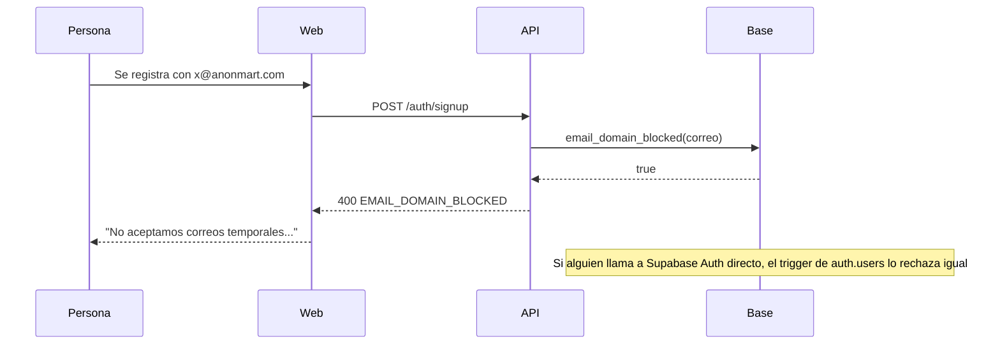

# Plan: correos temporales bloqueados al registrarse

> Planeación original. Estado: **propuesta**, pendiente de aprobación.

Un cheater se crea cuentas nuevas con correos temporales. El 2026-11-26 había 5 cuentas de esta semana con `anonmart.com` (3) y `afronewz.com` (2), sobre 233. Pedido por Daniel el 2026-11-26: que un registro con uno de esos dominios dé error.

## Decisiones tomadas

| Tema | Decisión | Por qué |
|---|---|---|
| Qué se bloquea | Los dominios de la **lista pública** [disposable-email-domains](https://github.com/disposable-email-domains/disposable-email-domains) (10.455 el 2026-11-26, CC0) **y** los que agreguen los admins. Arranca con la pública, que ya trae `afronewz.com` y `anonmart.com` | Daniel, 2026-11-26 |
| Sacar uno de la lista pública | Un admin lo desbloquea desde la web; queda guardado como excepción, así una actualización de la lista no lo vuelve a bloquear | Daniel: "debemos tener la opción como admins de eliminar uno de esos dominios" |
| Subdominios | Bloquear `anonmart.com` bloquea también `x.anonmart.com` | Los servicios temporales rotan subdominios |
| Dónde se controla | En la base: un trigger en `auth.users` (alta y cambio de correo) rechaza los dominios bloqueados. Además, la API revisa antes para dar un error claro | `db.cmleague.lat/auth/v1/signup` se puede usar directo, sin la API; y cambiar el correo solo se hace por Supabase Auth |
| Mensaje | "No aceptamos correos temporales. Usa otro correo, por ejemplo Gmail u Outlook." (código `EMAIL_DOMAIN_BLOCKED`) | |
| Cuentas que ya existen | No se tocan. Administración muestra cuáles usan un dominio bloqueado, para que un admin decida | Daniel, 2026-11-26 |
| Confirmación del correo | Sin cambios: ya está prendida en producción (`ENABLE_EMAIL_AUTOCONFIRM=false`) | Revisado el 2026-11-26 |
| Quién administra | Solo admins | Como las palabras bloqueadas |

## 1. El flujo

## 2. La base (replanteo `148`)

- Tabla `email_domain_blocks`: `domain` (clave, en minúsculas), `source` (`lista` o `admin`), `blocked` (false = excepción de un admin), `reason`, `updated_by`, `created_at`, `updated_at`. Solo admins (RLS).
- `email_domain_blocked(email)`: true si el dominio o alguno de sus padres está bloqueado. La puede llamar `anon` (la API la usa antes del registro): solo responde sí o no.
- Trigger `BEFORE INSERT OR UPDATE OF email` en `auth.users`: si el dominio está bloqueado, `raise exception` con `EMAIL_DOMAIN_BLOCKED`.
- Admin: `admin_email_domains(q, source, blocked, sort, page, per)` (paginada, con filtros y orden), `admin_email_domain_block(domain, reason)`, `admin_email_domain_unblock(domain)` y `admin_email_domain_accounts(page, per)` (las cuentas que usan un dominio bloqueado).
- La lista pública se carga con un script aparte (`pruebas/cargar_lista.sql`, generado desde el archivo de la lista) que solo agrega los dominios que no estén ya, sin tocar las excepciones.

## 3. La API

- `POST /auth/signup`: antes de crear la cuenta, `email_domain_blocked`; si da true, 400 `EMAIL_DOMAIN_BLOCKED`. Si igual llega el error del trigger, se traduce al mismo código.
- Admin: `GET /api/v1/admin/email-domains` (paginada, filtros y orden), `POST /api/v1/admin/email-domains` (bloquear), `DELETE /api/v1/admin/email-domains/{domain}` (desbloquear) y `GET /api/v1/admin/email-domains/accounts`.

## 4. La web

- Registro: el mensaje del error por `error.code`.
- Administración › Usuarios: pestaña **Correos bloqueados**, como la de palabras: buscar, filtrar (lista pública o agregados, bloqueados o excepciones), bloquear un dominio, desbloquear (con confirmación) y la tabla de cuentas que usan un dominio bloqueado.

## 5. Manual

- `admin/`: página nueva "Bloquear correos temporales" (o una sección en la de usuarios).
- `jugador/` (crear cuenta): que no se aceptan correos temporales.

## 6. Términos y privacidad

- **`/terminos`:** al crear la cuenta hay que usar un correo propio; no se aceptan correos temporales o descartables.
- **`/privacidad`:** sin datos nuevos (la lista es de dominios, no de personas). Revisar si conviene nombrarlo.

## 7. Requisitos antes de empezar

- El archivo de la lista pública (se baja de GitHub, CC0).
- La base local para probar el replanteo y el trigger (la copia de producción no se borra).

## 8. Orden de implementación

1. Replanteo `148` y su inversa, probados en la base local (registro bloqueado, subdominio, excepción, cambio de correo, permisos).
2. Script de carga de la lista pública.
3. API y sus pruebas.
4. Web (registro y pestaña de Administración) y sus pruebas.
5. Manual y legales.
6. Producción: respaldo, `148`, carga de la lista, API y web. Comprobar con un registro de prueba con `@anonmart.com` (debe fallar) y uno normal.
7. Documentación, guía y `PENDIENTES.md`.
