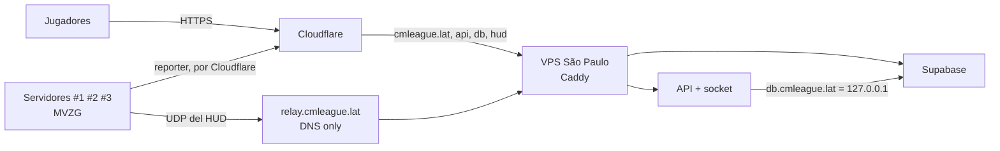

# Migración del VPS a São Paulo: documentación

## Qué hace

Desde el 2026-11-26 todo lo de la web de CMLeague corre en un VPS de Halver en São Paulo (3 vCPU, 5,8 GB de RAM, 59 GB de disco, Ubuntu 24.04): Supabase, la API con el socket del matchmaking, el worker del matchmaking, el relay del HUD, la web y los timers (temporadas, notificaciones, medallas, demos, vigía y respaldo). Antes estaba en un VPS de OVH en Beauharnois, Canadá, más chico y lejos de los jugadores, que están casi todos en Argentina y Chile.

El dominio no cambió: los nombres siguen en Cloudflare, que ahora apunta al VPS nuevo. Lo único que cambió para los servidores de juego es el nombre al que mandan el HUD: `relay.cmleague.lat`.

## Los nombres en Cloudflare

| Nombre | Proxy | Para qué |
|---|---|---|
| `cmleague.lat`, `www` | Proxied | La web |
| `api` | Proxied | La API y el socket del matchmaking |
| `db` | Proxied | Supabase (`/rest`, `/auth`, `/storage`) |
| `hud` | Proxied (antes "DNS only") | Los links del HUD para OBS |
| `relay` | DNS only | El UDP del HUD que mandan los servidores (Cloudflare no pasa UDP) |

No hay registros AAAA propios: el VPS nuevo no tiene IPv6 pública.

## El VPS

- **Acceso:** `ubuntu` y `deploy` con la llave de Daniel; `root` con contraseña (`NEW_VPS_*` del `.env`), por pedido de Daniel, hasta decidir quitarla. `VPS_HOST` del `.env` apunta acá.
- **`resan`:** usuario con sudo que dejó el proveedor. Tiene la contraseña bloqueada; no se borra sin preguntarle a Daniel.
- **`/etc/hosts`:** `db.cmleague.lat` es `127.0.0.1`. La API, el worker y los timers le hablan a la base por el Caddy local, sin ir y volver por Cloudflare.
- **Firewall:** `solo-cloudflare.sh on`: 80 y 443 solo para Cloudflare y MVZG, el UDP del HUD solo para MVZG, y el SSH abierto con `limit` (más de 6 conexiones en 30 s se cortan).
- **Respaldo:** el diario de las 09:00 UTC, a R2, igual que antes.

## El VPS viejo

Apagado desde el corte, con todo deshabilitado (no vuelve a arrancar nada si se reinicia) y con su copia de la base y de los archivos. Sirve para volver atrás hasta que se dé de baja (`VPS_HOST_VIEJO` del `.env`).

## Qué cambia para cada rol

| Rol | Qué cambia | Página del manual |
|---|---|---|
| Jugador, capitán, organizador, moderador, admin | La web y el matchmaking responden más rápido (el servidor está más cerca). Nada más | — |
| Streamer | Los links del HUD para OBS vuelven a abrirse (antes no cargaban desde el 2026-11-20). Son los mismos links | — |
| Dueño de un servidor externo | Nada (hoy no hay) | — |

## Términos y privacidad

`/privacidad` cambia en la tabla de servicios (OVH por Halver) y en la transferencia internacional: los datos están en São Paulo, Brasil; hasta el 2026-11-26 estuvieron en OVH, en Beauharnois, Canadá, que guarda una copia hasta darlo de baja. Cambió la fecha de actualización de los dos documentos. `/terminos`, sin cambios de texto.

## Dónde está cada cosa

| Qué | Archivo / ubicación |
|---|---|
| Preparar un VPS | `deploy/vps/preparar.sh` (`--ssh-sin-cambios`, `--en-espera`, `--dominios`) |
| Supabase | `deploy/supabase/instalar.sh` (`--en-espera`), `/srv/supabase/` en el VPS |
| Clave de pgsodium | Volumen de Docker `supabase_db-config` (`/var/lib/docker/volumes/supabase_db-config/_data`) |
| Certificados | `/var/lib/caddy/.local/share/caddy` |
| Host del HUD en los servidores | `cfg/sourcemod/csstv_hud.cfg` de #1, #2 y #3 |
| Host del UDP que muestra Administración › Servidores | `HUD_UDP_HOST` de `/etc/cmleague/api.env` |
| Restaurar un respaldo | `sudo cmleague-restaurar <carpeta>` (`deploy/supabase/restaurar.sh`, con `permisos.sql`) |
| Plan, guía y pendientes | [`PLAN.md`](PLAN.md), [`GUIA_IMPLEMENTACION.md`](GUIA_IMPLEMENTACION.md) |
