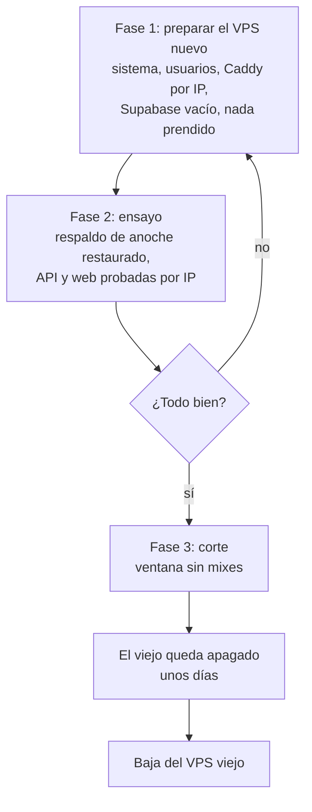
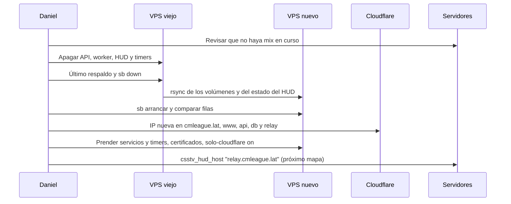

# Plan: migración del VPS a São Paulo

> Planeación original. Estado: **en curso** (fase 1 pedida por Daniel el 2026-11-26).

Todo lo que corre en el VPS de OVH (Beauharnois, Canadá: 2 vCPU, 3,7 GB de RAM) pasa a un VPS más potente que compró Kyan en São Paulo (Halver, AS274564: 3 vCPU, 5,8 GB de RAM, 59 GB de disco, Ubuntu 24.04). Los jugadores están casi todos en Argentina y Chile: la API, el matchmaking y el HUD quedan mucho más cerca. El dominio no cambia. Cuando el VPS nuevo atiende todo, el viejo queda apagado unos días para volver atrás y después se da de baja.

## Decisiones tomadas

| Tema | Decisión | Por qué |
|---|---|---|
| Qué se mueve | Todo: Supabase, API con el socket del matchmaking, worker `cmleague-mm`, relay del HUD, web, timers (temporadas, notificaciones, medallas, demos, respaldo) y vigía | Daniel, 2026-11-26: "migrar toda la web" a un VPS más potente. Separar solo el socket rompe la presencia de la cola (dos `hub` en memoria se sacarían gente entre ellos) |
| Cómo se copia la base | Copia física de `/srv/supabase/oficial/docker/volumes` (`db`, 107 MB, y `storage`, 57 MB, medidos el 2026-11-26) con Supabase apagado en los dos lados | Pasa exacto todo: roles (`mm_listener` y los internos) con sus contraseñas, Vault y los archivos. Es la misma imagen de Postgres 17.6 (el compose en el mismo commit), así que el sistema del host (24.04 contra 26.04) no importa. Con este tamaño tarda segundos |
| Secretos | `/etc/cmleague/supabase.env` y los demás de `/etc/cmleague/` se copian **idénticos** del VPS viejo (solo los activos, sin los `.bak`, `.antes-*` ni `.nube`). No se corre `preparar-env.sh` | Otro `JWT_SECRET` o `JWT_KEYS` cierra todas las sesiones y anula las claves del Worker de demos, del render de clips y del `.env`. Otro `VAULT_ENC_KEY` deja ilegible lo guardado en Vault |
| SSH | `root` sigue entrando con contraseña (Daniel, 2026-11-26: "por ahora dejémoslo así"). Se suman `ubuntu` (sudo sin contraseña, como en OVH) y `deploy` con la llave de Daniel. `preparar.sh --ssh-sin-cambios` no toca `sshd` | Los scripts (`desplegar.sh`, los README) entran como `ubuntu` y `deploy` con llave. Quitar la contraseña queda para después |
| Servicios en espera | Hasta el corte, en el VPS nuevo no corre nada de la aplicación: `preparar.sh --en-espera` e `instalar.sh --en-espera` instalan las unidades sin prenderlas, y `desplegar.sh api` solo sube la versión si `cmleague-api` está apagado (como ya hace con el HUD) | Con los secretos de producción, un timer o el worker prendidos en los dos VPS duplicarían cierres de temporada, avisos y `mm_tick()`, y dos APIs con `MM_LISTEN_URL` se sacarían gente de la cola |
| `cmleague-medals` | `preparar.sh` lo instala con los demás | Está en `deploy/vps/` y corre en el VPS viejo, pero `preparar.sh` no lo instalaba: se había puesto a mano |
| Swap | `preparar.sh` no crea `/swapfile` si ya hay swap de 2 GB o más | El VPS nuevo trae `/swap.img` de 4 GB |
| HUD | Nombre nuevo `relay.cmleague.lat` ("DNS only") para el UDP, y `hud.cmleague.lat` pasa a "Proxied". `csstv_hud_host` cambia en el #1, el #2 y el #3 en la misma tanda | `csstv_hud.sp` resuelve el dominio una sola vez y solo reconecta si cambia el host o el puerto: si solo cambia la IP, sigue mandando al VPS viejo. Además resuelve el pendiente de [`2026-11-20-proteccion-ddos`](../2026-11-20-proteccion-ddos/) (los streamers no pueden abrir el HUD con `hud` en "DNS only" y el 443 cerrado) |
| Firewall | `solo-cloudflare.sh on` en el VPS nuevo después de que Caddy tenga los certificados, con `PERMITIDOS="190.104.34.3"` | Igual que en el viejo. Con el 80 cerrado a todos menos Cloudflare, el primer certificado de `relay` no se podría pedir |
| Usuario `resan` | No se borra sin preguntar: es un usuario con sudo que dejó el proveedor (nunca entró por SSH). Antes de copiar secretos, Daniel o Kyan confirman de quién es | Con sudo puede leer los secretos de `/etc/cmleague/` |
| Términos y privacidad | `/privacidad` cambia el proveedor (OVH por Halver) y el lugar (Beauharnois, Canadá, por São Paulo, Brasil) en la página y en `terms/privacidad.html`, en el commit del corte | Es donde se guardan los datos de las cuentas |

## 1. El flujo completo

## 2. Fase 1: preparación (sin tocar producción)

1. Crear `ubuntu` con la llave de Daniel y sudo sin contraseña.
2. `preparar.sh --ssh-sin-cambios --en-espera`: sistema al día, `cmleague` y `deploy`, ufw (22 con `limit`, 80, 443 y el UDP del HUD), fail2ban, actualizaciones automáticas, Node 24, Caddy con `Caddyfile.ip`, carpetas, unidades instaladas sin prender, sudoers de `deploy` y journald.
3. Después de confirmar lo de `resan`: copiar `/etc/cmleague/` del viejo (sin pasar los valores por la consola), `/etc/caddy/acceso-web.caddy` y las fuentes del HUD (`/srv/cmleague/hud/fonts`).
4. `instalar.sh --en-espera`: Docker y Supabase con los mismos secretos, base vacía, el respaldo sin prender.
5. `desplegar.sh api`, `web` y `hud` con `VPS_HOST` del VPS nuevo: quedan subidos y apagados.

## 3. Fase 2: ensayo

- Restaurar el último respaldo (`base.dump` y `storage.tar.gz` de `/srv/supabase/respaldos/`) en el Supabase nuevo. Sirve además para probar que el respaldo se puede restaurar.
- Prender la API **sin `MM_LISTEN_URL`** y con `SUPABASE_URL` local, y probar por túnel: `/api/health`, iniciar sesión y ver avatares.
- Volver a apagar todo y dejar la base como estaba para la copia del corte.

## 4. Fase 3: corte

- **Ningún mix en curso** (último evento de `csstv_reporter` en `logs/L*.log` de los tres: cierre de la partida) y aviso en Discord. No se reinicia ningún servidor de juego.
- **Nunca** dos APIs con `MM_LISTEN_URL`, dos `cmleague-mm` ni dos juegos de timers prendidos a la vez.
- Verificar: conteo de filas por tabla igual en los dos, `/api/health`, iniciar sesión, socket del matchmaking, una demo y el HUD.
- Volver atrás: IPs viejas en Cloudflare y servicios prendidos en el viejo, solo si el nuevo no recibió escrituras.
- Después del corte: subir los límites de memoria de `cmleague.yml` (Storage usa 209 de 256 MB en el viejo) y el `MemoryMax` de la API, con la RAM nueva.

## 5. Documentación del corte

`CLAUDE.md` (Cuidados: dónde está la base, el túnel), `docs/PENDIENTES.md`, `deploy/vps/README.md`, `deploy/supabase/README.md`, `/privacidad` (web y `terms/privacidad.html`) y la memoria del VPS. El `.env`: `VPS_HOST` pasa a la IP nueva, y el túnel de `PG_*` también.

## 6. Requisitos antes de empezar

- Acceso al VPS nuevo: `NEW_VPS_IP`, `NEW_VPS_USER` y `NEW_VPS_PASSWORD` en el `.env` (Daniel, 2026-11-26).
- Acceso al viejo: `ubuntu` con la llave de Daniel (ya está).
- Para el corte: acceso a Cloudflare y al SFTP de MVZG para `csstv_hud_host`.

## 7. Orden de implementación

1. Cambios en los scripts: `preparar.sh` (`--ssh-sin-cambios`, `--en-espera`, medallas, swap), `instalar.sh` (`--en-espera`) y `desplegar.sh` (API apagada: solo sube).
2. Fase 1, pasos 1 y 2.
3. Confirmar lo de `resan` y seguir con los pasos 3 a 5.
4. Fase 2.
5. Fase 3, con la confirmación de Daniel justo antes.
6. Documentación, legales y fila de la bitácora al día.
