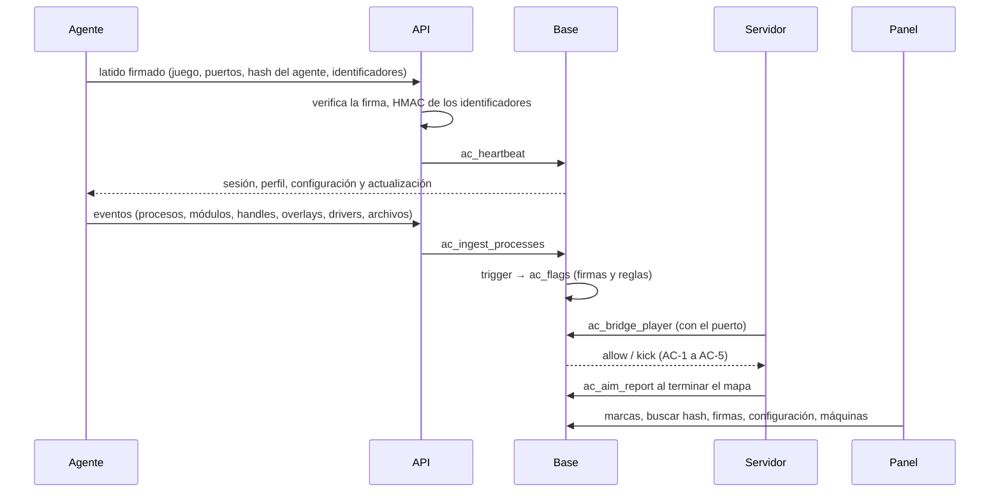
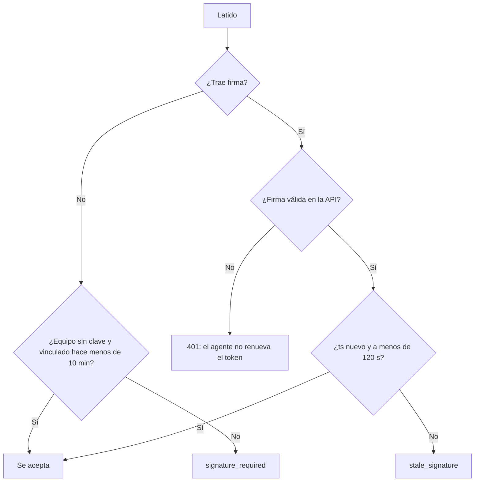
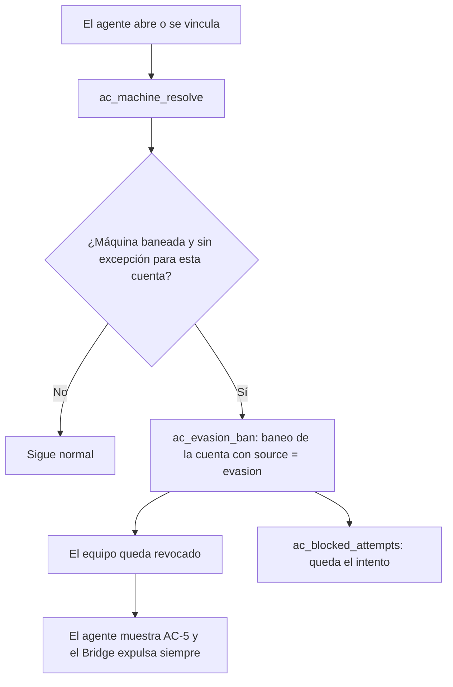

# Anticheat: detección, robustez, panel, ban por máquina y aim: documentación

## Qué hace

El agente 0.5.0 deja de ser solo un capturador de pantalla y procesos. En sesión mira lo que tiene que hacer un cheat para funcionar:

- quién abre la memoria del juego;
- qué ventanas se dibujan encima;
- qué drivers hay cargados;
- si los archivos del juego son los originales.

Todo llega a la base como eventos. **La base, no el agente**, los compara con una lista de firmas y crea **marcas** con gravedad, que el staff revisa en el panel.

El agente también se volvió más difícil de falsificar:

- el latido va firmado con la clave del equipo;
- el agente manda el hash de su propio `.exe`;
- los nombres que busca van cifrados en el binario;
- recibe la configuración y las actualizaciones desde la base.

Se suman dos piezas nuevas:

- El **ban por máquina**: los identificadores del hardware, hasheados en la API, banean la PC aunque la persona se cree otra cuenta o cambie el SteamID. Una cuenta nueva en una máquina baneada queda baneada por evasión apenas abre el agente.
- El plugin **`cml_aimstats`**: mide el aim del lado del servidor, sin depender del agente.

**Regla para todo el anticheat:** ningún texto que vea el jugador dice qué hace, qué recopila ni qué detecta (Kyan, 2026-11-27). El jugador solo ve códigos (`AC-1` a `AC-5`). Los motivos quedan en el log del servidor y en el panel. Este documento y el manual del admin son del staff.

## Qué mira el agente en sesión

| Qué | Cómo | Cada cuánto (por defecto) | Evento |
|---|---|---|---|
| Módulos del juego | `CreateToolhelp32Snapshot` sobre `CMLauncher.exe` | 5 s | `module` |
| Acceso a la memoria del juego | `NtQuerySystemInformation(SystemExtendedHandleInformation)`: los handles de otros procesos al juego con permiso de leer o escribir su memoria. Si Windows esconde las direcciones (Windows 11 24H2 sin privilegios), duplica el handle y compara el proceso. Se descartan los servicios de Windows por nombre, solo si están en `System32` | 10 s | `handle`, con el permiso, si las direcciones estaban ocultas y el proceso padre |
| Overlays | `EnumWindows`: ventanas visibles de otro proceso, siempre arriba, transparentes o en capas, que tapan al menos el 50 % del juego | 5 s | `overlay`, con cuánto tapan |
| Drivers | `EnumServicesStatusEx` (los drivers registrados como servicios), con hash y firma | Al empezar la sesión | `driver` |
| Archivos del juego | Hash de `CMLauncher.exe`, `ClientModEAC.exe`, `bin\clientmod*.dll` y `bin_clientmod\ClientModNetwork.dll` | Cada vez que se abre el juego | `game_file` |
| Puertos | `GetExtendedUdpTable`: los puertos UDP locales del juego | En cada latido | En `ac_devices.game_ports` |
| Capturas | Todo el monitor del juego, 1280 px de ancho, JPEG calidad 60 | Una cada 30 a 35 s | `ac_screenshots` |

Todo esto se puede cambiar desde el panel sin sacar otra versión: viaja en `ac_config.agent_config` con cada latido.

Para probarlo en una PC: `CMLeagueAC.exe --detect` imprime lo que ve, sin vincular ni mandar nada.

## Marcas

`ac_flags` guarda una fila por regla, sesión y objeto. No se duplica: el mismo módulo en la misma sesión es una sola marca. La gravedad va de 1 (leve) a 3 (grave). Se crean solas:

- con el trigger `ac_flag_event` sobre `ac_process_events`;
- desde el latido;
- desde el Bridge;
- desde `ac_aim_report`.

| Regla | Gravedad | Cuándo |
|---|---|---|
| `signature` | 3 | El hash está en `ac_signatures` como `bad` |
| `signature_name` | 3 | El nombre coincide con una firma `bad` por nombre |
| `module_unsigned` | 3 si la firma es inválida, 2 si falta | Un módulo del juego sin firma o con la firma inválida |
| `handle_to_game` | 3 si el programa no tiene firma válida, 2 si la tiene | Otro programa abrió la memoria del juego |
| `handle_parent` | 1 | El que tiene el handle es el que abrió el juego (normal en un launcher) |
| `overlay` | 2 sin firma válida, 1 con firma | Una ventana encima del juego |
| `driver_unsigned` | 3 si la firma es inválida, 2 si falta | Un driver sin firma o con la firma inválida |
| `game_file_unknown` | 2 | Hay hashes `good` cargados para ese archivo del juego, y el que llegó no es ninguno. Sin hashes `good` cargados, no marca |
| `agent_modified` | 3 | El hash del agente no está en `ac_config.agent_hashes` (si la lista no está vacía) |
| `port_mismatch` | 1 | El puerto que ve el servidor no es ninguno de los del juego. Con NAT puede pasar: es un indicio |
| `machine_weak_match` | 2 | La máquina se parece a otra (de 2 a 4 puntos), sin llegar a ser la misma |
| `aim_snap` | 2 | Al menos el 30 % de las kills tienen un giro de mira de más de `cml_aim_snap` grados por tick |
| `aim_smoke` | 2 | Al menos 4 kills a través de un humo y el 25 % del total |
| `aim_headshot` | 1 | Al menos 15 kills y el 75 % de headshots |

Las reglas de aim solo cuentan desde 10 kills en el mapa.

**Firmas** (`ac_signatures`): un hash o un nombre, opcionalmente limitado a algunos tipos de evento, con `bad` (es una trampa) o `good` (es conocido y no marca). Una firma `bad` gana sobre todas las reglas, y una `good` las apaga para ese objeto. La lista queda en la base y nunca viaja al agente, para que no se pueda leer.

> **Antes de usarlo:** cargar como `good` los hashes de los archivos originales de ClientMod. Si no, `game_file_unknown` no marca nada.

## Latido firmado e integridad

- El agente firma `v1|hb|<unix>|<sha256 del token>` con su clave ECDSA P-256 (la de la `47`, guardada con DPAPI). La manda en `X-AC-Ts` y `X-AC-Sig`.
- La base rechaza un `ts` repetido o viejo (`hb_last_ts`).
- El latido manda el `sha256` del propio `.exe`. Si `ac_config.agent_hashes` tiene valores y ese no está, `agent_ok = false`, marca `agent_modified` y `AC-4`.
- **Actualización:** `ac_config.agent_latest` (`version`, `url` y `sha256`). El agente la baja fuera de una sesión, solo por `https` de `*.cmleague.lat`, comprueba el hash, renombra su `.exe` y se relanza.
- **Versión mínima:** con un agente anterior a `ac_config.agent_min_version`, el Bridge expulsa con `AC-4`.
- **Ofuscación:** los nombres de procesos, las rutas y las de la API van cifrados con XOR en el `.exe` (`OBF()`). Sube el costo de leerlo con un editor, pero no reemplaza a un empaquetador comercial.

## Ban por máquina

El agente lee los identificadores del hardware sin WMI y los manda en el latido y al vincular. **La API los pasa por HMAC-SHA256 con `AC_HWID_SALT`** antes de mandarlos a la base: la base nunca ve los valores reales. Los valores genéricos (ceros, "To be filled by O.E.M." y otros) se descartan.

| Identificador | De dónde sale | Puntos |
|---|---|---|
| SMBIOS (UUID del sistema) | `GetSystemFirmwareTable('RSMB')` | 3 |
| Placa madre (serie) | SMBIOS | 2 |
| `MachineGuid` de Windows | Registro | 2 |
| Disco (serie) | `IOCTL_STORAGE_QUERY_PROPERTY` | 2 cada uno |
| MAC física | Adaptadores de red, sin los virtuales | 1 cada una |
| CPU | `cpuid` | 0,5 |
| GPU | `EnumDisplayDevices` | 0,5 |

`ac_machine_resolve` suma los puntos de los identificadores en común con cada máquina conocida:

- **Desde 4 puntos** es la misma máquina y se le suman los identificadores nuevos.
- **De 2 a 4**, es otra máquina, con la marca `machine_weak_match`.
- **Debajo de 2**, es una máquina nueva.

- **Al vincular:** si la máquina está baneada, `/link` y la aprobación responden `403` con `AC-5`, sin detalle.
- **En el latido:** si la máquina pasó a estar baneada, se revoca el equipo y la cuenta queda baneada por evasión (`bans.source = 'evasion'`, `bans.evades` apunta al baneo original).
- **Excepción:** el staff puede permitir una cuenta en una máquina baneada (por ejemplo, un hermano en la misma PC) con `ac_admin_machine_exception`.
- No hace falta registro desde el agente: como la cola tiene el anticheat obligatorio, alcanza con que la persona lo abra.

## Aim del lado del servidor (`cml_aimstats` 1.0.0)

- Por cada kill, guarda el giro de mira más grande entre dos ticks seguidos en los **8 ticks anteriores**, si fue headshot y si la línea de tiro atravesó un humo (los humos de los últimos 18 s, con un radio de 140 unidades).
- Cuando `cml_ac_mix` vuelve a `0`, o al terminar el mapa, manda los totales por jugador a `ac_aim_report`.
- `ac_aim_report` los guarda en `ac_aim_stats` y busca la sesión del anticheat del jugador (la abierta o la de las 3 horas anteriores) para crear las marcas `aim_*`.
- **No expulsa:** solo marca.
- No lleva licencia. Usa `cml_ac_api_url`, `cml_ac_api_key` y `cml_ac_server_token` del Bridge. Su única cvar es `cml_aim_snap` (grados por tick que cuentan como snap, 25 por defecto).

## Códigos del Bridge (1.2.0)

| Código | Motivo (en el log) | Cuándo expulsa |
|---|---|---|
| `AC-1` | Sin perfil, sin agente, sin latido reciente u otra IP | Servidor protegido, `enforce_mixes` y en mix |
| `AC-2` | `game_not_seen` | Igual que `AC-1` |
| `AC-3` | `hl2_detected` | **Siempre**, aunque los mixes estén abiertos con `sm_ac_open` |
| `AC-4` | `agent_modified` o `agent_outdated` | **Siempre** |
| `AC-5` | `machine_banned` | **Siempre** |

El Bridge manda el puerto del jugador (`p_port`, de `GetClientIP(…, false)`) para el cruce de `port_mismatch`. Al jugador solo le dice "CMLeague Anticheat no te deja jugar (AC-n). Si crees que es un error, habla con el staff".

## Capturas y retención

- Una cada 30 a 35 s en sesión (`ac_config.capture_min_s` y `capture_max_s`), de todo el monitor donde está el juego. Las que pide un admin **no avisan al jugador**.
- Se borran a los **7 días** (`ac_config.screenshot_retention_days`), salvo las de una sesión conservada. El trabajo `runScreenshotRetention` corre en `scripts/anticheat-tick.mts`: borra el archivo del almacenamiento y marca `ac_screenshots.purged_at`. En la cadena de evidencia, una captura borrada figura como `screenshot_expired`.
- Cuenta de Kyan (2026-11-27): con 10 mixes por día son unos 1,1 GB por día, es decir, unos 8 GB en 7 días. Entra en los 10 a 15 GB libres del VPS.

## Panel del staff (Administración › Anticheat)

| Pestaña | Qué tiene |
|---|---|
| **Sesiones** | La lista de siempre, con la columna **Marcas**: cuántas sin revisar y la gravedad más alta. En la evidencia de una sesión, en orden: marcas, máquina, acceso a la memoria del juego, overlays, archivos del juego, drivers que no son de Microsoft, módulos y programas |
| **Marcas** | Todas las marcas de todas las sesiones, con filtros por gravedad y "Solo sin revisar". **Revisada** acepta una nota |
| **Firmas y hashes** | Buscar un hash entre todos los jugadores, cargar firmas `bad` o `good` (por hash o nombre) y la lista con su borrado. Cada hash del panel es un enlace a esta búsqueda |
| **Agente** | Qué revisa y cada cuánto, los archivos del juego, las capturas, la retención, la versión mínima, la actualización y los hashes permitidos |

En la evidencia, el bloque **Máquina** muestra las cuentas que usaron esa PC, sus baneos, los intentos bloqueados y los botones **Banear la máquina**, **Levantar el ban de la máquina** y **PC compartida** (la excepción para una cuenta).

## Datos

| Tabla | Qué guarda | Replanteo |
|---|---|---|
| `ac_process_events` | Los tipos nuevos `handle`, `overlay`, `driver` y `game_file`, y la columna `detail jsonb` | `156` |
| `ac_signatures` | Firmas `bad` y `good` | `156` |
| `ac_flags` | Las marcas y su revisión | `156` |
| `ac_config` | `agent_config`, `agent_latest`, `agent_min_version`, `agent_hashes` y `screenshot_retention_days` | `156` |
| `ac_devices` | `agent_sha`, `agent_ok`, `game_ports`, `hb_last_ts` y `machine_id` | `156` y `157` |
| `ac_screenshots` | `purged_at` | `156` |
| `ac_machines`, `ac_machine_ids` | Las máquinas y sus identificadores hasheados | `157` |
| `ac_machine_bans`, `ac_machine_exceptions` | Los baneos de máquina y las cuentas permitidas | `157` |
| `ac_blocked_attempts` | Los intentos desde una máquina baneada | `157` |
| `bans` | `source = 'evasion'` y `evades` | `157` |
| `ac_aim_stats` | Los totales de aim por jugador y mapa | `158` |

## Límites conocidos

- **Sin driver**, un cheat de kernel puede esconderse de todo esto. Los handles y los módulos solo ven lo que Windows deja ver al usuario.
- **El EAC de ClientMod puede negar** la lista de módulos y la duplicación de handles. En ese caso los eventos llevan `access_denied`, que no es un indicio.
- Un spoofer de hardware cambia los identificadores. Por eso se cruzan varios y una coincidencia parcial ya marca.
- `port_mismatch` y las reglas de aim son indicios: nunca expulsan solas.
- Sin certificado de firma de código, SmartScreen y los antivirus van a advertir el agente.

## Qué cambia para cada rol

| Rol | Qué cambia | Página del manual |
|---|---|---|
| Jugador | Puede ser expulsado con `AC-4` (agente modificado o viejo) o `AC-5` (equipo bloqueado), y el agente se actualiza solo. Una cuenta nueva en una PC baneada queda baneada | Se escribe al pasar el anticheat a `main`. Solo con los códigos y qué hacer (actualizar el agente o hablar con el staff), sin decir qué detecta |
| Moderador | Nada: el panel del anticheat es solo del admin, y `sm_ac_status` no cambió | — |
| Admin | Las pestañas Marcas, Firmas y hashes y Agente, la columna Marcas, las secciones nuevas de la evidencia, el bloque Máquina y los códigos `AC-4` y `AC-5` | [`admin/anticheat.md`](../../manual/admin/anticheat.md) |
| Admin del servidor | El plugin nuevo `cml_aimstats`, sin comandos (solo la cvar `cml_aim_snap`) | — |

## Términos y privacidad

**Sin cambios en este commit**, porque el anticheat no está en `main`. Antes de distribuir el agente (el "5" de Kyan), `/privacidad` y `/terminos`, y sus `.html` de `terms/`, tienen que decir, **en categorías generales y sin detallar qué busca**:

- que se guardan identificadores del hardware de la PC, **hasheados**, para impedir que una persona baneada vuelva con otra cuenta;
- que una PC baneada **bloquea las cuentas nuevas** que se usen en ella (sanción por evasión), con la posibilidad de pedir una excepción;
- que las capturas son de **toda la pantalla**, cada 30 a 35 s durante la sesión, que el staff puede pedirlas **sin aviso** y que se borran a los **7 días**, salvo las de una sesión conservada por una revisión;
- que el agente puede **actualizarse solo**;
- que el servidor guarda **estadísticas de aim** de cada jugador.

La revisión legal también queda para ese momento.

## Dónde está cada cosa

| Qué | Archivo |
|---|---|
| Detecciones e identificadores de la máquina | `agent/src/detect.cpp` |
| Cadenas cifradas | `agent/src/obf.h` |
| Cola de eventos, configuración remota, capturas y retención local | `agent/src/evidence.cpp` |
| Latido firmado, actualización, vinculación y `--detect` | `agent/src/main.cpp` |
| Base | `supabase/replanteo/156_anticheat_deteccion.sql`, `157_anticheat_maquinas.sql` y `158_anticheat_aim.sql` |
| Inversas | `docs/bitacora/2026-10-14-replanteo-modelo-datos/reversas/` |
| Firma y HMAC en la API | `web/backend/src/services/anticheat.ts` |
| Latido y vinculación | `web/backend/src/routes/anticheat.ts` |
| Rutas del panel | `web/backend/src/routes/anticheat-staff.ts` |
| Retención de capturas | `web/backend/src/jobs/anticheat-retention.ts`, `scripts/anticheat-tick.mts` |
| Panel | `web/frontend/src/features/admin/anticheat/AdminAnticheatPage.tsx` y `AdminAnticheatTools.tsx` |
| Bridge | `server/addons/sourcemod/scripting/cml_anticheat_bridge.sp` |
| Aim | `server/addons/sourcemod/scripting/cml_aimstats.sp` |
| Capturas de las pantallas | [`capturas/`](capturas/) |
