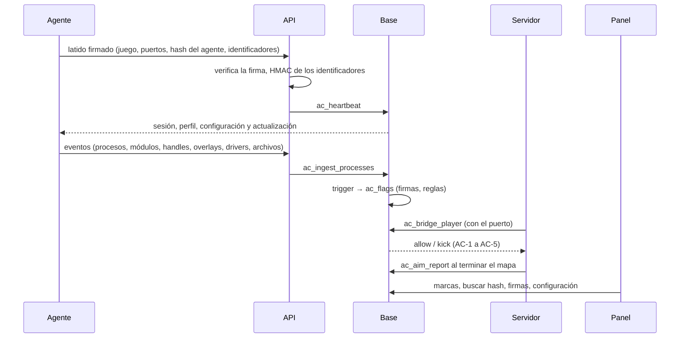

# Plan: detección, robustez, panel del staff, ban por máquina y aim del lado del servidor

> Planeación original. Estado: **en curso**, pedida por Kyan (2026-11-27: "hacé todo, menos el 0 y el 5, lo vamos a hacer al final"). Rama `kyan/pruebas`, sin commit. Sigue a [`2026-11-27-anticheat-ver-el-juego`](../2026-11-27-anticheat-ver-el-juego/PLAN.md) (replanteo `155`).

Lo que queda **fuera** a pedido de Kyan, para el final: probar con el juego, compilar el Bridge y probar la base local (el "0"), y la mezcla en `main`, la revisión legal y `/privacidad` (el "5").

**Regla que vale para todo:** ningún texto que vea el jugador dice qué hace, qué recopila ni qué detecta el anticheat (Kyan, 2026-11-27). Los motivos van al log del servidor y al panel del staff; al jugador, solo códigos.

## Decisiones tomadas

| Tema | Decisión | Por qué |
|---|---|---|
| Programas que tocan el juego | El agente lista los *handles* de otros procesos al proceso del juego con permiso de leer o escribir su memoria, con `NtQuerySystemInformation` (`SystemExtendedHandleInformation`). Si Windows esconde las direcciones (Windows 11 24H2 sin privilegios), duplica el handle y compara el proceso | Un cheat externo tiene que abrir el juego para leerlo. Sin driver, es la señal más fuerte |
| Overlays | Ventanas de otros procesos, visibles, siempre arriba y transparentes o en capas, que tapan al menos la mitad del juego | Así se dibuja un ESP externo |
| Drivers | La lista de drivers cargados, con hash y firma, al empezar la sesión | Cheats de kernel y spoofers usan drivers conocidos |
| Archivos del juego | Hash de los archivos que diga la configuración remota (por defecto los `.dll` principales de `bin` y `cstrike/bin`) al empezar la sesión | Detecta clientes modificados |
| Puertos | El latido manda los puertos UDP locales del juego. El Bridge manda el puerto que ve el servidor. Si no coincide, es una marca leve, no expulsa | Con NAT el puerto puede cambiar: sirve como indicio, no como prueba. Ayuda con la segunda PC con ClientMod abierto en las dos |
| Firmas de trampas | **Quedan en la base, no en el agente.** La base compara cada evento con `ac_signatures` (hash o nombre, `bad` o `good`) y crea marcas | Si la lista viajara al agente, se podría leer |
| Marcas | `ac_flags`: regla, gravedad (1 a 3), detalle y revisión. Se crean solas al recibir eventos (trigger) y desde el latido y el Bridge | El staff revisa primero lo más grave |
| Latido firmado | El agente firma `v1|hb|<unix>|<sha256 del token>` con la clave del equipo (la de la `47`). La API la verifica, y la base rechaza un `ts` viejo o repetido. Un equipo sin clave a los 10 minutos de vincularse ya no puede latir | Un agente falso, escrito a mano, no tiene la clave |
| Configuración remota | `ac_config.agent_config` (qué chequear y cada cuánto) viaja en el latido | Se cambia lo que mira sin sacar otra versión |
| Actualización | `ac_config.agent_latest` (`version`, `url` de `cmleague.lat` y `sha256`). El agente la baja fuera de una sesión, comprueba el hash y se reemplaza. `agent_min_version`: debajo, el Bridge expulsa con `AC-4` | Sin esto, cada cambio exige que todos bajen el `.exe` a mano |
| Integridad del agente | El latido manda el hash del propio `.exe`. Si `ac_config.agent_hashes` no está vacía y no está ahí, marca grave y `AC-4` | Una versión modificada no pasa |
| Ofuscación | Los nombres de procesos y las rutas de la API van cifrados con XOR en el `.exe` | Sube el costo de leerlo con un editor. No reemplaza a un empaquetador comercial |
| Capturas | Una cada 30 a 35 s, de todo el monitor, a 1280 px de ancho y calidad 60, y se borran a los 7 días salvo una sesión conservada (Kyan, 2026-11-27). Con 10 mixes por día son ~1,1 GB por día: ~8 GB en 7 días | Entra en los 10 a 15 GB libres del VPS |
| Certificado de firma | **No se puede hacer acá:** hay que comprarlo | Queda en los requisitos |
| Panel | En Administración › Anticheat: marcas por gravedad con revisión, buscar un hash entre todos los jugadores, firmas (`bad` y `good`) y la configuración del agente | Lo que pidió Kyan en el punto 3 |
| Ban por máquina | El plan de `main` ([`2026-11-26-ban-por-maquina`](../2026-11-26-ban-por-maquina/PLAN.md)), con los identificadores leídos sin WMI: SMBIOS por `GetSystemFirmwareTable`, discos por `IOCTL_STORAGE_QUERY_PROPERTY`, `MachineGuid`, MAC físicas, CPU por `cpuid` y GPU. Hash con `AC_HWID_SALT` en la API. `AC-5` | Ya decidido el 2026-11-26 |
| Aim del lado del servidor | Plugin nuevo `cml_aimstats`: por kill, el giro máximo de la mira en los 8 ticks anteriores, headshot y si atravesó un humo. Al terminar el mapa manda los totales por jugador a `ac_aim_report`, que marca lo anormal | No depende del agente |

## 1. El flujo completo

## 2. Base

- **`156_anticheat_deteccion.sql`:** tipos de evento nuevos (`handle`, `overlay`, `driver` y `game_file`) y columna `detail jsonb`; `ac_signatures`; `ac_flags` con su trigger; `ac_config` con `agent_config`, `agent_latest`, `agent_min_version` y `agent_hashes`; `ac_devices` con `agent_sha`, `game_ports` y `hb_last_ts`; el latido y el Bridge nuevos (`p_port`, `agent_modified`); las funciones del panel.
- **`157_anticheat_maquinas.sql`:** las tablas y funciones del ban por máquina (sección 2 del plan de `main`), con `bans.source = 'evasion'` y `bans.evades`.
- **`158_anticheat_aim.sql`:** `ac_aim_stats` y `ac_aim_report`.
- Cada una con su inversa en `docs/bitacora/2026-10-14-replanteo-modelo-datos/reversas/`.

## 3. API

- Latido: firma, `agent_sha`, puertos e identificadores (con HMAC). Devuelve configuración y actualización.
- Vinculación: identificadores en `/link`. Si la máquina está baneada, `403` sin detalle.
- Eventos: los tipos nuevos y `detail`.
- Admin: marcas, revisión, buscar hash, firmas, configuración del agente, máquinas (banear, levantar, excepción, cuentas).
- Variable nueva: `AC_HWID_SALT`.

## 4. Agente (0.5.0)

- `detect.cpp` nuevo: handles, overlays, drivers, archivos del juego, puertos e identificadores de la máquina.
- Latido firmado, registro de la clave apenas se vincula, configuración remota, actualización y hash propio.
- `obf.h`: cadenas cifradas.

## 5. Bridge (1.2.0) y plugin `cml_aimstats` (1.0.0)

- Bridge: manda el puerto del jugador y entiende `agent_modified` (`AC-4`) y `machine_banned` (`AC-5`, expulsa siempre).
- `cml_aimstats`: sin licencia, usa `cml_ac_api_url`, `cml_ac_api_key` y `cml_ac_server_token` del Bridge.

## 6. Requisitos

- **Certificado de firma de código** (lo compra el equipo).
- `AC_HWID_SALT` en `/etc/cmleague/api.env`, generada en el VPS.
- `spcomp` 1.8 para el Bridge y `cml_aimstats` (en el servidor de pruebas de Daniel).
- Docker para probar las migraciones.

## 7. Orden

1. Agente: detecciones.
2. Base `156`.
3. API.
4. Agente: robustez.
5. Panel.
6. Ban por máquina (`157`, API, agente, Bridge y panel).
7. `cml_aimstats` y `158`.
8. Compilar el agente, tipos y pruebas unitarias de la API y la web.
