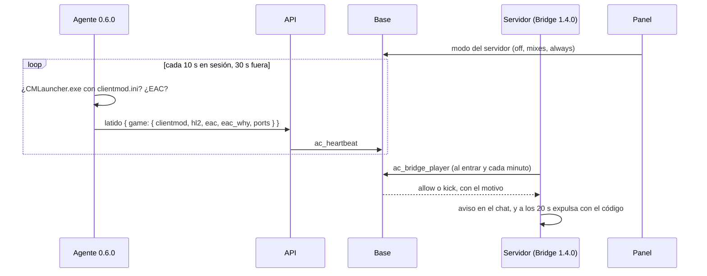
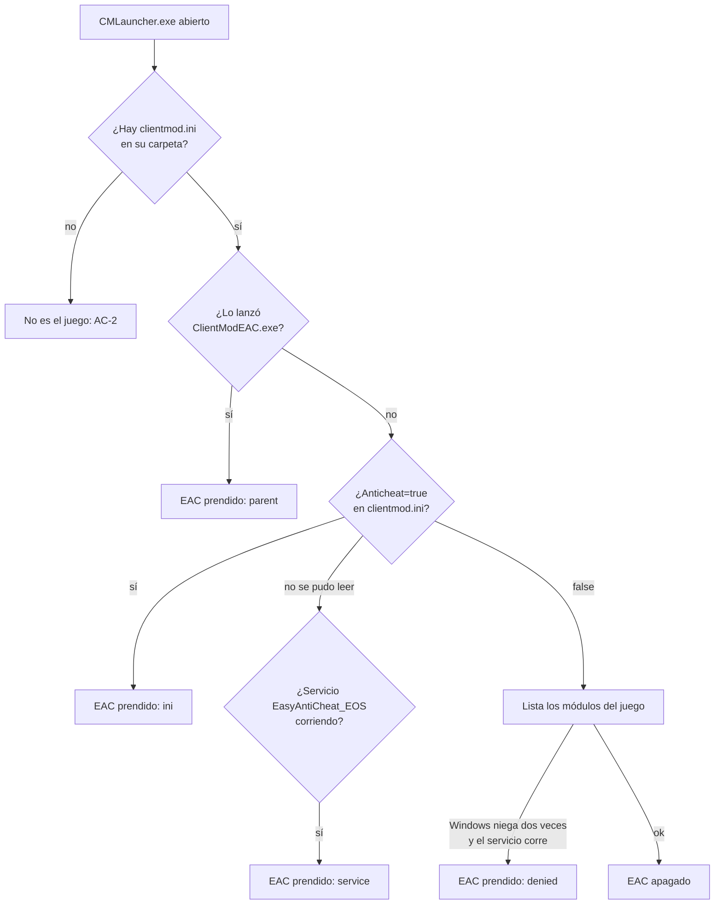
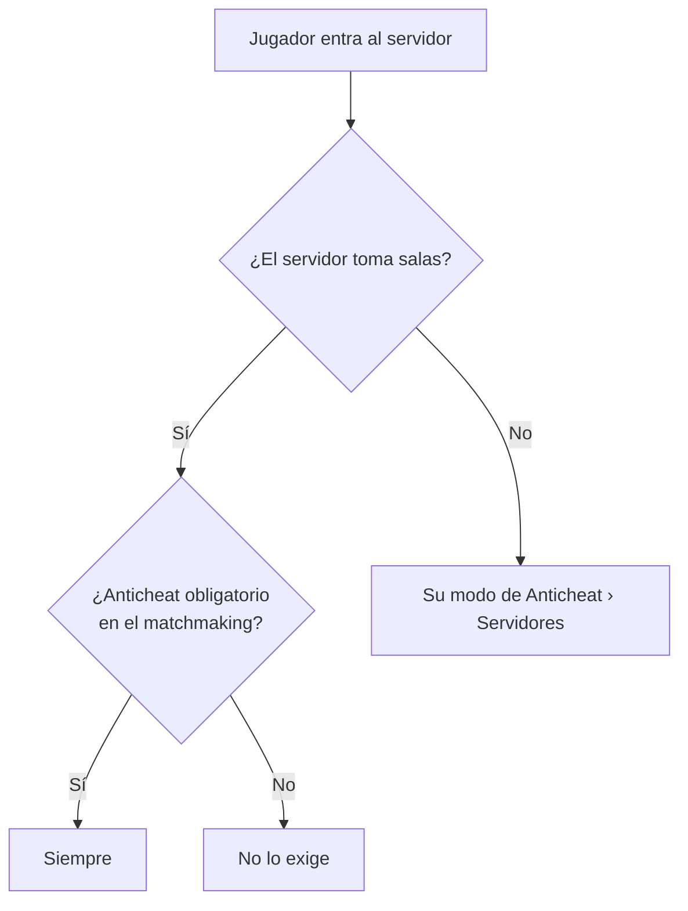

# Anticheat sin el EAC de ClientMod y expulsión obligatoria: documentación

## Qué hace

ClientMod trae **Easy Anti-Cheat de Epic (EOS)**: `ClientModEAC.exe` arranca el servicio de EAC y lanza `CMLauncher.exe`, que queda protegido a nivel del kernel. CM Launcher deja apagarlo (`clientmod.ini` → `[Launcher] Anticheat=false`). Con el EAC prendido, dos funciones de nuestro agente chocaban con él: la lista de módulos del juego y la búsqueda de programas con acceso a su memoria. EAC las bloquea y, peor, las puede tomar como un cheat.

Daniel decidió (2026-11-27) que **en nuestros servidores el EAC está prohibido**: se juega con ClientMod sin su anticheat y la protección es CMLeague Anticheat, más liviano. El agente 0.6.0 ve si el juego se abrió con el EAC, sin tocar el proceso del juego, y el servidor expulsa con `AC-6` y un mensaje que dice cómo apagarlo.

En la revisión de `kyan/ac` salieron, además, cuatro problemas que hacían que la expulsión obligatoria no funcionara: ningún cfg ponía `cml_ac_mix 1`, la expulsión llegaba con la partida empezada, un jugador con IPv6 quedaba afuera aunque tuviera todo bien, y `AC-5` nunca salía. Este requerimiento los arregla y suma la pestaña **Servidores** del panel, para elegir cuándo exige el anticheat cada servidor.

## Cómo ve el agente el EAC

Todo sin tocar el proceso del juego: la lista de procesos, la ruta con el permiso mínimo (el mismo del Administrador de tareas), el `clientmod.ini` y el estado de un servicio.

| Señal | `eac_why` | Por qué así |
|---|---|---|
| El padre de `CMLauncher.exe` es `ClientModEAC.exe` | `parent` | Es como arranca ClientMod con el EAC |
| `Anticheat=true` en `clientmod.ini` | `ini` | Es la opción de CM Launcher |
| El servicio `EasyAntiCheat_EOS` corre y no se pudo leer el `.ini` | `service` | Solo cuando falta lo anterior: otro juego con EAC también prende el servicio |
| La lista de módulos negada dos veces seguidas, con el servicio corriendo | `denied` | Sin el servicio, la causa suele ser el juego abierto como administrador, que no es el EAC |

Con el EAC prendido, el agente **no** lista los módulos ni busca programas con acceso al juego. No hace falta que la detección sea imposible de engañar: a quien hace trampa le conviene tener el EAC apagado, que es lo que pedimos.

`CMLauncher.exe` cuenta como el juego solo si tiene `clientmod.ini` al lado: un programa cualquiera renombrado ya no alcanza. Si Windows no deja leer la ruta, se acepta sin poder comprobarlo.

## Cuándo exige el anticheat cada servidor

| Modo (panel) | Valor | En `ac_server_policy` | Qué hace |
|---|---|---|---|
| **Siempre** | `always` | `protected`, `enforce_always` | Lo exige desde que el jugador entra, también en el calentamiento. En los servidores que toman salas, es lo que da "Anticheat obligatorio" del matchmaking prendido (ver abajo) |
| **No lo exige** | `off` | `protected = false` o sin fila | No abre sesiones ni expulsa a nadie |
| Solo en la partida (ya no se elige) | `mixes` | `protected`, `enforce_mixes` | Lo exige con `cml_ac_mix 1`, que pone `live.cfg`. Se lista si un servidor ya lo tiene |

Con "Siempre", nadie queda afuera con la partida empezada: el aviso y la expulsión llegan en el calentamiento.

### Los servidores del matchmaking siguen a "Anticheat obligatorio"

Daniel, 2026-11-27: un solo interruptor para la cola y los servidores. Antes eran dos (`mm_config.require_anticheat` solo cerraba la cola y el modo del panel solo lo usaba el servidor) y se podían contradecir: la cola pedía el agente y el servidor dejaba entrar a cualquiera, o al revés.

- `ac_server_rule(server)` (interna) da la regla de cada servidor. Si toma salas (`game_servers.mm_enabled`), `require_anticheat` prendido es **Siempre** y apagado es **No lo exige**, sin mirar su fila de `ac_server_policy`. Si no, su fila, como antes.
- La usan `ac_bridge_player` (expulsar y `always` de la respuesta) y `ac_server_mode(server)`, que da el modo del panel.
- `ac_admin_server_policies` suma `mm` a cada servidor, y `ac_admin_set_server_policy` no deja cambiar uno que toma salas (400 con el mensaje).
- El panel muestra el modo de esos servidores con "Lo decide el matchmaking", sin menú. El texto de "Anticheat obligatorio" en Administración › Matchmaking lo dice.
- El cambio le llega al Bridge en la próxima revisión de cada jugador (al entrar y cada minuto). El Bridge no cambia.
- `mm_lobbies.require_anticheat` (lo que tenía la configuración al armar la sala) no cuenta para el servidor: manda el interruptor de ahora.

"Solo en la partida" era el modo de Kyan. Daniel lo sacó del panel el 2026-11-27, después de probarlo en el servidor local: quien entra sin el anticheat, o con el EAC prendido, juega todo el calentamiento y el servidor lo expulsa al arrancar el mix, con el equipo ya armado. `ac_admin_set_server_policy` y el `PUT` solo aceptan `off` y `always`. La columna `enforce_mixes` y su lógica en `ac_bridge_player` siguen, porque las usan la demo (`anticheat-demo.mts`) y las pruebas de integración de Kyan.

## Motivos y códigos

`ac_bridge_player` revisa en este orden y responde el primero que encuentra:

| Motivo | Código | Expulsa |
|---|---|---|
| `no_profile` (el SteamID no tiene cuenta) | `AC-1` | Según el modo, pasado 1 minuto desde que entró (para el `!claim`) |
| `machine_banned` (con el equipo revocado o no) | `AC-5` | Siempre |
| `no_agent`, `agent_stale`, `ip_mismatch` | `AC-1` | Según el modo |
| `agent_modified`, `agent_outdated` | `AC-4` | Siempre |
| `hl2_detected` | `AC-3` | Siempre |
| `game_not_seen` | `AC-2` | Según el modo |
| **`eac_on`** | **`AC-6`** | Según el modo |
| (el Bridge no lee el SteamID) | `AC-0` | Con `cml_ac_mix 1`, o en un servidor en Siempre, pasado 1 minuto desde que entró |

"Según el modo" es: con `always`, siempre; con `mixes`, con la partida en vivo. En los dos casos, nunca mientras un admin tenga los mixes abiertos (`sm_ac_open` en el servidor o **Abrir mixes** en el panel).

`AC-6`, `AC-0` y el `AC-1` del SteamID sin vincular son los únicos que le dicen al jugador qué hacer, porque no revelan nada de lo que detecta el agente. El resto sigue la regla de Kyan (2026-11-27): solo el código.

### IPv4 contra IPv6

La base compara la IP desde la que el agente llegó a la API con la que ve el servidor. `api.cmleague.lat` está en Cloudflare, que responde por IPv6 (`2606:4700:…`), y los servidores de juego son solo IPv4. Si las dos IP son de distinta familia, ya no es `ip_mismatch`: el jugador juega y queda una marca leve `ip_family`, con las dos IP, para el staff. La contra: con IPv6, la IP deja de servir para ver si juega desde otra PC. El cruce del puerto (`port_mismatch`) sigue.

### `AC-5` con el equipo revocado

Cuando el latido ve una máquina baneada, revoca el equipo (replanteo `157`). Antes, desde ahí la base respondía `no_agent`, que es `AC-1` y no expulsa fuera de un mix. Ahora `machine_banned` se revisa primero, entre todos los equipos de la cuenta, revocados o no. Una excepción por PC compartida lo sigue dejando jugar.

## Base (replanteo `159_anticheat_sin_eac.sql`)

| Cambio | Qué es |
|---|---|
| `ac_server_policy.enforce_always` | `true`: exige el anticheat sin esperar a `cml_ac_mix 1` |
| `ac_devices.game_eac`, `game_eac_why` | El último estado del EAC que mandó el agente. `null` con un agente anterior a 0.6.0, que no expulsa |
| `ac_same_ip_family(a, b)` | Si dos IP son de la misma familia |
| `ac_heartbeat` | Lee `game.eac` y `game.eac_why` |
| `ac_bridge_player` | `enforce_always`, `eac_on`, `machine_banned` primero y la tolerancia a IPv6 |
| `ac_server_mode(ac_server_policy)` | `off`, `mixes` o `always` |
| `ac_admin_server_policies(…)` | Los servidores activos con su modo: pagina, filtra (nombre y modo) y ordena (`name`, `mode` y `updated_at`). Solo admin |
| `ac_admin_set_server_policy(server, mode)` | Cambia el modo y lo registra en `ac_admin_actions`. Solo admin |

La inversa está en `docs/bitacora/2026-10-14-replanteo-modelo-datos/reversas/159_anticheat_sin_eac.sql`.

## API

| Ruta | Qué hace |
|---|---|
| `POST /api/v1/anticheat/heartbeat` | `game` suma `eac` y `eac_why` (`parent`, `ini`, `service` o `denied`), opcionales. Con el token vencido responde **401** también en el latido firmado (antes, 403: ver abajo) |
| `GET /api/v1/admin/anticheat/servers` | Los servidores con su modo. `page`, `per`, `sort` (`name`, `mode`, `updated_at`), `order`, `q` y `mode` |
| `PUT /api/v1/admin/anticheat/servers/{id}` | `{ "mode": "off" \| "always" }` |

**El latido con el token vencido (arreglado el 2026-11-27).** El token de acceso del agente dura 15 minutos, y el agente lo renueva solo cuando la API responde 401. A los 10 minutos de vincularse, el latido va firmado: la API pide antes la clave del equipo (`ac_device_key`), que con el token vencido da `42501` en la base, y `fromPostgrest` lo vuelve **403**. El agente se quedaba sin latidos a los 15 minutos de abrirse, y el servidor lo expulsaba con `AC-1`. Venía de la `47` y la API de Kyan, y salió en la prueba en el servidor local. Ahora ese `42501` ("Token de agente inválido") es 401; el de un secreto de la API equivocado sigue siendo 403. Prueba: `test/unit/anticheat-heartbeat.test.ts`.

## Bridge 1.4.0 (`cml_anticheat_bridge.sp`)

La 1.3.0 se hizo con el plan; la 1.4.0, después de la prueba en el servidor local (Daniel, 2026-11-27):

- **SteamID sin vincular (`no_profile`): 1 minuto desde que entró** para escribir `!claim`. El manual del jugador dice que el SteamID se vincula con `!claim` en la primera partida, y que quien entra desde otra PC escribe el que le muestra la sala. Con **Siempre**, la 1.3.0 los sacaba a los 20 segundos con un aviso que no decía qué hacer. Ahora el aviso es "Vincula tu SteamID: escribe en el chat el !claim que te muestra la sala o Mi perfil en cmleague.lat. Tienes N segundos.", el Bridge escucha `say` y `say_team` y, tras un `!claim`, lo vuelve a revisar a los 5 y a los 15 segundos. Pasado el minuto, sale con "Para jugar aquí vincula tu SteamID con !claim y abre CMLeague Anticheat (cmleague.lat)". El minuto cuenta desde que entró, no desde cada mapa: se guarda con el `userid`, que no cambia entre mapas.
- **`AC-0` también en Siempre.** La base suma `always` a la respuesta de `ac_bridge_player`, y el Bridge recuerda la última. Sin SteamID no le puede preguntar a la base, así que usa esa: con el servidor recién prendido, hasta la primera revisión de alguien, `AC-0` solo expulsa en un mix. También tiene 1 minuto desde que entró, porque Steam a veces tarda en validar.
- `sm_ac_status` suma `siempre=0` o `1`.

Lo que ya hacía la 1.3.0:

- `eac_on` → `AC-6`. Chat: "Apaga el anticheat de ClientMod (EAC): en CM Launcher, debajo de Play tiene que decir Disabled o Not available. Después vuelve a abrir el juego (AC-6). Tienes 20 segundos." Expulsión: lo mismo, más corto. En CM Launcher, el botón del EAC está gris apagado y azul prendido, y debajo de **Play** dice `Anticheat: Disabled` o `Anticheat: Enabled` (Daniel, 2026-11-27); `Anticheat: Not available` también es apagado. El aviso del agente y el manual del jugador lo dicen igual, y el manual muestra la captura de CM Launcher (`docs/manual/jugador/img/cm-launcher-anticheat.webp`).
- Sin SteamID: `AC-0`, "No pudimos leer tu SteamID. Vuelve a entrar al servidor".
- `AC-1` dice "Para jugar aquí…" en vez de "Para jugar este mix…", porque con "Siempre" también expulsa en el calentamiento.
- `OnMapStart` borra los avisos pendientes. Antes, si cambiaba el mapa durante los 20 s, el aviso se perdía y al minuto se expulsaba sin volver a avisar.
- `cfg/csstv/live.cfg` pone `cml_ac_mix 1`. `warmup.cfg` y `end.cfg` ya lo ponían en `0`.
- Comandos, sin cambios: `sm_ac_status` (flag `b`, moderador) y `sm_ac_open <minutos>` (flag `m`, admin). No estaban en el manual: ahora sí.

## `cml_aimstats` 1.0.1 (revisión del plugin de Kyan)

Mientras `cml_ac_mix` está en 1, cuenta por cada kill de cada jugador si fue headshot, si antes giró la mira más de `cml_aim_snap` grados entre dos ticks seguidos (en los 8 anteriores) y si mató a través de un humo. Al terminar el mix o el mapa manda los totales a `ac_aim_report` (replanteo `158`), que los guarda y marca en la sesión del anticheat lo anormal: `aim_snap` (30 % de las kills con snap), `aim_smoke` y `aim_headshot`. No sanciona ni le dice nada al jugador. Lo que corre en cada tick (`OnPlayerRunCmd`) es copiar dos números: no pesa.

Arreglos de la revisión (2026-11-27):

- **El envío en lotes de 12 jugadores.** System2 corta el cuerpo en 2048 bytes (lo mismo que hizo partir el envío del reporter) y la 1.0.0 mandaba todos juntos: con unos 20 jugadores con kills en el mapa, el JSON llegaba cortado y la base rechazaba el lote entero. Cada lote pesa como mucho unos 1,4 KB, y la base suma cada uno.
- **El historial de la mira se borra al empezar el mix y cada ronda.** Antes, la primera kill podía comparar la mira con la de minutos atrás, o con la del respawn.
- **No cuenta las kills a un compañero ni las de granada**, que no dicen nada de la puntería y bajaban los porcentajes.

Queda para mirar con datos reales: `cml_aim_snap` (25°) es por tick, así que depende del tickrate. Con 66 ticks son unos 1650° por segundo, que un flick rápido de una persona puede alcanzar. Si `aim_snap` marca a muchos jugadores limpios, se sube. No manda `p_match_uid`: las marcas quedan con el mapa.

## Agente 0.6.0

- `GameScan()` (en `evidence.cpp`) devuelve `dir`, `eac`, `eacWhy` y `eacService`.
- `scanModules` y la búsqueda de accesos al juego no corren con `eac`.
- El latido manda `eac` y `eac_why`.
- Ventana: con el EAC, la tarjeta naranja "Desactiva el EAC de ClientMod" ([captura](pruebas/ventana-eac.png)). `--render eac` la dibuja.
- `--detect` (solo la versión de pruebas): la línea `game` con lo que vio y cuánto tardó cada chequeo.

## Firmas buenas de ClientMod

Las DLL del v34 y de ClientMod no tienen firma digital: sin firmas `good`, cada sesión llena el panel de marcas `module_unsigned`. `agent/firmas-clientmod.ps1` calcula el SHA-256 de cada `.dll` y `.exe` de una instalación (la raíz, `bin`, `bin_clientmod` y `EasyAntiCheat`; no `cstrike*`, que es contenido del jugador) y escribe un `.sql` que las carga como `good` para `module` y `game_file`. Va por hash: un cheat puede llamarse `client.dll`. Volver a aplicarlo no duplica nada.

Con la instalación de la PC de Daniel (ClientMod 1.5.14) salieron 72 ([`pruebas/firmas-clientmod-1.5.14.sql`](pruebas/firmas-clientmod-1.5.14.sql)). Esa instalación tiene un `steam_api.dll` de 2014 en `cstrike/cfg` que no es de ClientMod, así que el 2026-11-28 se repitió con un ClientMod 1.5.14 recién bajado (`D:\ClientModClean`): salieron los mismos 72 archivos con los mismos hashes. Ese `.sql` es el de producción. Probado en la copia local dentro de una transacción con rollback: carga 72 firmas `good` y aplicarlo dos veces no duplica nada. El script, además, ya acepta una ruta absoluta en `-Salida` (antes fallaba con "No se admite el formato proporcionado de la ruta de acceso").

## Panel: Administración › Anticheat › Servidores

Cada servidor activo, con un menú para el modo (**Siempre** o **No lo exige**) y la fecha del último cambio. Un servidor con "Solo en la partida" lo muestra, sin dejar volver a elegirlo. El filtro por modo y la paginación los hace la API. Arriba explica cada modo y que `AC-3`, `AC-4` y `AC-5` expulsan siempre.

## Qué cambia para cada rol

| Rol | Qué cambia | Página del manual |
|---|---|---|
| Jugador | En los servidores que lo exigen, tiene que tener CMLeague Anticheat abierto y vinculado desde que entra, y jugar con ClientMod **sin** su EAC. Si no, un aviso y la expulsión a los 20 s, con un código que dice qué hacer. Con un SteamID sin vincular, 1 minuto desde que entra para el `!claim` | [`jugador/anticheat.md`](../../manual/jugador/anticheat.md) (nueva) y [`jugador/vincular-steamid.md`](../../manual/jugador/vincular-steamid.md) |
| Moderador | `sm_ac_status` en la consola, que ya existía y no estaba documentado | [`moderador/comandos-en-el-servidor.md`](../../manual/moderador/comandos-en-el-servidor.md) |
| Admin | La pestaña **Servidores**, los códigos `AC-0` y `AC-6`, la marca `ip_family` y las firmas de ClientMod. `sm_ac_open`, que ya existía y no estaba documentado | [`admin/anticheat.md`](../../manual/admin/anticheat.md), [`admin/comandos-en-el-servidor.md`](../../manual/admin/comandos-en-el-servidor.md) |
| Capitán, organizador, streamer y dueño de un servidor externo | Nada | — |

## Términos y privacidad

El anticheat sigue "En preparación" (`Wip`) en las cuatro páginas, porque no está desplegado. Lo que dicen se puso al día con lo que hace el agente 0.6.0, que ya no coincidía desde el 0.5.0 de Kyan:

- **`/privacidad`** (`PrivacyPage.tsx` y `terms/privacidad.html`, sección 7): el latido (versión, huella, estado del juego y del EAC, puertos e identificadores del hardware guardados como huella cifrada, para el ban por máquina); la evidencia por categorías, sin detallar qué detecta (procesos, datos técnicos del juego y de la PC, drivers y archivos de ClientMod); **capturas de toda la pantalla, cada 30 a 35 s y sin aviso**, también cuando las pide el staff; las capturas a 7 días y el resto a 30. Ya no dice "no lee la memoria del juego": dice que no se inyecta ni lo modifica, porque con el EAC apagado lista los archivos que el juego cargó.
- **`/terminos`** (`TermsPage.tsx` y `terms/terminos.html`, sección 6): la aceptación en vez de la lista; el servidor que exige el anticheat lo exige desde que entras, también en el calentamiento; expulsión a los 20 s, que no es una sanción; **ClientMod sin su EAC** y sin otro `hl2.exe`; el ban por evasión de una PC baneada; modificar o imitar la aplicación es motivo de sanción.
- `/seguridad` y las preguntas frecuentes, que decían lo mismo.
- La fecha pasa a "27 de noviembre de 2026" en `LEGAL_UPDATED` y en los dos `.html`. En `main` está "26 de noviembre de 2026": al mezclar queda la más nueva.

## Dónde está cada cosa

| Archivo | Qué |
|---|---|
| `supabase/replanteo/159_anticheat_sin_eac.sql` | La base |
| `docs/bitacora/2026-10-14-replanteo-modelo-datos/reversas/159_anticheat_sin_eac.sql` | La inversa |
| `web/backend/src/schemas/anticheat.ts` | `eac` y `eac_why` en el latido |
| `web/backend/src/routes/anticheat-staff.ts` | Las dos rutas de Servidores |
| `web/backend/src/db/types.ts` | `enforce_always` y las dos funciones |
| `web/frontend/src/features/admin/anticheat/AdminAnticheatTools.tsx` | `ServersTab` y la regla `ip_family` |
| `web/frontend/src/features/admin/anticheat/ServersTab.test.tsx` | Sus pruebas |
| `web/frontend/src/features/anticheat/queries.ts` | `serverPoliciesOptions` y `setServerMode` |
| `server/addons/sourcemod/scripting/cml_anticheat_bridge.sp` y `plugins/cml_anticheat_bridge.smx` | Bridge 1.4.0 |
| `server/addons/sourcemod/scripting/cml_aimstats.sp` y `plugins/cml_aimstats.smx` | `cml_aimstats` 1.0.1: el de Kyan con los arreglos de la revisión |
| `server/cfg/sourcemod/cml_anticheat.cfg` y `cml_aimstats.cfg` | Plantillas: la URL de la base, y `PEGAR_ANON_KEY` y `PEGAR_TOKEN` en vez de la clave y el token |
| `server/cfg/csstv/live.cfg` | `cml_ac_mix 1` |
| `agent/src/` | Agente 0.6.0 |
| `agent/firmas-clientmod.ps1` | Las firmas de ClientMod |
| `docs/bitacora/2026-11-27-anticheat-sin-eac/pruebas/` | La prueba de la base, el juego falso, la captura y las firmas de 1.5.14 |
